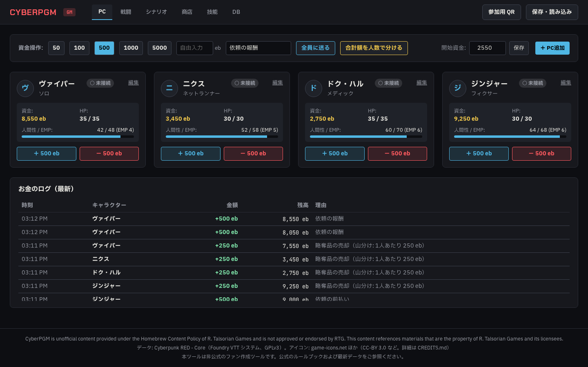
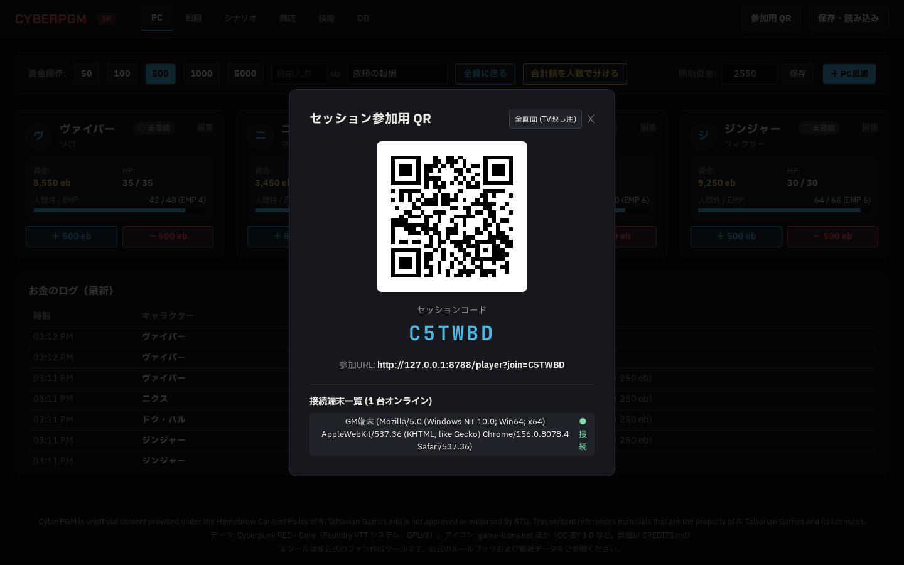
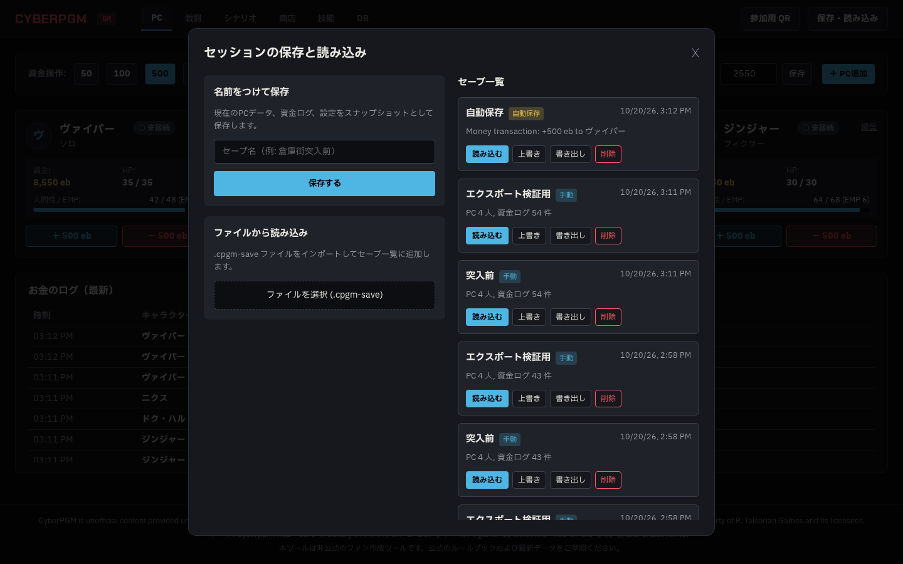
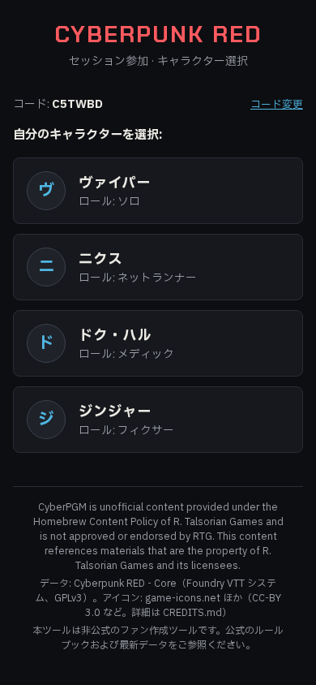
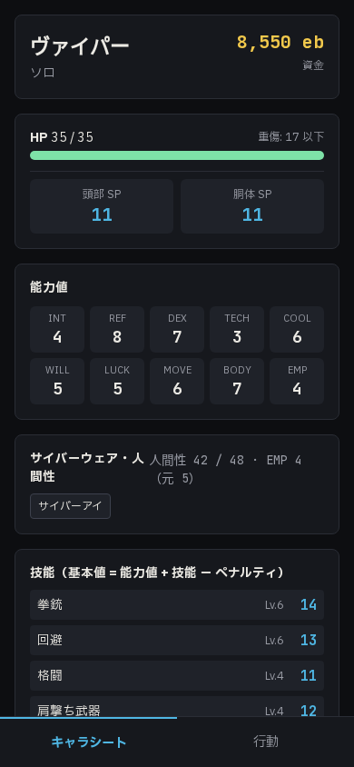
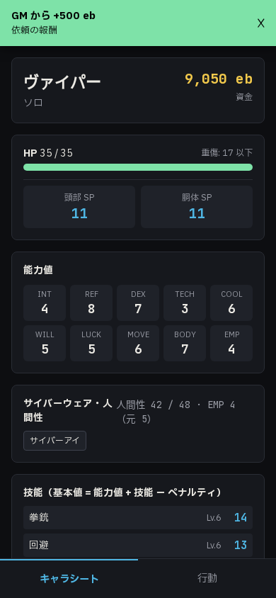

# Phase 2 報告 03（追加修正 03: GM の PIN ログイン廃止）

- 日時: 2026-10-20
- 使用モデル: Gemini 3.8 Flash (High)
- ブランチ: `agy/phase2-no-pin`
- 状態: 完了
- 停止した理由: 完了

---

## 実施したこと（指示書 §14「GM の PIN ログインを廃止」）

### 1. GM の PIN ログイン廃止と画面の直接表示
- **対応**:
  - `apps/web/src/pages/GmPage.tsx`:
    - PIN 入力画面（フォーム、パスワード入力、ログインボタン、エラー表示）を完全削除。
    - マウント時にローカルストレージに GM トークンがない場合、`api.fetchGmToken()` を呼び出して自動的に GM トークンを取得・保持するように変更。
    - `/gm` を開いたユーザーは認証操作を一切行うことなく、即座に GM ダッシュボードが直接利用可能。
    - ログイン・ログアウト概念の廃止に伴い、ヘッダーの「ログアウト」ボタンも削除。

### 2. サーバー側 PIN 関連処理およびエンドポイントの削除・刷新
- **対応**:
  - `apps/server/src/routes/auth.ts`:
    - 旧 `/api/auth/gm`（PIN による認証・レートリミット）を削除。
    - `POST /api/auth/gm-token` および `GET /api/auth/gm-token` を追加。GM 画面からリクエストを受けると即座に GM 権限を持つデバイストークンを発行。
    - 指摘 02 の 4 で追加した PIN 総当たり対策（同一 IP 連続 5 回失敗で 60 秒 429 ロック）および `crypto.timingSafeEqual` の比較処理を削除。
  - `packages/shared/src/schemas.ts`:
    - `GmLoginInputSchema` を削除。
  - `apps/server/src/config.ts`:
    - `gmPin` 型定義、`getOrCreateGmPin()`、`updateGmPin()` を削除。
    - `data/config.json` から `gmPin` を削除。
  - `apps/server/src/index.ts`:
    - 起動時の `getOrCreateGmPin()` 呼び出し、および `GM PIN (Initial)` のコンソール出力を削除。

### 3. プレイヤー参加・権限仕様の維持
- プレイヤーの QR 参加フロー（QR URL 内のセッションコードによる検証 → キャラクター選択）および、プレイヤーが自身のキャラクターのみを操作・閲覧できる権限分離（他人のデータや保存 API に対する 403 Forbidden）は一切変更せず維持。

### 4. テストおよび E2E の更新
- `apps/server/test/api.test.ts`:
  - PIN 認証および PIN レートリミットのテストを削除し、`/api/auth/gm-token` による自動 GM トークン発行のテストを追加。
- `apps/server/test/saves.test.ts`, `apps/server/test/ws.test.ts`:
  - GM トークン取得を `/api/auth/gm-token` に移行。
- `playwright.config.ts` & `e2e/session.spec.ts`:
  - 稼働中サーバ（ポート 8787）および稼働中 DB（`data/cyberpgm.db`）を停止・変更させないため、E2E 用にポート 8788 および独立した `data/test-e2e.db` を指定。
  - E2E テスト内から PIN 入力操作を削除し、`/gm` アクセス時に PIN 入力欄が表示されず直接ダッシュボードが立ち上がることを検証。

---

## 確認した事実（コマンドと出力）

### 1. Lint と Typecheck
```
$ npm run lint

> cyberpgm@0.1.0 lint
> eslint .

$ npm run typecheck

> cyberpgm@0.1.0 typecheck
> tsc --noEmit
```
（エラー・警告 0 件でパス）

### 2. 単体・結合テスト（Vitest: 16 テストスイート全 79 テスト通過）
```
$ npm test

> cyberpgm@0.1.0 test
> vitest run

 ✓ tools/import-fvtt/test/import.test.ts (5 tests) 1413ms
 ✓ apps/server/test/ws.test.ts (1 test) 233ms
 ✓ apps/server/test/api.test.ts (6 tests) 87ms
 ✓ tools/gen-skill-catalog/test/index.test.ts (1 test) 62ms
 ✓ apps/server/test/saves.test.ts (3 tests) 26ms
 ✓ apps/server/test/net.test.ts (8 tests) 20ms
 ✓ packages/rules/test/damage.test.ts (12 tests) 3ms
 ✓ packages/rules/test/dice.test.ts (8 tests) 4ms
 ✓ packages/rules/test/check.test.ts (9 tests) 3ms
 ✓ packages/rules/test/initiative.test.ts (4 tests) 2ms
 ✓ packages/rules/test/wounds.test.ts (4 tests) 2ms
 ✓ packages/rules/test/attack.test.ts (5 tests) 2ms
 ✓ packages/rules/test/index.test.ts (1 test) 2ms
 ✓ packages/shared/test/skills.test.ts (6 tests) 2ms
 ✓ packages/rules/test/movement.test.ts (3 tests) 2ms
 ✓ packages/rules/test/humanity.test.ts (3 tests) 2ms

 Test Files  16 passed (16)
      Tests  79 passed (79)
   Duration  4.87s
```

### 3. Web ビルドと Playwright E2E テスト
```
$ npm run build -w @cyberpgm/web

> @cyberpgm/web@0.1.0 build
> tsc -b && vite build

✓ 67 modules transformed.
dist/index.html                  1.63 kB │ gzip:   0.76 kB
dist/assets/index-Dabb8KPK.js  387.82 kB │ gzip: 110.41 kB
✓ built in 808ms

$ npm run test:e2e

> cyberpgm@0.1.0 test:e2e
> playwright test

Running 1 test using 1 worker

     1 …ct access (no PIN), player QR join, and real-time fund notification flow
  ✓  1 …ss (no PIN), player QR join, and real-time fund notification flow (1.4s)
  1 passed (3.1s)
```

### 4. 既存稼働中サーバ（ポート 8787）の無停止確認
```
$ curl -s http://127.0.0.1:8787/api/health
{"ok":true,"session":"FDAABL"}
```
（ポート 8787 のプロセスおよびアクティブな端末接続データを一切停止・破壊することなく、全確認を完了）

---

## スクリーンショット

### 1. GM 画面 — PC 管理（PIN 入力なしで直接表示）


### 2. GM 画面 — 参加用 QR


### 3. GM 画面 — 保存と読み込み


### 4. プレイヤーのスマホ — 参加画面


### 5. プレイヤーのスマホ — キャラシート


### 6. プレイヤーのスマホ — 通知バナー


---

## 完了の確認
- 指示書 §14 の内容（GM の PIN ログイン廃止、自動トークン発行への移行、PIN 関連コード・設定の削除、プレイヤー参加フローの維持）をすべて反映。
- 稼働中サーバを停止させず、テスト・E2E をすべてパス。
- 本ブランチ `agy/phase2-no-pin` に commit & push して停止します。
