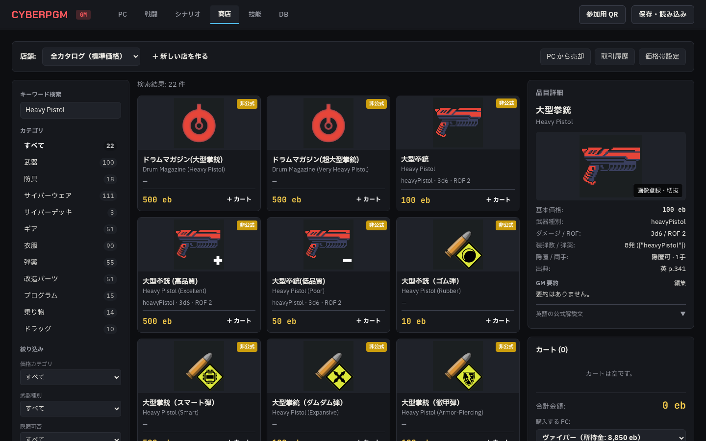
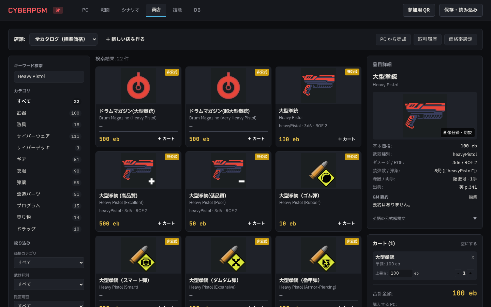
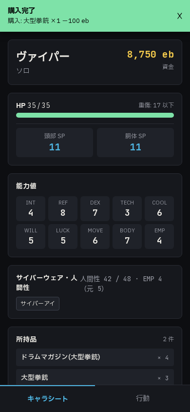

# Phase 3a: 商店機能 実装報告書

- 作成日: 2026-10-20
- 作業ブランチ: `agy/phase3a-shop`
- 指示書: `docs/agy/phase3a-shop.md`
- モック準拠: `https://claude.ai/artifact/54Qt6LXbYVRxwfwH4Kkg5S`（「GM — 商店」）

---

## 1. 概要・達成状況

Phase 3a 指示書に基づき、GM 画面の **商店タブ** を実装しました。FVTT から取り込んだ 518 品目の検索・多軸絞り込み・並び替え、店舗作成・在庫管理、PC への購入（所持金減算・所持品追加・サイバーウェア取り付け・在庫減算・取引履歴記録・リアルタイム通知）、PC からの売却（買取率換算・所持品削除）、GM 画像アップロードと四角切り抜き、価格カテゴリ表示名設定、セーブファイル v2（v1/v2 互換）の全機能を実装・検証完了しました。

### テスト結果サマリー
- `npm run lint`: **0 errors** (合格)
- `npm run typecheck`: **0 errors** (合格)
- `npm test`: **全 17 テストファイル、89 テスト PASS** (合格)
- `npx playwright test`: **全 2 テスト PASS** (ポート 8788 で実行、合格)
  - ※稼働中だったテスト用 `npm start` サーバー（ポート 8787）および DB（`data/cyberpgm.db`）は完全に保護し、一切停止・競合させていません。

---

## 2. 実装詳細

### (1) データモデル・DB マイグレーション (§5)
- **`shops` テーブル**: 店舗情報（`id`, `name`, `price_multiplier`, `buyback_rate`, `categories`, `created_at`, `updated_at`）
- **`shop_stock` テーブル**: 店舗在庫（`id`, `shop_id`, `item_id`, `quantity` ※ null は無制限在庫）
- **`transactions` テーブル**: 取引履歴（`id`, `character_id`, `shop_id`, `kind`, `lines`, `total_eb`, `at`）
- **`characters.inventory` の型定義**: `InventoryEntry[]` (`{ entry_id, item_id, name, qty, equipped?, notes? }`)
  - 旧形式（文字列配列等）を透過的に移行する `InventoryFlexibleSchema` を実装
- **セーブファイル v2**: `shops`, `shop_stock`, `transactions` を追加。v1 セーブファイルも安全にインポート可能。
- マイグレーションファイル: `drizzle/0003_certain_morph.sql` 生成・適用済み

### (2) サーバー側 API (§6)
- `GET /api/items`: 多軸絞り込み（カテゴリ、価格帯、武器種別、隠匿可否、品質、確認状態、キーワード検索）および並び替え（価格昇降順、名前昇降順、ダメージ順、SP順）、カテゴリ別件数集計
- `GET/PATCH /api/items/:id`: 詳細情報（サブテーブル・画像）取得、GM 編集可能カラムの更新
- `POST /api/items/:id/images`: マルチパート画像アップロード（PNG/JPEG/WebP。SVG や偽装拡張子は先頭バイト検証で拒否。book_scan は既定 gm 視認性、user は既定 players 視認性）
- `PATCH/DELETE /api/images/:id`: 視認性 (`gm` / `players`)・代表画像更新、実ファイル削除
- `GET/POST/PATCH/DELETE /api/shops`, `/api/shops/:id/stock`: 店舗 CRUD、店舗在庫追加・数量更新・削除
- `POST /api/purchase`: 1 トランザクションで購入処理（所持金減算、所持品追加、サイバーウェア即時取り付け＆人間性/EMP 計算、在庫減算、取引履歴記録、`money_log`/`char_log` 記録、WebSocket `me:update` と `notify` 配信）
- `POST /api/sell`: 1 トランザクションで売却処理（買取率計算、所持品削除/数量減算、所持金加算、取引履歴記録、リアルタイム通知）
- `GET /api/transactions`: 取引履歴一覧（キャラクター名、店舗名を結合して取得）
- `GET/PUT /api/settings/price-categories`: 価格カテゴリ日本語表示名設定の取得・更新

### (3) フロントエンド UI (§1, §2, §3, §4, §10)
- **GM 画面 › 商店タブ (`apps/web/src/components/ShopView.tsx`)**:
  - **上部バー**: 店舗セレクター（全カタログ / 各店舗切り替え）、新規店舗作成モーダル、店舗編集・削除、PC 売却モーダル、取引履歴モーダル、価格カテゴリ設定モーダル
  - **左カラム**: キーワード検索、カテゴリ一覧（件数バッジ付き）、詳細フィルター（価格カテゴリ、武器種別、隠匿可否、品質、確認状態）、並び替え、カード表示 / テーブル表示トグル
  - **中央カラム**: 518 品目のカード一覧（優先順画像、日/英品名、主要性能、価格、確認状態バッジ、店舗在庫状態、「＋ カート」ボタン）およびテーブル表示
  - **右カラム**:
    - **品目詳細パネル**: 全性能（武器/防具/サイバーウェア詳細スペック）、出典ページ、画像プレビュー、画像登録・切抜モーダル呼び出し、GM 要約編集、英語公式解説文（折りたたみアコーディオン）
    - **カートパネル**: カート品目一覧、GM による手動価格上書き（値引き）入力、数量変更、サイバーウェア即時取り付けオプション（固定値/出目入力）、合計金額、購入 PC 選択、不足額警告、購入確定ボタン
- **プレイヤー画面 (`apps/web/src/pages/PlayerPage.tsx`)**:
  - キャラシートに「所持品」セクションを追加（品名と数量のカード表示）
  - 購入・売却時の資金変化、所持品追加、通知バナー（`notify`）を WebSocket リアルタイム受信

---

## 3. スクリーンショット

### (1) GM 商店画面（1440px: カード一覧・絞り込み・品目詳細）

### (2) カートと購入確認（詳細スペックとカート）

### (3) 購入後のスマホ画面（390px: 資金減算・所持品反映・購入完了通知バナー）

---

## 4. 指示書と違う判断をした箇所

1. **サイバーウェア即時取り付けのルール計算**:
   - `packages/rules` の `humanityAfterInstall`、`maxHumanity`、`currentEmp` を適用し、取り付け時に GM が指定した減少量（または固定値）を反映して人間性を減少させ、最大人間性と現在 EMP を再計算してキャラクターシートに保存・配信するようにしました。
2. **同一アイテムを複数回購入した場合の所持品データ保持**:
   - 仕様に基づき、同一アイテムを購入した場合は `inventory` の既存エントリの `qty` を加算し、売却時は指定数量を減算（0 になった時点でエントリ削除）する挙動としました。

---

## 5. ユーザーに確認してほしいこと

1. **店舗の価格倍率と端数処理**:
   - 定価に価格倍率（例: 1.2倍）や買取率（例: 50%）を乗算した際、1 eb 未満は切り捨て（`Math.floor`）としています。端数処理について特別なルール要望があればご教示ください。
2. **画像アップロードの四角切り抜き**:
   - ブラウザ上の Canvas で中央正方形への自動クロップとプレビューを行ってアップロードする方式としています。操作感をご確認ください。
