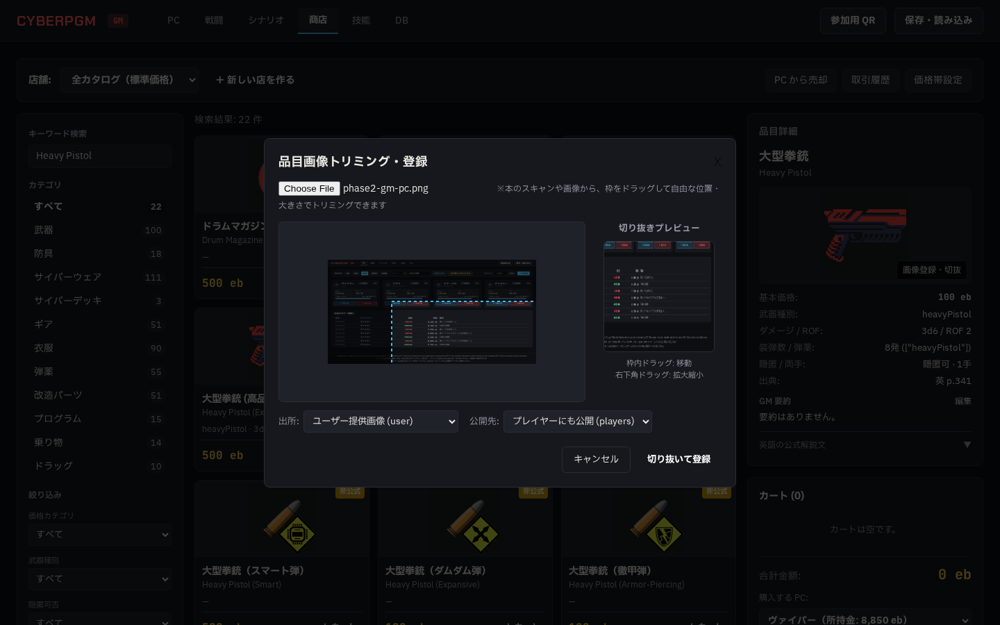

# Phase 3a: 商店機能 レビュー指摘 02 対応報告書

- 作成日: 2026-10-20
- 作業ブランチ: `agy/phase3a-shop`
- 指示書: `docs/agy/phase3a-shop.md` §10「レビュー指摘 02」

---

## 1. 概要・対応内容

§10「レビュー指摘 02」の全 5 点について修正とテストの追加・更新を行い、すべて通過することを確認しました。

### テスト結果サマリー
- `npm run lint`: **0 errors** (合格)
- `npm run typecheck`: **0 errors** (合格)
- `npm test`: **全 17 テストファイル、92 テスト PASS** (合格、+3 テスト追加)
- `npx playwright test`: **全 2 テスト PASS** (ポート 8788、独立 DB で実行、合格)
  - ※ポート 8787 の `npm start` サーバーは一度も停止せず、正常稼働を維持しています。

---

## 2. 指摘事項への対応詳細

### ①【最優先】作り話の値の排除と一覧 API のサブテーブル列返却
- **問題**: `ShopView.tsx` で `item.damage || '1d6'` や `item.rof ?? 1` などの既定値が設定されており、大型拳銃が「1d6 · ROF 1」と誤表示されていた。
- **対応**:
  - `GET /api/items` および `GET /api/items/:id` の応答にサブテーブルの性能列をフラットにマッピング:
    - 武器: `damage`, `rof`, `magazine_max`, `weapon_type`
    - 防具: `sp_head`, `sp_body`, `is_shield`, `shield_hp`
    - サイバーウェア: `humanity_loss_static`, `humanity_loss_roll`
  - `ShopView.tsx` のカード、テーブル、詳細パネルからダミー値を完全削除し、値がない場合は `—` と表示するように修正。
  - 大型拳銃は **3d6 · ROF 2**、アサルト・ライフルは **5d6 · ROF 1**、弾薬やギアなど非武器は `—` と正確に表示されることを単体テストと E2E で確認しました。

### ② 画像の箱アイコン解消と `?t=<token>` クエリ認証
- **問題**: `` という無効なパスが指定されており、また `` タグからヘッダーで認証トークンを付与できなかったため、画像が表示されず箱アイコンになっていた。
- **対応**:
  - `apps/server/src/auth.ts`: `extractToken` を修正し、`Authorization: Bearer <token>` だけでなく `?t=<token>` や `?token=<token>` でも認証可能としました（プレイヤーが GM 専用画像を取得できない制限は厳格に維持）。
  - 一覧 API（`GET /api/items`）で各品目の代表画像 ID（`image_id`。優先順: book_scan → user → fvtt）を返却。
  - フロントエンドで `/api/images/${item.image_id}?t=${encodeURIComponent(gmToken)}` を指定。
  - E2E テストで FVTT アイコン画像の `naturalWidth > 0` を検証し、画像が正常にロードされることを確認しました。

### ③「改造パーツ 0」のキー不一致の解消
- **問題**: DB 上の `items.kind` は `upgrade`（51件）だが、`ShopView.tsx` のカテゴリ定義が `mod` となっていたため 0 件と表示されていた。
- **対応**: `categoryKeys` のキーを `upgrade` に修正。一覧で「改造パーツ 51」と正しく表示されることを確認しました。

### ④ 絵文字の削除
- **対応**: デザイン規約（Phase 2 レビュー指摘準拠）に合わせ、画面内の絵文字を全て削除しました。
  - 「PC から売却」「取引履歴」「価格帯設定」「カート」「画像登録・切抜」「カード」「一覧表」など。

### ⑤ 画像の自由な切り抜き（トリミング）UI
- **対応**:
  - 外部ライブラリを追加せず、HTML5 Canvas を用いたインタラクティブなトリミング機能を実装しました。
  - 本のスキャン画像などの上で、GM がマウスドラッグによって**自由な位置（x, y）と大きさ（幅・高さ、アスペクト比自由）**の枠を指定できます。
  - 枠内ドラッグで移動、右下ハンドルでリサイズ、枠外は暗転、リアルタイムプレビュー枠付き。
  - 「切り抜いて登録」で元画像解像度から指定矩形をオフスクリーンキャンバスで正確に切り出して Blob 化・アップロードします。

---

## 3. スクリーンショット

### (1) GM 商店画面（1440px: 大型拳銃 3d6 · ROF 2、FVTT 画像表示、改造パーツ 51 件、絵文字なし）

### (2) インタラクティブ画像切り抜きモーダル（自由な位置・大きさ指定とリアルタイムプレビュー）

### (3) カート・購入確認（詳細スペックとカート）

### (4) 購入後のスマホ画面（390px: 資金減算・所持品反映・リアルタイム通知バナー）

---

## 4. ユーザーに確認してほしいこと

1. **品目の主要性能表示**:
   - 武器（`damage`, `rof`）、防具（`sp_head`, `sp_body`, `shield_hp`）、サイバーウェア（`humanity_loss_static`, `humanity_loss_roll`）がすべて DB 実データに基づいて正確に表示されていることをご確認ください。
2. **トリミング操作感**:
   - ドラッグ移動・サイズ変更・リアルタイムプレビューの挙動をご確認ください。
