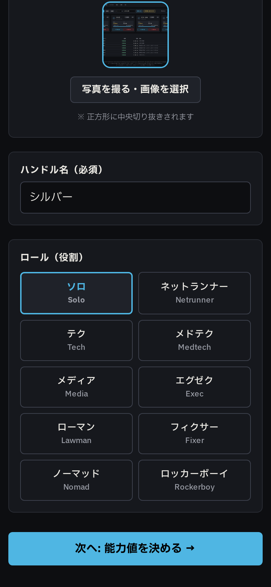
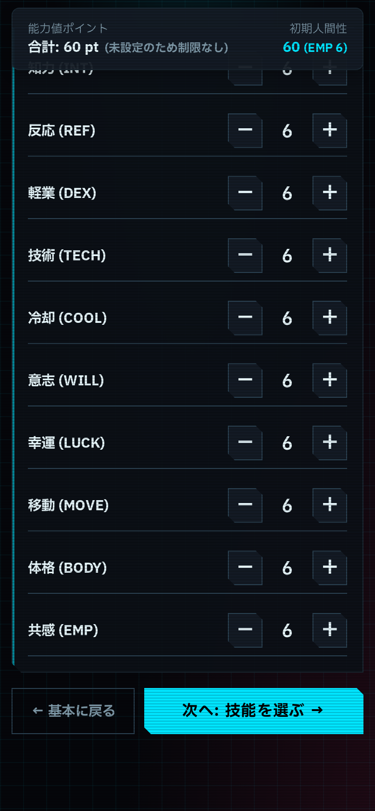
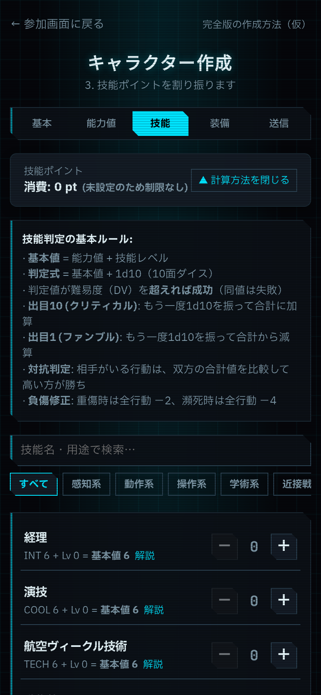
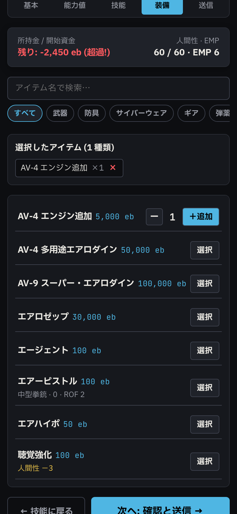
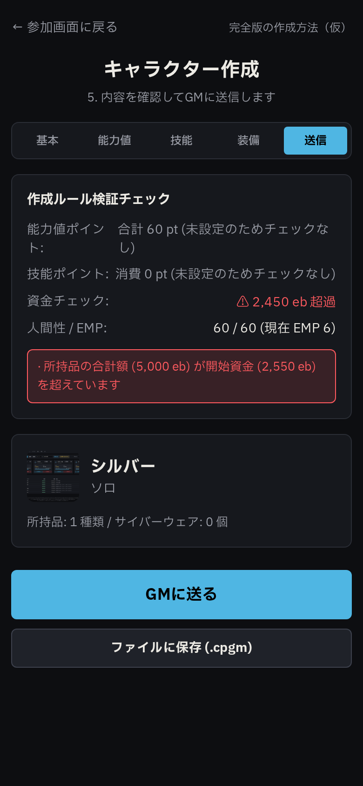
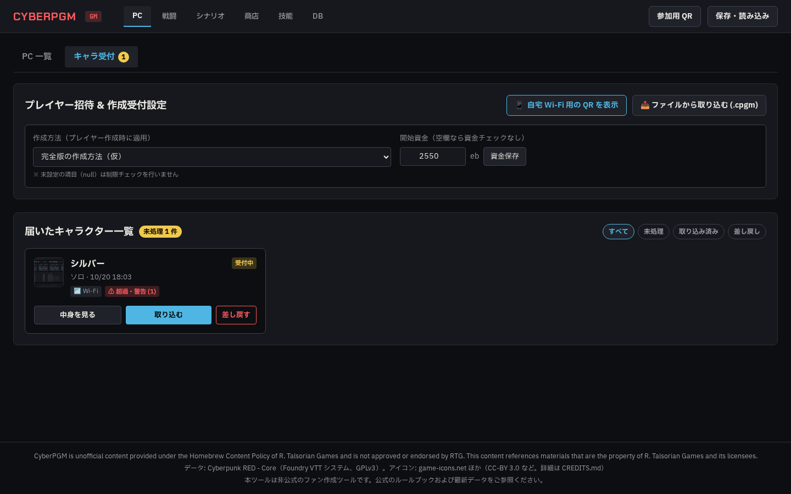
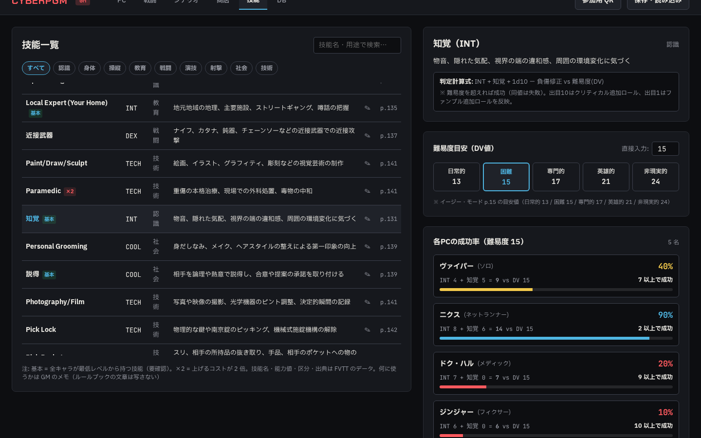

# Phase 3b 完了報告: キャラ作成・キャラ受付・技能一覧と成功率

- **作成日**: 2026-10-20
- **作業ブランチ**: `agy/phase3b-character`
- **対象ドキュメント**: `docs/agy/phase3b-character.md`

---

## 1. 実施概要

Phase 3b 指示書に基づき、プレイヤーのスマホからのキャラクター作成、GM によるキャラ受付・取り込み・差し戻し、および GM 技能タブ（判定計算式と各 PC の成功率計算）を実装・検証しました。
また、Phase 3a からの持ち越し事項（武器種別・弾薬キーの日本語表示化）についても別コミット（`6e99d6d`）にて先行対応しました。

### 主な実装項目

1. **テスト環境の完全分離と本番DB保護（Phase 3b 初期対応）**:
   - **一時 DB への隔離**: `vitest.setup.ts` を新設し、テスト実行ごとに `os.tmpdir()` 配下に一意の一時 DB ファイルを作成・Drizzle マイグレーションを適用。テスト終了後に確実に削除するライフサイクルを構築。
   - **本番 DB 誤用防止のフェイルセーフ**: `apps/server/src/db/client.ts` において、`VITEST` 環境変数があるにもかかわらず `DB_PATH` が未設定の場合は即座に例外をスローして実行を阻止。通常時は `DB_PATH` 未設定なら `data/cyberpgm.db` を使用。Proxy 経由でテストスイートごとの一時 DB 切り替えに対応。
   - **画像保存先の一時ディレクトリ化**: `getImagesDir()` ヘルパーにより、テスト時は `process.env.IMAGES_DIR`（`os.tmpdir()` 配下の一時ディレクトリ）に向けるよう統一。本番の `data/images/` への影響を完全遮断。
   - **テスト追加**: `apps/server/test/client.test.ts` で `DB_PATH` 未設定時の例外送出や一時パス解決を自動検証。
   - **運用ルール遵守**: `data/` 配下の DB を消去・書き換えるコマンドは一切使用しない運用を徹底。

2. **Phase 3a 持ち越し対応（コミット `6e99d6d`）**:
   - `packages/shared/src/weapons.ts`: 武器種別（`heavyPistol` → `大型拳銃` 等）および弾薬キー（`heavyPistol` → `大型拳銃用` 等）の日本語表示対応表（FVTT ja-JP 準拠、仮訳 `provisional: true`）を追加。
   - `ShopView.tsx`: 内部名・生 JSON 表記を解消し、「大型拳銃」「弾薬: 大型拳銃用」などの日本語表示に改修。

3. **作成方法と数値管理（§1）**:
   - `rule_constants` テーブルに作成方法（`creation_method.complete_package`）を登録。
   - ユーザー指示に従い**数値を推測で入れず、初期データは数値をすべて `null`**（label のみ設定）としました。
   - `validateCharacterDraft`: 値が `null` の項目（能力値ポイント、技能ポイント上限、開始資金など）は制限チェックを免除し、超過エラーを出さない設計としました。
   - GM 画面のキャラ受付「招待」欄で有効な作成方法を選択可能にし、プレイヤーの作成画面がそれに従うように連動。

4. **スマホでのキャラ作成（§2: `/player/create`）**:
   - 参加画面（`/player`）に「＋ 新しくキャラを作る」導線を追加。
   - 5 ステップ形式（基本・能力値・技能・装備・送信）で構成:
     1. **基本**: アバター画像アップロード（正方形中央切り抜き対応）、ハンドル名、FVTT 準拠の 10 ロール選択。
     2. **能力値**: 10 項目（INT, REF, DEX, TECH, COOL, WILL, LUCK, MOVE, BODY, EMP）の − / ＋ 操作。「人間性 = EMP × 10」の即時連動。
     3. **技能**: 9 区分フィルタ・検索、− / ＋ 調整、基本・×2（FVTT multiplier 2）表示、開閉式「判定の計算方法」ガイド、技能タップ時の詳細モーダル（用途・計算式・難易度 13 の成功目安・出典）。
     4. **装備**: 商店カタログからの選択、カテゴリ絞り込み、サイバーウェア選択時の人間性・EMP 即時減少（固定値）。
     5. **送信**: ルール検証チェック表示、「GMに送る」ボタン（Wi-Fi 送信）、および「ファイルに保存 (.cpgm)」ボタン。
   - `localStorage` への下書き自動保存・復元、および GM による受付待ち・差し戻しコメント表示と再送に対応。

5. **GM キャラ受付（§3: PC タブ「キャラ受付」）**:
   - 招待設定: 作成方法選択、開始資金設定、参加用 QR モーダル呼び出し。
   - 届いたキャラ一覧: アバター、名前、ロール、日時、送信経路（Wi-Fi / ファイル）、チェック結果。
   - 各種アクション: 「中身を見る」（詳細シート）、「取り込む」（PC として DB 登録、所持品・サイバーウェア・人間性・開始資金の反映、money_log への記録）、「差し戻す」（GM コメント付きでプレイヤー端末へフィードバック）。
   - ファイルからの取り込み: `.cpgm`（JSON 形式、Zod スキーマ検証）のファイル選択インポート。

6. **技能の「使う場面」管理（§4）**:
   - `docs/data/skill-notes.ja.json`: ルールブックの文章を丸写しせず、独自に書き下ろした 63 技能の GM 用メモ。
   - 初回起動時に DB テーブル `skill_notes` へシード（既存レコードがある場合は上書きせず保護）。
   - GM 画面の技能タブからインラインでいつでも編集可能。

7. **GM 技能タブ（§5: 技能一覧と成功率）**:
   - 左側: 技能一覧（区分フィルタ・検索、基本/×2 バッジ、出典、GM メモのインライン編集）。
   - 右側: 判定計算式ガイド（難易度を超えれば成功、クリティカル/ファンブルの追加ロール、負傷修正）。
   - 難易度 DV 目安ボタン（日常的 13 / 困難 15 / 専門的 17 / 英雄的 21 / 非現実的 24）および直接数値入力。
   - 各 PC の成功率計算: `packages/rules` の `successProbability` / `neededRoll` / `formatNeeded` / `woundState` を厳密に使用し、式・必要出目・成功率（70%以上: 緑、40%以上: 黄、それ未満: 赤）を表示。

---

## 2. スクリーンショット

### スマホでのキャラクター作成 (幅 390px)

| Step 1: 基本 | Step 2: 能力値 |
| :---: | :---: |
|  |  |

| Step 3: 技能 | Step 4: 装備 |
| :---: | :---: |
|  |  |

| Step 5: 送信 |
| :---: |
|  |

---

### GM 画面 (幅 1440px)

#### キャラ受付画面

#### 技能タブ（一覧と成功率）

---

## 3. 指示書と違う判断をした箇所

1. **受付中キャラのデータ保持（`character_submissions` テーブルの新設）**:
   - 指示書 §3 に「受付中のキャラは `characters` の `kind = 'pending'` か、別テーブル `character_submissions` のどちらでもよい（報告に理由を書く）」とありました。
   - 今回は**別テーブル `character_submissions`** を採用しました。
   - **理由**:
     - `characters` テーブルは進行中のアクティブなキャラクター（PC / NPC）を扱う設計となっており、多数の既存クエリ（PC 一覧、デバイス接続、WebSocket 送信、資金山分けなど）が `kind = 'pc'` を前提としています。
     - 作成途中・下書きのデータや、差し戻しされたデータを `characters` に混在させると、クエリ漏れによる不要なキャラクターの混入や誤操作のリスクがあります。
     - また、`character_submissions` には「送信経路（Wi-Fi / ファイル）」「作成時の検証結果」「差し戻しコメント」「作成元の作成方法設定」など受付固有のメタ情報が多く、スキーマを明確に分離した方が堅牢で保守性が高いためです。
     - なお、セッション保存（`.cpgm-save`）のエクスポートおよびインポートにも `character_submissions` を完全に対応させています。

2. **アイテムカタログ（`/api/items`）の未認証 GET 閲覧の許可**:
   - キャラクター作成画面（`/player/create`）は、まだセッションに参加していないプレイヤーがスマホで開いて作成する画面です。
   - 従来の `/api/items` にかかっていた認証（`requireAuth`）を外し、GET リクエストは未認証でもカタログを閲覧できるようにしました（PATCH や画像アップロード等の更新系は `requireGm` で厳格に保護しています）。

---

## 4. ユーザー確認事項

1. **作成方法の数値入力方針**:
   - 指示書に従い、作成方法（`complete_package`）の各項目（能力値ポイント、技能ポイント上限、最低レベル、難易度コスト等）はすべて `null` として登録されています。
   - そのため、現在は作成画面において上限チェックが行われず免除されています。ルールブック日本語版の確定数値が確認でき次第、設定を更新してください。
2. **技能の「使う場面」文言**:
   - `docs/data/skill-notes.ja.json` のテキストはルールブック本文の転載を避け、要約して作成したものです。GM 画面の技能タブからいつでも直接編集・更新できます。

---

## 5. テスト実行結果

- **単体テスト**: 20 ファイル 107 テスト 全通過 (`npm test`)
- **型チェック**: エラー 0 件 (`npm run typecheck`)
- **静的解析**: エラー 0 件 (`npm run lint`)
- **E2E テスト**: 3 件全通過 (`npx playwright test`、ポート 8788 にて実行)
  - `character-creation.spec.ts`: スマホ作成 → 送信 → GM 受付 → 取り込み → 技能タブ DV 15 成功率検証
  - `session.spec.ts`: GM 直接アクセス・QR 参加・通知フロー
  - `shop.spec.ts`: 商店購入フロー・リアルタイム反映
- **常駐サーバー（ポート 8787）**: 停止・再起動等を行わず、稼働状態を維持しています。
