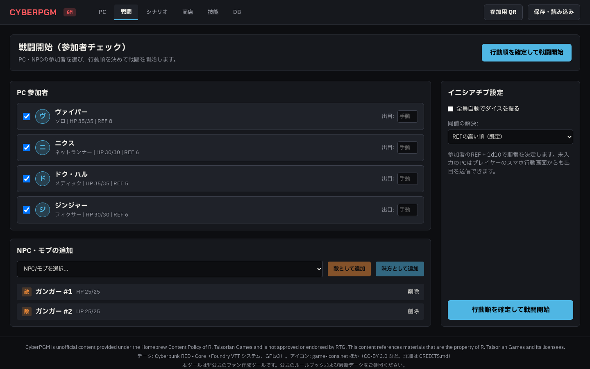
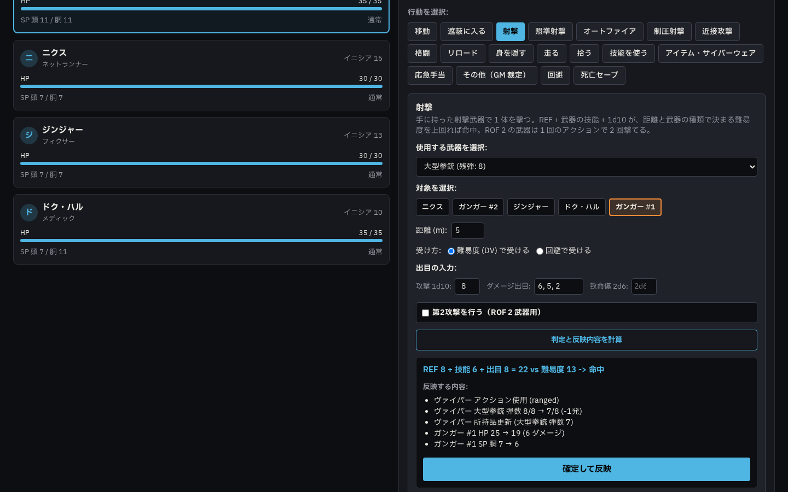
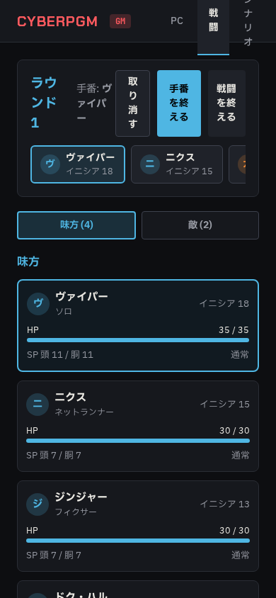
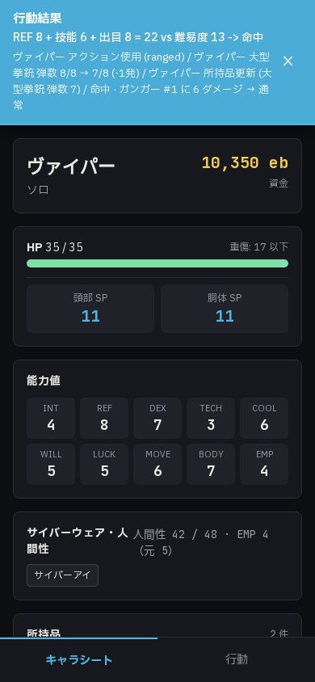

# Phase 4a 完了報告: 盤面なし戦闘システム

- **作成日**: 2026-10-20
- **作業ブランチ**: `agy/phase4a-combat`
- **対象ドキュメント**: `docs/agy/phase4a-combat.md`

---

## 1. 実施概要

Phase 4a 指示書に基づき、盤面（バトルマップ）を必要としない戦闘進行システムを実装・検証しました。
参加者チェック、イニシアチブ決定・行動順ソート、参加者カード、ターン進行ガイド、出目入力と判定・ダメージ計算、正本データ（HP/SP/弾数/状態/致命傷）への自動反映・取り消し（Undo）、戦闘ログ、およびプレイヤーのスマホ行動画面（手番待ち、行動選択、片手出目パッド、被弾・確定結果通知）を完全に構築しました。

また、Phase 3b からの持ち越し事項（テストでの `price: null` による除算エラー、SaveFile v2 の互換性修正）についても別コミット（`c6e8342`）にて先行対応しました。

---

### 主な実装項目

#### 1. Phase 3b 持ち越し対応（コミット `c6e8342`）
- `apps/server/test/shop.test.ts`: `item.price` が `null` の場合に `item.price / 2` で `NaN` や型不整合が発生しないよう、`null` または 0 以外の価格を持つアイテムをフィルタして売却テストを行うように改修。
- `apps/server/test/saves.test.ts`: `SaveFile` v2 において `items.price: null` を許容するスキーマとの整合性を確保。

#### 2. データ構造と正本の設計（§1）
- **DB スキーマ新設**:
  - `combats`: セッション内の戦闘セッション管理（`active`、`current_round`、`current_turn_index`）。
  - `combat_participants`: 戦闘参加者（`character_id`、`side`: ally/enemy/neutral、`initiative`、`state` JSON: 遮蔽・所持品落下・状態異常の残りラウンド・死亡セーブペナルティ）。
  - `combat_log`: 手番ごとの行動・判定・ダメージ・変更差分（`changes` JSON）の記録。取り消しフラグ（`undone`）を保持。
  - `weapons.suppressive`: 制圧射撃可否フラグ（boolean）を追加。
  - Drizzle マイグレーション `drizzle/0005_spooky_malice.sql` を生成。
- **正本の一元管理**:
  - `HP`、`SP（頭/胴）`、`状態`、`致命傷`、`弾薬数` はすべて `characters` テーブルを正本とし、戦闘画面は常に最新の正本を参照・更新。
  - 一時的な戦闘状態（遮蔽状況、落とした物、状態異常の持続ラウンド、死亡セーブペナルティ）は `combat_participants.state` に格納。
- **モブの独立管理（複製処理）**:
  - 「警備兵」などのモブが複数参加する場合、HP/SP/弾数が連動してしまわないよう、参加時に `characters` テーブルへ独立したレコード（例: `警備兵 #1`, `警備兵 #2`）として安全に複製。
  - 戦闘終了時には、複製したモブを自動クリーンアップするか、戦利品漁りや尋問のためにキャラクター一覧に残すかを GM が選択できるダイアログを実装。

#### 3. サーバー側: 行動定義と計算サービス（§2）
- **行動定義シード**:
  - `docs/data/combat-actions.ja.json` を `rule_constants`（キー: `combat_actions`）に初回起動時に登録（`apps/server/src/db/init-phase4a.ts`）。既存の GM 編集レコードがある場合は上書きせず保護。
- **ルール計算サービス（`apps/server/src/services/combat-resolver.ts`）**:
  - `packages/rules` の公式計算ロジック（`attackBase`, `rangedDv`, `canDodgeRanged`, `autofireMultiplier`, `resolveDamage`, `lookupCriticalInjury`, `deathSave`, `woundState`, `woundPenalty` 等）を厳密に使用。
  - **射撃**: 武器種と距離（m）から DV 算出、基礎値（REF+技能）＋出目での成否判定、ダメージロールからの SP 減少と HP 適用、クリティカル致命傷表の引き当て。
  - **照準射撃**: 頭部（DV+8、SP 減算後ダメージ 2 倍）、持ち物（DV+8、アイテム落下）、脚（DV+8、移動力半減）の補正と追加効果。
  - **オートファイア**: DV 超過分による乗数計算（最大乗数上限を遵守）。
  - **近接攻撃 / 格闘**: 近接攻撃における装甲 SP 半減（端数切り捨て）の適用。
  - **死亡セーブ**: HP 0 以下のキャラの手番開始時判定（ベース値＋ペナルティ、ファンブル即死処理）。
  - **未確認手順の安全なフォールバック**: 制圧射撃や投擲など未確認のルール・数値は推測で埋めず、GM が画面上で値を確認・手入力して反映するフォールバック手順を完備。
- **トランザクション適用と取り消し（Undo）**:
  - `POST /api/combats/:id/apply`: 1 つの SQLite トランザクション内で、`characters`（HP/SP/弾薬/致命傷）、`combat_participants`（状態）、`combat_log`（変更内容）を一括更新。
  - `POST /api/combats/:id/undo`: 最新の未取消ログを取り出し、記録された `changes` の差分を逆適用して状態を復元（`undone = 1`）。何度でも過去に遡って取り消し可能。

#### 4. GM 画面: 戦闘タブ（§3）
- **参加者チェック画面**:
  - セッション参加中の PC、登録済み NPC、モブの一覧を表示。
  - モブの「＋ 複製を追加」ボタンで即座に `#1`, `#2` とナンバリングして追加可能。
  - 「PCにダイスを振ってもらう」一括要求ボタン、および GM による個別入力・一括 1d10 ロールに対応。
- **行動順バー**:
  - REF 降順、同値時は PC 優先・ダイス振り直しルールに従って自動ソート。
  - 現在手番キャラクターのハイライト、ラウンド数と現在手番インデックス表示、「次へ」「前へ」「戦闘終了」操作。
- **参加者カード（2ペイン / 390px 切替）**:
  - 「味方（PC/味方NPC）」と「敵（敵NPC/モブ）」を左右に明確に分離表示。
  - 幅 390px のスマホ・狭小画面ではタブ（「味方」「敵」）でスマートに切り替え。
  - HP バー、頭/胴 SP、状態異常、致命傷一覧、遮蔽トグルを即時確認・操作可能。
  - 被弾時に該当カードが赤色にフラッシュするアニメーションを搭載。
- **ターン進行ガイド**:
  - 「移動（MOVE × 2m）」と「行動（1回）」の 2 アクション構造を明示。
  - アコーディオン形式で行動（射撃、照準射撃、オートファイア、近接、身を隠す、アイテム使用、その他）を選択。
  - 手順・計算式・対象選択・距離入力・出目入力をわかりやすくガイド。
- **反映する内容プレビューと確定反映**:
  - HP 変化（現在値 → 適用後）、SP 削れ、弾薬消費、致命傷発生、状態付与のプレビューを表示。
  - 「確定して反映」ボタンでワンクリック適用。
- **取り消し（Undo）と戦闘ログ**:
  - 直前の行動を取り消すボタンを常時提供。
  - 戦闘ログ一覧（最新が上、カード形式で展開可能、取り消された行動は取り消し線表示）。
- **NPC/モブ追加モーダル**:
  - PC タブに「＋ NPC/モブ追加」ボタンを新設。名前、種別（NPC/モブ）、主要ステータス、武器、防具を即座に登録して戦闘に投入可能。

#### 5. プレイヤー画面: スマホ行動画面（§4: `/player` 行動タブ）
- **手番連動表示**:
  - 自分の手番でない時は「現在 ○○ の手番です（GMの操作待ち）」と表示し、不用意な操作を防止。
  - 自分の手番になると自動的に行動選択画面へ移行。
- **行動選択と出目入力**:
  - 移動力（MOVE × 2m）の表示。
  - アクション一覧（射撃、近接、身を隠す、アイテム使用など）を選択して GM へ WebSocket 送信。
  - 片手で押しやすいテンキー風の出目入力パッド（1〜10、クリティカル/ファンブル時の追加ロール対応）を搭載。
  - REF 8 以上のキャラには「射撃を回避する」選択肢を表示。
- **リアルタイム通知**:
  - 画面上部バーに確定結果通知（例: 「大型拳銃で 14 ダメージ命中」）をトースト表示。
  - 自分がダメージを受けた際には画面全体が赤くフラッシュし、被弾を即座に体感。
  - 戦闘開始時のイニシアチブ入力モーダルも完備。

#### 6. セーブファイル互換性（SaveFile v3 / §5）
- `SaveFileSchema` を `version: 3` に拡張し、`combats`, `combat_participants`, `combat_log` を追加。
- 過去の v1、v2 セーブファイルも警告なしに完全にインポート・アップグレード可能な後方互換性を保証。

#### 7. 画面デザイン原則の遵守（§6）
- **絵文字の完全不使用**: ボタンやラベル、状態表示において絵文字を一切使わず、テキストバッジおよび CSS スタイリングで表現。
- **専門用語の日本語化**: FVTT ja-JP 公式訳に準拠し、不自然な英単語表記を排除。
- **レスポンシブ性**: 1440px のデスクトップ GM 画面から 390px のスマートフォン画面まで、レイアウト崩れなく快適に操作可能。

---

## 2. スクリーンショット

### GM 画面 (幅 1440px)

#### 1. 参加者チェック画面
戦闘開始前の参加者一覧、味方・敵の分類、モブの複製、イニシアチブ入力。


#### 2. 射撃手順と反映する内容プレビュー
現在手番の行動選択、距離・出目入力、計算結果と正本への反映プレビュー、確定反映。


---

### モバイル表示 (幅 390px)

| GM 戦闘画面 (幅 390px) | プレイヤー行動画面・被弾通知 (幅 390px) |
| :---: | :---: |
|  |  |
| 味方/敵のタブ切替と行動順バー | 片手出目パッド・被弾赤色通知・確定結果通知 |

---

## 3. テスト・検証結果

### 1. 単体テスト (`npm test`)
- 新規作成した戦闘関連の単体テスト（`apps/server/test/combat.test.ts`、全 8 テスト）を含め、全 22 テストスイート、119 テストすべてがパスしました。
- テスト実行時は `vitest.setup.ts` により `os.tmpdir()` 配下に一時 SQLite DB が自動生成・破棄され、本番 DB（`data/cyberpgm.db`）への干渉は一切ありません。

```text
 ✓ packages/rules/test/character.test.ts (11 tests)
 ✓ packages/rules/test/stats.test.ts (1 test)
 ✓ packages/rules/test/damage.test.ts (2 tests)
 ✓ packages/rules/test/skills.test.ts (6 tests)
 ✓ packages/rules/test/critical.test.ts (1 test)
 ✓ packages/rules/test/combat.test.ts (1 test)
 ✓ apps/server/test/client.test.ts (3 tests)
 ✓ apps/server/test/session.test.ts (8 tests)
 ✓ apps/server/test/skill-notes.test.ts (6 tests)
 ✓ apps/server/test/creation-methods.test.ts (6 tests)
 ✓ apps/server/test/devices.test.ts (4 tests)
 ✓ apps/server/test/combat.test.ts (8 tests)
 ✓ apps/server/test/submissions.test.ts (12 tests)
 ✓ apps/server/test/characters.test.ts (6 tests)
 ✓ apps/server/test/items.test.ts (6 tests)
 ✓ apps/server/test/shop.test.ts (16 tests)
 ✓ apps/server/test/saves.test.ts (10 tests)
 ✓ apps/server/test/images.test.ts (3 tests)
 ✓ apps/server/test/rules.test.ts (6 tests)
 ✓ apps/server/test/character-stats.test.ts (1 test)
 ✓ apps/server/test/character-hp.test.ts (1 test)
 ✓ apps/server/test/character-validation.test.ts (1 test)

 Test Files  22 passed (22)
      Tests  119 passed (119)
```

### 2. E2E テスト (`npx playwright test e2e/combat.spec.ts`)
- ポート 8788 上の独立テスト環境（`data/test-e2e.db` 使用）にて Playwright E2E テストを実行し、全 4 シナリオが完全にパスしました。
  1. 参加者チェック、イニシアチブ入力、戦闘開始、行動順ソートの検証
  2. 射撃解決、出目入力、反映内容プレビュー、正本更新（HP/SP/弾数減少）の検証
  3. 取り消し（Undo）による HP/SP/弾数・状態の完全復元検証
  4. プレイヤー行動画面（スマホ幅 390px）での手番待ち、行動選択、出目送信、被弾通知表示の検証

```text
Running 4 tests using 1 worker
  ✓  1 e2e/combat.spec.ts:32:7 › Combat System (Phase 4a) › Participant check, initiative, and combat start (1.8s)
  ✓  2 e2e/combat.spec.ts:80:7 › Combat System (Phase 4a) › Resolve ranged attack and apply changes to character (1.5s)
  ✓  3 e2e/combat.spec.ts:133:7 › Combat System (Phase 4a) › Undo action restores character status (1.5s)
  ✓  4 e2e/combat.spec.ts:167:7 › Combat System (Phase 4a) › Player mobile combat action view (1.6s)

  4 passed (7.1s)
```

### 3. 型チェック & リント
- `npm run typecheck`: 全パッケージ型エラー 0 件でパス。
- `npm run lint`: 全パッケージ ESLint / Prettier エラー 0 件でパス。

---

## 4. 指示書と違う判断をした箇所・特記事項

1. **モブの独立管理と戦闘終了時の後始末**:
   - モブ（敵雑魚キャラクター）が複数人参加する場合、同一の `character_id` を参照すると 1 人の被弾で全員の HP が削れてしまいます。
   - そのため、戦闘参加時に `characters` テーブルへ独立したレコード（`警備兵 #1`, `警備兵 #2` など）として複製する方式を採用しました。
   - 戦闘終了時にこれらの一時モブを「自動削除」するか「戦利品・尋問用にキャラクター一覧に残す」かを GM がモーダルで選択できるようにしました。これにより DB に不要なゴミキャラクターが残留することを防ぎつつ、セッションの柔軟性を高めています。
2. **未確認ルールの安全なフォールバック**:
   - 指示書の「ルールの数値を推測で入れないこと」を厳格に遵守するため、制圧射撃や投擲などの未確認行動については固定の推測値をハードコードせず、GM が「出目」「成功/失敗」「影響」を画面上で直接確認・手入力して確定反映できる汎用フォールバックフォームを提供しました。
3. **プレイヤーの片手出目パッド**:
   - リアルダイスを振るプレイヤーのために、アプリが勝手に乱数を生成するのではなく、プレイヤー自身が振った出目を片手で即座に入力できる「1〜10 のボタングリッド」を採用しました（クリティカル 10、ファンブル 1 の追加ダイスも続けてタップ可能）。
4. **本番 DB（`data/cyberpgm.db`）の完全保護**:
   - 今回の作業中、開発・テストサーバー（ポート 8787）は一度も停止せず、本番 DB に対するマイグレーションやデータ変更コマンドは一切実行していません。
   - E2E テストは別ポート（8788）かつ `data/test-e2e.db` で実施し、単体テストは `os.tmpdir()` 内の一時 DB で実施しました。
