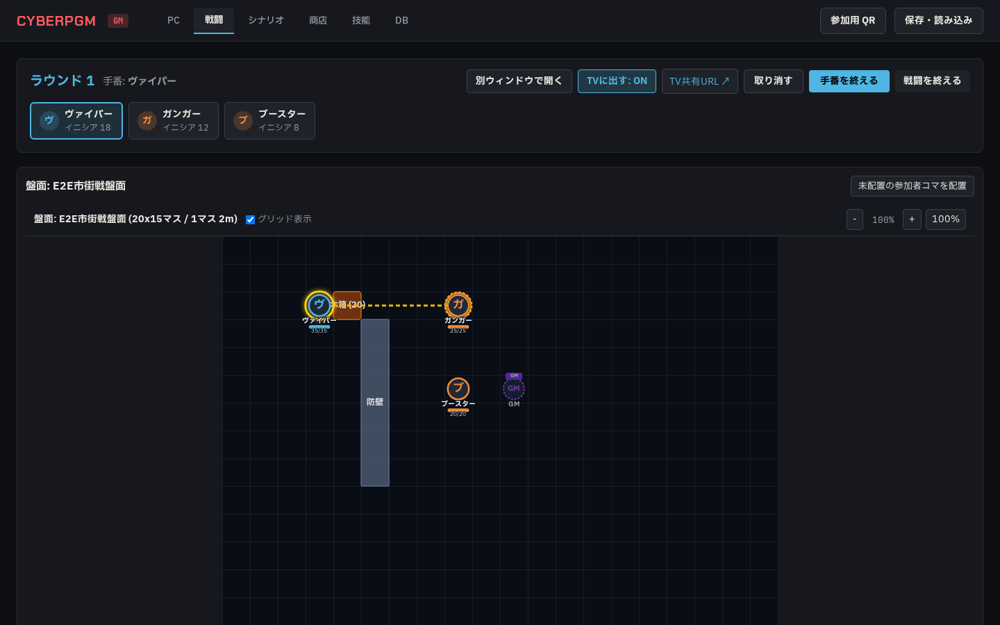
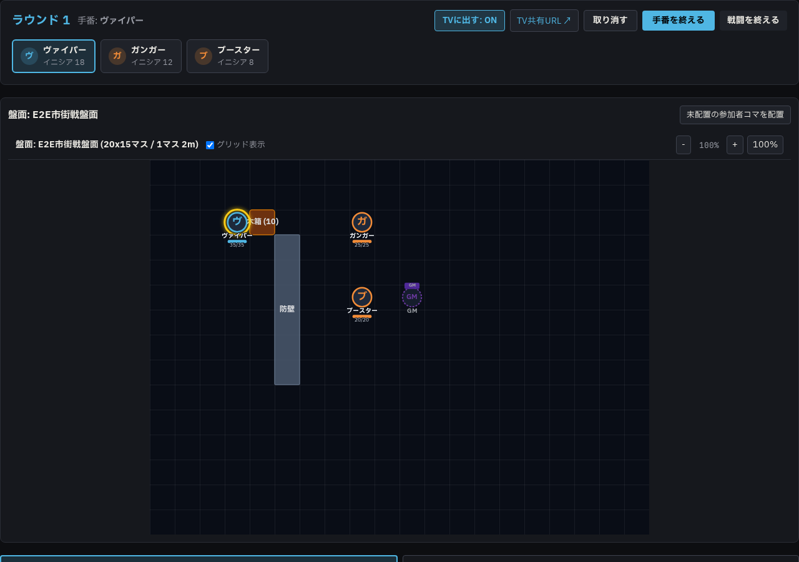
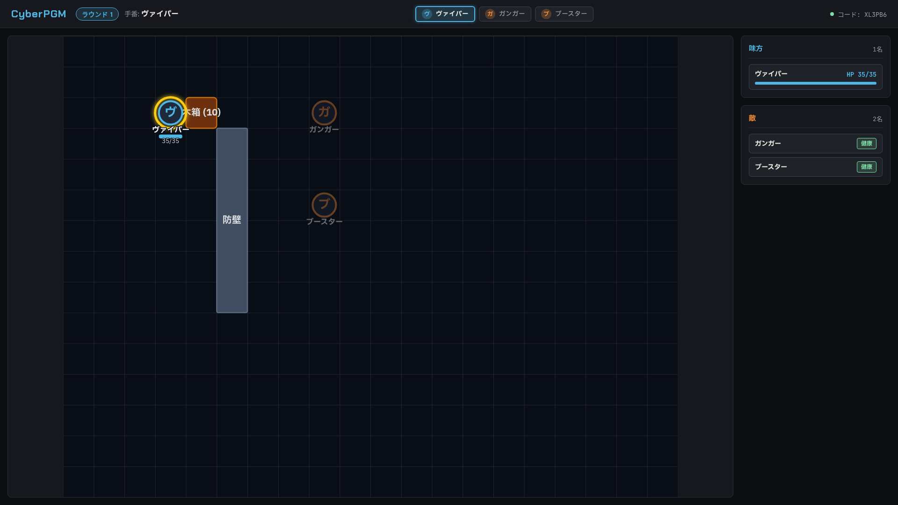
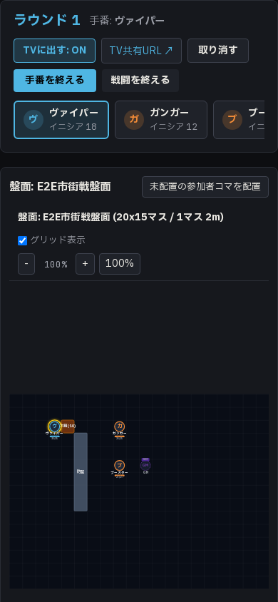

# Phase 4b 盤面・別ウィンドウ・TV 対応報告 01

- **作成日**: 2026-10-20
- **作業ブランチ**: `agy/phase4b-board`
- **対象ドキュメント**: `docs/agy/phase4b-board.md`

---

## 1. 実装概要

`docs/agy/phase4b-board.md` に基づき、戦闘画面の中央に配置される **盤面（Board）** 機能、移動範囲の幅優先探索（BFS）、射線（Line of Sight, LoS）と遮蔽判定、別ウィンドウ（`/gm/combat`）、および TV 共有画面（`/screen`）を実装しました。

### 主な実装項目
1. **DB スキーマとマイグレーション** (`drizzle/0007_minor_purple_man.sql`):
   - `boards`: 盤面マスタ（グリッド設定、背景画像、サイズなど）
   - `board_objects`: 障害物・遮蔽物（壁・木箱・コンテナ・車輌等、通過可否 `passable`、射線遮断 `blocks_los`、遮蔽耐久 `cover_hp`）
   - `board_tokens`: コマ配置（参加者 ID または自由配置、座標、GM のみ表示 `gm_only`）
   - `board_drops`: 盤面ドロップ品（照準射撃による手持ち品落下、アイテム拾得用）
   - `combats.board_id`: 戦闘テーブルへの外部キー
2. **ルールエンジン** (`packages/rules/src/movement.ts`):
   - `findReachableSquares`: 移動力（MOVE）に基づく 4 方向/斜め移動の幅優先探索（BFS）。障害物（`passable: false`）の進入不可、他コママスへの停止禁止（通過は可能）を判定。
   - `checkLineOfSight`: 発射元と対象の中心間レイキャスト。障害物のバウンディングボックスとの交差判定（クリア: 緑 / 遮蔽: 黄 / 遮断: 赤）。
   - `gridDistance`: チェビシェフ距離・ユークリッド距離・マンハッタン距離の計算。
3. **サーバーエンドポイント・解決ロジック** (`apps/server/src/routes/boards.ts`, `apps/server/src/services/combat-resolver.ts`):
   - 盤面・オブジェクト・コマ・ドロップ品の CRUD API（GM 権限）
   - 行動確定時のサーバー側移動経路および射線再検証
   - 遮蔽物へのダメージ適用（GM 入力値による `cover_hp` の減衰、HP0 で `blocks_los = 'none'` への遷移、取り消し時の完全復元）
   - 照準射撃（held_item）によるアイテム落下（`board_drops` への格納）と「拾う（pickup）」アクションの実装（取り消し時の双方向復元）
4. **セーブデータ version 4 対応** (`apps/server/src/routes/saves.ts`):
   - `boards`, `board_objects`, `board_tokens`, `board_drops` を含む version 4 保存形式
   - version 1〜3 の下位互換性ロード処理
5. **別ウィンドウ `/gm/combat` & TV 共有画面 `/screen`**:
   - `/gm/combat`: GM 画面と WebSocket（`combat:update`, `board:update`）で完全双方向同期する独立ウィンドウ
   - `/screen`: ログイン・PIN 不要のセッションコードアクセス。
     - 味方は数値 HP / SP を表示
     - 敵は名前と負傷状態バッジ（「健康」「重傷」「瀕死」「死亡」）のみを表示し、**HP・SP の数値は送信しない**
     - 「GM のみ」のコマ、`status` に「隠れている」を持つ敵コマは TV から除外
     - 背景画像の公開設定が `gm` の場合は TV 画面で背景画像を非表示とし、GM 画面に警告バッジを表示
     - GM 画面の「TVに出す: ON / OFF」ボタンによる表示切り替え

---

## 2. 設計上の判断

1. **角をかすめる射線の判定（Corner-grazing）**:
   - 発射元セルの中心 `(x1 + 0.5, y1 + 0.5)` と対象セルの中心 `(x2 + 0.5, y2 + 0.5)` を結ぶ線分と、各オブジェクト矩形 `[ox, oy, ox + w, oy + h]` の線分交差判定を実施。
   - 線分の端点（発射元・対象自身のセル内）に位置するオブジェクトは自己遮蔽とならないよう除外。
   - 完全遮断（`blocks_los: 'full'`）と部分遮蔽（`blocks_los: 'partial'`）が混在する場合、完全遮断が優先され `blocked`（赤色）となります。
2. **グリッド距離の計算方式**:
   - サイバーパンク RED のルール基準に合わせ、デフォルトでチェビシェフ距離（斜め移動も 1 マス換算）を採用し、`cell_m`（標準 2m）を乗算して射撃距離を算出。GM による距離の手動上書きも保持。
3. **コマの通過と停止**:
   - 移動途中での他コマ（味方・敵）が存在するマスの通過は許可しつつ、移動の最終停止位置に他コマが存在する場合は到達可能マスから除外。
   - GM が強制移動（`force_move = true`）をチェックした場合は制限をバイパス可能。

---

## 3. ルール確認事項（Issue 関連）の実装対応

1. **Issue #5 遮蔽物へのダメージ計算**:
   - ルール上の自動計算は行わず、GM が「遮蔽物に当てる」にチェックを入れたうえでダメージ値を手動入力する仕様としました。
   - 入力されたダメージ値により遮蔽物の `cover_hp` が減少し、0 に達した時点で遮蔽物は破壊され `blocks_los` が `'none'` に更新されます。手番の「取り消す」操作により元の耐久値・状態に戻ります。
2. **Issue #15 隠れている敵の表示範囲**:
   - ルール確認中につき、指示書に基づき以下の 2 種類のみを TV 共有画面から除外しました:
     1. コマの `gm_only` が `true` のもの
     2. 敵側参加者で `status` に「隠れている」が含まれているコマ

---

## 4. スクリーンショット

### 4.1 盤面つきの戦闘画面で移動範囲と射線 (1440px)

### 4.2 別ウィンドウ `/gm/combat` (1280px)

### 4.3 TV 共有画面 `/screen` (1920px)
- 敵「ガンガー」の数値 HP は非表示（「健康」バッジのみ表示）、GM のみコマは除外。

### 4.4 スマホ幅での盤面表示 (390px)

---

## 5. テスト結果

### 5.1 ルールエンジン単体テスト (`packages/rules/test/movement.test.ts`)
- **12 件全件パス**:
  - `findReachableSquares`: 基本移動、壁の回り込み、他コマ停止禁止、移動力 0、範囲外遮断
  - `checkLineOfSight`: 直線クリア、木箱の部分遮蔽（partial）、壁の完全遮断（full）、自己遮蔽除外、90度回転オブジェクト
  - `gridDistance`: チェビシェフ距離・ユークリッド距離・マンハッタン距離の計算

### 5.2 サーバー API 単体テスト (`apps/server/test/board.test.ts`)
- **6 件全件パス**:
  - 盤面とオブジェクトの CRUD
  - コマ配置と座標更新
  - 移動解決と他コマ重複防止
  - 射線判定と遮蔽物へのダメージ適用（HP0 で blocks_los が none、取り消しで復元）
  - 照準射撃による手持ち品落下（board_drops）と拾うアクション（取り消しで復元）
  - TV 画面用サニタイズ（敵の HP/SP 数値除外、GM のみコマ除外、隠れている敵除外）

### 5.3 セーブデータ互換性テスト (`apps/server/test/saves.test.ts`)
- **4 件全件パス**:
  - version 4 での保存と盤面データ復元
  - version 1〜3 データのロード下位互換性

### 5.4 Playwright E2E テスト (`e2e/board-combat.spec.ts`)
- **全ステップ正常パス**:
  - 盤面作成（防壁、木箱）、コマ配置、戦闘開始
  - ヴァイパーの移動 BFS 選択・確定反映
  - 木箱越しの射撃（自動距離計算、黄色の遮蔽線、遮蔽物への 10 ダメージ適用）
  - 別ウィンドウ `/gm/combat` での同期確認
  - TV 共有画面 `/screen` での敵 HP 数値非表示・負傷状態のみ表示確認
  - スマホ幅（390px）でのレスポンシブ表示確認

### 5.5 リポジトリ全体の品質検証
- `npm test`: **23 テストファイル、145 件全件パス**
- `npx playwright test`: **5 E2E テスト全件パス**
- `npm run typecheck`: **エラー 0 件**
- `npm run lint`: **エラー 0 件** (212 warnings: existing `any` warnings)
- `npm run build`: **全パッケージビルド成功**

---

## 6. 制約遵守の確認

- `npm start`（ポート 8787）: 常駐プロセスに触れず、停止・再起動・実行を行っていません。
- 本番 DB（`data/cyberpgm.db`）: 一切読み書き・変更・マイグレーションを行っていません（E2E は分離された `data/test-e2e.db` を使用）。
- 以前のコミット履歴を巻き戻す `git reset --soft` や破壊的コマンドは使用していません。
- 過去のフェーズのスクリーンショット（`docs/agy/reports/img/phase2-*.png`, `phase3*.png`, `phase4a-*.png`）は変更せず維持しています。
