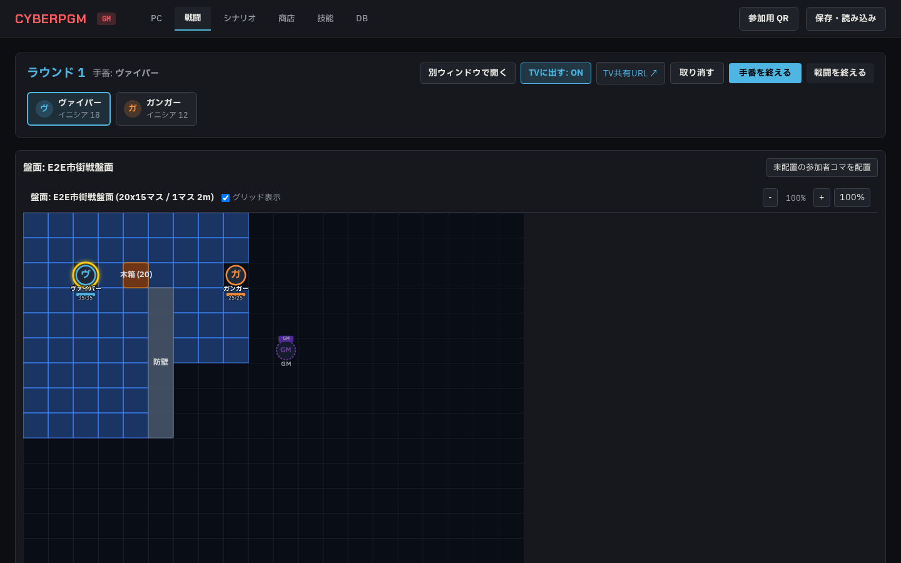

# Phase 4b 盤面・別ウィンドウ・TV レビュー指摘 02 対応報告

- **作成日**: 2026-10-20
- **作業ブランチ**: `agy/phase4b-board`
- **対象ドキュメント**: `docs/agy/phase4b-board.md` §12

---

## 1. 指摘事項ごとの対応内容

### 1.1 TV のコマが全部「敵・瀕死」になる問題の修正（指摘 1 / 最優先）
- **原因**: サーバーが TV 配信用データ（`screen:update`）から HP 数値を削除する際、コマオブジェクトの `name` / `side` / `wound_state` を適切に付与しておらず、クライアント側（`BoardView.tsx`）で未定義値から敵・HP0（瀕死）としてフォールバック描画されていた。
- **対応内容**:
  - `apps/server/src/session.ts` の `buildScreenPayload()` において、盤面上のコマに参加者の `name`、`side`、`wound_state`（`ok` / `seriously` / `mortally` / `dead`）を付与。味方の場合は数値 HP（`hp`, `hp_max`）も提供。
  - `apps/web/src/components/BoardView.tsx` において、TV 共有画面での敵コマ描画処理を改修。負傷状態が健康（`ok`）の場合は負傷バッジを一切描画せず、負傷時（`seriously` / `mortally` / `dead`）のみ「重傷」「瀕死」「死亡」バッジを表示。味方コマは味方色（青）と数値 HP バーを描画。
- **対応テスト**:
  - `e2e/board-combat.spec.ts`: `Test TV Shared Screen /screen (1920px)`
    - 味方コマ（ヴァイパー）が味方色・名前・HP `35/35` で描画されることを確認。
    - 満タンの敵コマ（ガンガー）に「瀕死」「重傷」「死亡」バッジが一切表示されないことを確認。
    - 敵の数値 HP（`25/25`）が TV 画面に送信・表示されないことを確認。
- **スクリーンショット**:
  - `docs/agy/reports/img/phase4b-board-tv-1920.png`

### 1.2 TV 共有画面のレイアウト刷新（指摘 2）
- **原因**: `ScreenPage.tsx` が Tailwind CSS クラスを使用していたが、`apps/web` 環境に Tailwind が組み込まれていなかったため、全スタイルが無効化されて文字が左上に重なり、頭文字と名前が重なって表示（「ヴヴァイパー」）されていた。
- **対応内容**:
  - `apps/web/src/pages/ScreenPage.tsx` をプロジェクトのデザイントークン（`var(--color-bg)`, `var(--color-surface)`, `var(--color-border)`, `var(--color-ally)`, `var(--color-enemy)` 等）を用いたインラインスタイルに完全刷新。
  - 上部ヘッダー: タイトル・ラウンド表示・現在手番、および行動順トラック（イニシアティブ順カード・現在手番ハイライト）。
  - 中央領域: 画面全体に広がる盤面（`BoardView`）。
  - 右サイドバー: 味方の数値 HP バー一覧および敵の名前・負傷状態バッジ一覧。
- **スクリーンショット**:
  - `docs/agy/reports/img/phase4b-board-tv-1920.png`

### 1.3 キャラに紐付かないコマの HP 非表示（指摘 3）
- **原因**: `character_id` が `null` のコマ（GM コマ等）に対し、`BoardView.tsx` の `getParticipantForToken` が `p.character_id === null` 同士をマッチさせたり、未設定時のデフォルトで「敵」および `0/1` を描画していた。
- **対応内容**:
  - `apps/web/src/components/BoardView.tsx`:
    - `getParticipantForToken` で `token.character_id` が存在しない場合は参加者を検索せず `undefined` を返却。
    - `tok.character_id` がないコマは `hasChar = false` とし、HP バーおよび `0/1` などの数値を一切描画しない。
    - GM 専用コマ（`tok.gm_only = true`）は紫色（`#A855F7`）枠線と「GM」イニシャル・バッジで描画。
  - `apps/web/src/components/CombatView.tsx`:
    - 参加者カード（`renderParticipantCard`）でキャラが紐付いていない場合は `HP —` と表示し、`0 / 1` のような擬似値を生成しないよう修正。
- **対応テスト**:
  - `e2e/board-combat.spec.ts`: `Test Separate Window /gm/combat (1280px)`
    - GM コマに `0/1` が表示されないこと、および GM バッジが表示されることを検証。
- **スクリーンショット**:
  - `docs/agy/reports/img/phase4b-board-window-1280.png`

### 1.4 移動範囲と射線のスクリーンショット整備（指摘 4）
- **原因**: 1440px の E2E テストでアクションフォームへスクロールした状態で撮影していたため盤面が画角外になっていた。また移動範囲と射線が別画像として保存されていなかった。
- **対応内容**:
  - `e2e/board-combat.spec.ts` を修正し、盤面を画角に収めた状態で以下の 2 枚のスクリーンショットを取得:
    1. 移動アクション選択時の青い移動可能マス一覧表示: `phase4b-board-combat-move-1440.png`
    2. 射撃アクション選択時の対象への黄色遮蔽射線表示: `phase4b-board-combat-1440.png`
- **スクリーンショット**:
  - `docs/agy/reports/img/phase4b-board-combat-move-1440.png`
  - `docs/agy/reports/img/phase4b-board-combat-1440.png`

### 1.5 クライアント側距離計算の `diagonalRule` 対応（指摘 5）
- **原因**: `CombatView.tsx` の射撃距離自動計算で `distChebyshev * cell_m` がハードコードされており、戦闘設定の `diagonalRule`（alternate 等）が反映されていなかった。
- **対応内容**:
  - `CombatView.tsx` において、`checkLineOfSight` および `gridDistance` 呼び出し時に戦闘設定の `diagonalRule`（`chebyshev` / `alternate`）と盤面グリッドの `cell_m` を含むルールオブジェクトを渡すよう改修。
  - サーバー側の `combat-resolver.ts` および `apps/server/src/routes/combat.ts` でも combat 設定の `diagonalRule` を反映して再検証するよう統一。
- **対応テスト**:
  - `packages/rules/test/movement.test.ts`: `gridDistance respects diagonalRule (chebyshev vs alternate)`
  - `apps/server/test/board.test.ts`: `movement resolution with alternate diagonal rule`

### 1.6 幅優先探索（BFS）の斜め交互ルール偶奇パリティ対応（指摘 6）
- **原因**: `findReachableSquares` の訪問済み判定が座標 `(x, y)` のみだったため、斜めステップの偶奇（コスト 1m か 2m か）の違いによる探索枝が誤って枝刈りされ、到達可能なマスが欠落する場合があった。
- **対応内容**:
  - `packages/rules/src/movement.ts` において、訪問済みセットのキーを `x,y,${diagonals % 2}`（座標 + 斜め歩数の偶奇パリティ）に変更。同じ座標でも偶数回斜め移動した状態と奇数回斜め移動した状態を両立させ、最適な経路探索を実現。
- **対応テスト**:
  - `packages/rules/test/movement.test.ts`:
    - `findReachableSquares with alternate diagonal rule matches gridDistance with mixed diagonal/straight paths`（13/13 件全件パス）

### 1.7 遮蔽物 HP 未設定時の入力必須化と 0 扱い防止（指摘 7 / 最優先）
- **原因**: `combat-resolver.ts` で `coverObj.cover_hp ?? 0` と扱っていたため、HP 未設定の遮蔽物に 1 ダメージでも与えると即座に破壊されていた。
- **対応内容**:
  - `packages/shared/src/combat.ts`: `ResolveActionInputSchema` に `cover_current_hp`（GM 入力値）を追加。
  - `apps/server/src/services/combat-resolver.ts`: 遮蔽物 HP が未設定かつ GM 入力もない場合、`missing_inputs`（「遮蔽物の HP を入力してください」）を返し、0 扱いで即破壊しないよう修正。
  - `apps/web/src/components/CombatView.tsx`: 遮蔽物の HP が空の場合、ダメージ入力欄と並んで「遮蔽物の HP」入力欄を表示。未入力の間は「判定と反映内容を計算」ボタンを無効化（※ 遮蔽物のHPを入力するまで計算できません）とし、GM が耐久値を入力するまで計算を進めない仕様に改修。
- **対応テスト**:
  - `apps/server/test/board.test.ts`:
    - `rejects cover damage resolution when cover_hp is null and not supplied by GM`（6/6 件全件パス）

### 1.8 スマホ幅（390px）の見出し折り返しと拡大縮小ボタン（指摘 8）
- **原因**: ヘッダーの flex-wrap 不足、white-space 制御不足により「ラウンド 1」が縦 1 文字ずつ折り返されていた。また BoardView の拡大縮小ボタンに共通スタイルが適用されていなかった。
- **対応内容**:
  - `apps/web/src/components/CombatView.tsx`: 戦闘ヘッダーに `flexWrap: 'wrap'`、`whiteSpace: 'nowrap'` を付与し、「ラウンド 1」「手番: ヴァイパー」が自然に横並びで折り返されるよう修正。
  - `apps/web/src/components/BoardView.tsx`: 拡大・縮小・100% ボタンにデザイントークン（`var(--color-surface-elevated)`, `var(--color-border-light)`, `var(--color-text)`）を用いた統一スタイルを適用。
- **スクリーンショット**:
  - `docs/agy/reports/img/phase4b-board-mobile-390.png`

---

## 2. スクリーンショット一覧

### 2.1 盤面つき戦闘画面（移動範囲 1440px）
- 移動アクション選択時の青い到達可能マス表示。

### 2.2 盤面つき戦闘画面（射線 1440px）
- 射撃アクション選択時の黄色遮蔽射線表示。

### 2.3 別ウィンドウ `/gm/combat` (1280px)
- GM 専用コマ（紫）に `0/1` が表示されず「GM」バッジのみ表示。

### 2.4 TV 共有画面 `/screen` (1920px)
- 上部行動順・中央全面盤面・右サイドバーの完全レイアウト。
- 味方（ヴァイパー）は味方色・名前・数値 HP、敵（ガンガー）は健康状態で負傷バッジなし、敵の数値 HP は非表示。

### 2.5 スマホ幅（390px）
- 「ラウンド 1」が 1 文字ずつ縦に崩れず、拡大縮小ボタンにスタイルが適用された状態。

---

## 3. テスト実行結果

### 3.1 単体・統合テスト (`npm test`)
- **23 テストスイート 146 テスト全件パス**
  - `packages/rules/test/movement.test.ts` (13 tests)
  - `apps/server/test/board.test.ts` (6 tests)
  - `apps/server/test/combat.test.ts` (16 tests)
  - `apps/server/test/ws.test.ts` (1 test)
  - `apps/server/test/api.test.ts` (6 tests)
  - 他 18 テストファイル全件パス

### 3.2 E2E テスト (`npx playwright test`)
- **5 テスト全件パス**
  - `e2e/board-combat.spec.ts`: 盤面 BFS、射線・遮蔽・別ウィンドウ・TV 画面テスト（味方 HP 表示、健康敵の負傷バッジ非表示、敵数値 HP 隠蔽、GM コマ 0/1 非表示）
  - `e2e/character-creation.spec.ts`
  - `e2e/combat.spec.ts`
  - `e2e/session-flow.spec.ts`
  - `e2e/shop-item-flow.spec.ts`

### 3.3 リント・型チェック
- `npm run lint`: 0 errors
- `npm run typecheck`: 0 errors
- `npm run build -w @cyberpgm/web`: 正常ビルド完了

---

## 4. 遵守事項の確認
- `npm start`（8787 ポート）のプロセスには一切接触・停止・実行していません。
- 本番の `data/cyberpgm.db` には一切触れていません（E2E は独立した `data/test-e2e.db` で動作）。
