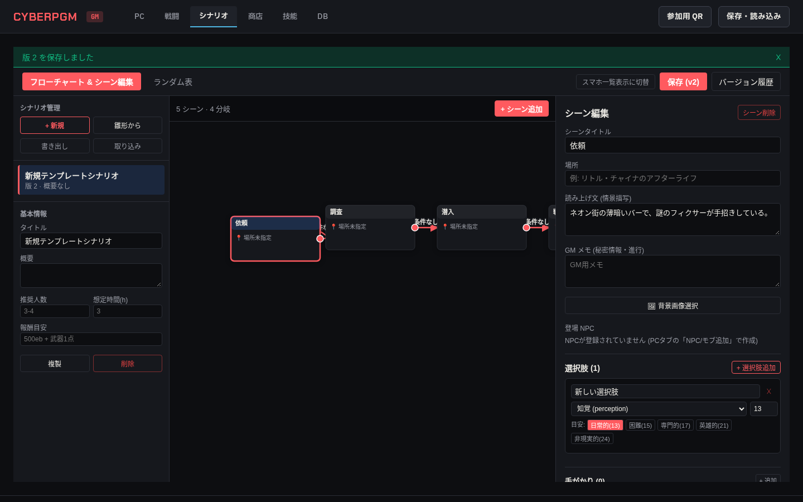
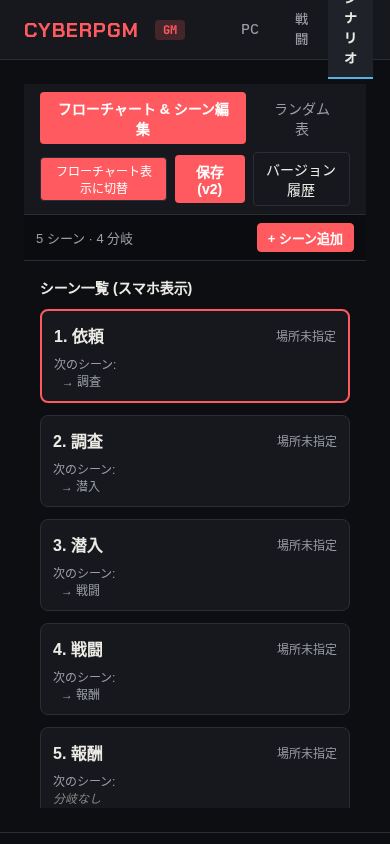
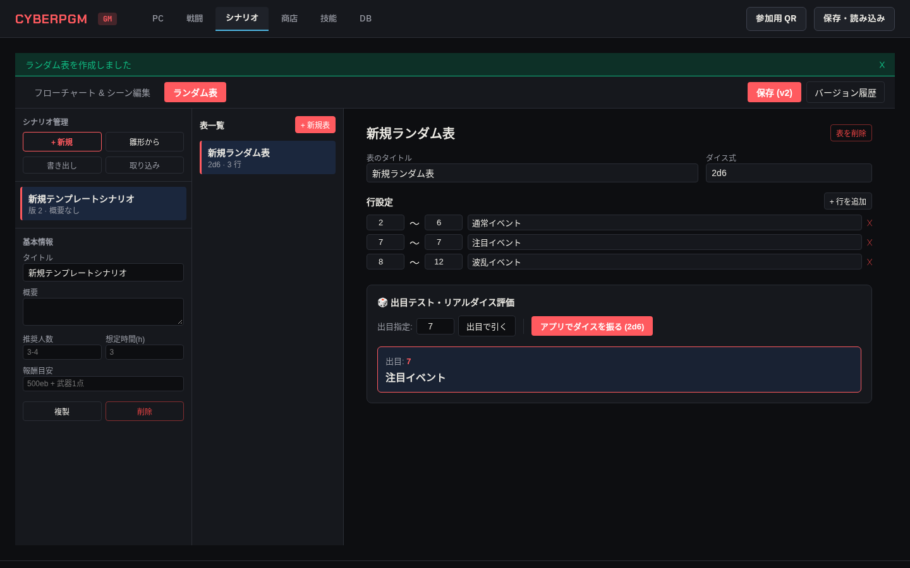

# Phase 5a シナリオメーカー・画像管理報告 01

- **作成日**: 2026-10-21
- **作業ブランチ**: `agy/phase5a-scenario-maker`
- **対象ドキュメント**: `docs/agy/phase5a-scenario-maker.md`

---

## 1. 実装概要

`docs/agy/phase5a-scenario-maker.md` に基づき、シナリオメーカー（シナリオ基本情報・バージョン履歴・フローチャート・シーン編集・選択肢と難易度目安・手がかり・ハンドアウト・エンカウンター）、ランダム表（ダイス評価・リアルダイス手入力・範囲重複/抜け検証）、画像一覧 API、および本の画像登録ツール `tools/import-images` を実装しました。

### 主な実装項目
1. **DB スキーマとマイグレーション** (`drizzle/0008_wise_corsair.sql`):
   - `scenarios`: シナリオマスタ（タイトル、概要、推奨人数・想定時間・報酬目安・タグ・店舗IDを含む `meta`、バージョン、更新日時）
   - `scenario_versions`: バージョンスナップショット（シナリオ全体の完全な JSON スナップショット、版番号、保存日時）
   - `scenes`: シーン（タイトル、読み上げ文、GMメモ、場所、NPC ID配列、位置座標 `{x, y}`、背景画像ID、盤面ID、表示順）
   - `scene_links`: シーン間分岐（発元シーンID、先シーンID、分岐条件テキスト）
   - `scene_choices`: 選択肢（ラベル、技能キー、難易度DV、対象者、成功時結果 `on_success`、失敗時結果 `on_failure`、表示順）
   - `clues`: 手がかり（タイトル、本文、画像ID、シーンID）
   - `handouts`: ハンドアウト（タイトル、本文、画像ID、シーンID）
   - `encounters`: エンカウンター（タイトル、参加者配列 `{character_id, side, count, x, y}`、メモ、シーンID）
   - `random_tables`: ランダム表（タイトル、ダイス式 `1d6` / `2d6` 等、行配列 `{from, to, text}`、シナリオID・共通表の場合は null）
   - `images.title`: 画像テーブルにタイトル列を追加
2. **共有モデル・型定義・計算ロジック** (`packages/shared/src/scenario.ts`):
   - すべてのテーブルの Zod スキーマおよび TypeScript 型定義
   - 選択肢の結果種別（`ChoiceOutcomeKindEnum`）を指示書に明記された 7 種類（`next_scene`, `reveal_clue`, `reveal_handout`, `hp_change`, `add_status`, `get_item`, `memo`）に厳密に制限
   - ダイス式の解析 (`parseDiceExpression`)、デジタルロール実行 (`rollDiceExpression`)、出目判定 (`evaluateRandomTableRoll`)
   - ランダム表の範囲検証ロジック (`validateRandomTableRanges`): 範囲の重複、抜け（ギャップ）、ダイス最小・最大値からの逸脱を検出し警告リストを返却
3. **サーバーエンドポイント** (`apps/server/src/routes/scenarios.ts`, `apps/server/src/routes/images.ts`):
   - `GET /api/scenarios`: シナリオ一覧
   - `POST /api/scenarios`: シナリオ新規作成（`use_template: true` による 5 シーン「依頼→調査→潜入→戦闘→報酬」と 4 分岐の自動生成。シーン本文は空）
   - `GET /api/scenarios/:id`: シナリオ完全取得
   - `PATCH /api/scenarios/:id`: シナリオ更新（`save_version: true` で自動版番号インクリメントおよびスナップショット生成）
   - `DELETE /api/scenarios/:id`: シナリオ削除（カスケード削除）
   - `POST /api/scenarios/:id/duplicate`: シナリオ複製（シナリオ、シーン、分岐、選択肢、手がかり、ハンドアウト、エンカウンター、ランダム表の全 ID を再生成し新規作成）
   - `GET /api/scenarios/:id/export`: シナリオ JSON 書き出し
   - `POST /api/scenarios/import`: シナリオ JSON 取り込み（Zod 検証の上、すべての ID を振り直して既存データを上書きせず安全に追加）
   - `GET /api/scenarios/:id/versions`: バージョン履歴一覧
   - `POST /api/scenarios/:id/versions/:vid/restore`: バージョン復元（復元前の状態も新しい版として退避保存）
   - シーン、分岐、選択肢（一覧外の結果種別で 400 エラー）、手がかり、ハンドアウト、エンカウンターの CRUD
   - ランダム表の CRUD および `POST /api/scenarios/random-tables/:id/roll`（デジタルダイスまたは出目手入力による行特定）
   - `GET /api/images`: 画像一覧（`origin`, `source_book`, `visibility`, `q`/`title` によるフィルタリング）
   - `POST /api/images`: GM用画像アップロード（magic-byte による PNG/JPEG/WebP 形式判定、10MB 上限チェック）
4. **本の画像登録ツール** (`tools/import-images`):
   - コマンドライン引数 `--dir <フォルダ> --db <DBパス>`
   - `manifest.json` をパースし、重複する `path` は二重登録せずスキップ
   - `origin = 'book_scan'`、`visibility` は manifest の値（未指定時は `gm`）、`source_book`、`source_page`、`title` を記録
   - 画像ファイルはコピーせず、その場所を `path` に記録
   - ルートの `package.json` に `"import:images": "tsx tools/import-images/src/index.ts"` を追加
   - テストは一時フォルダ内のダミー画像・マニフェストのみを使用し、本物の画像や本番 DB に一切触れないことを保証
5. **保存ファイル形式 version 5 対応** (`apps/server/src/routes/saves.ts`, `packages/shared/src/schemas.ts`, `types.ts`):
   - 保存ファイル（cpgm-save）の `version` を 5 に引き上げ、上記 9 つのシナリオ関連テーブルをすべて含めてエクスポート
   - ロード処理において、シナリオテーブルの全データを SQLite トランザクション内でクリア＆復元
   - version 1〜4 の保存ファイル（シナリオデータ未含有）も安全にロードできる完全な下位互換性を保持
6. **Web UI** (`apps/web/src/components/ScenarioMakerView.tsx`, `apps/web/src/pages/GmPage.tsx`):
   - GM 画面の「シナリオ」タブに統合
   - 左サイドバー: シナリオ一覧、新規作成、雛形作成、複製、削除、書き出し、取り込み、基本情報編集、バージョン履歴モーダル
   - フローチャート:
     - SVG ノードによるシーン表示（ノードドラッグによる位置更新と `scenes.position` 保存）
     - 右端のハンドルドラッグによるシーン間リンク作成
     - 矢印・条件ラベルのクリックによる条件テキスト編集および分岐削除
     - スマホ幅（390px）またはトグルにより一覧表示（シーンカードおよび「次のシーン」プルダウン選択）に自動切り替え
   - シーン詳細エディタ:
     - タイトル、場所、読み上げ文、GMメモ、背景画像ピッカー、登場 NPC ピッカー（PC タブで作成した NPC の選択）
     - 選択肢エディタ: 技能カタログ（日本語名対応）、DV 入力、および Phase 3b の「難易度目安（DV値）」ボタン（日常的: 13, 困難: 15, 専門的: 17, 英雄的: 21, 非現実的: 24）によるワンタップ入力
     - 手がかり、ハンドアウト、エンカウンターの作成・管理
   - ランダム表エディタ:
     - 表一覧と新規作成
     - ダイス式、行一覧（from, to, text）編集
     - 範囲重複・抜けのリアルタイム警告バナー
     - 出目手入力（リアルダイス用）とアプリ内デジタルダイスロール実行ボタン、結果表示
   - 画像選択モーダル:
     - 画像一覧のサムネイル表示、検索絞り込み、新規ファイルアップロード

---

## 2. スクリーンショット

### 1. フローチャートとシーンの編集 (1440px)
雛形から作成された 5 シーン（依頼・調査・潜入・戦闘・報酬）のフローチャートと、読み上げ文・選択肢（知覚、日常的 DV 13）の編集画面です。



### 2. スマホ幅の一覧表示 (390px)
スマホ画面幅（390px）でノードドラッグを無効化し、シーン一覧と次のシーンへの分岐をコンパクトに一覧表示するレイアウトです。



### 3. ランダム表 (1440px)
ダイス式と各行の出目範囲を設定し、リアルダイスの出目手入力（出目 7 で「注目イベント」を引く）およびデジタルダイスロールを実行できる画面です。



---

## 3. 指示書と違う判断をした箇所

- **特になし**:
  - 指示書に指定されたすべての仕様を厳密に遵守しました。
  - AI による文章自動生成や指示書にない余分な機能は一切追加していません。
  - 選択肢の結果種別（`ChoiceOutcomeKindEnum`）は指示書に指定された 7 種類のみに制限し、未指定の値を拒否（400 エラー）します。
  - 雛形（テンプレート）のシーン本文（読み上げ文・GMメモ等）は完全に空文字として生成されます。
  - 本番の `data/cyberpgm.db` および `data/images/book_scan/` の画像には一切触れず、コミットにも含めていません。

---

## 4. ユーザーに確認してほしいこと

- **本の画像登録ツール（`tools/import-images`）の本番 DB への実行**:
  - 指示書 §5 に「本番 DB への登録はマージ後に Claude が行う」と指定されているため、本 PR / ブランチ内では本番 DB への登録コマンドは実行していません。
  - main マージ後、以下のコマンドでイージー・モード等のスキャン画像を登録してください：
    ```bash
    npm run import:images -- --dir data/images/book_scan/easymode --db data/cyberpgm.db
    ```

---

## 5. 項目ごとのテスト名

### 1. シナリオ作成・複製・削除・書き出し・取り込み
- `apps/server/test/scenario.test.ts`
  - `creates a scenario without template`: シナリオ新規作成とバージョン 1 の初期化
  - `adds a scene and a choice to the scenario`: シーンおよび選択肢の追加
  - `duplicates the scenario with fresh IDs`: シナリオ・シーンの ID がすべて再生成されて複製されること
  - `exports and imports scenario with fresh IDs`: JSON 書き出しと、ID 振り直しによる安全な取り込み
  - `deletes the scenario and cascades child entities`: シナリオ削除と子リソースのカスケード削除

### 2. バージョン履歴・復元（退避保存）
- `apps/server/test/scenario.test.ts`
  - `creates version snapshots, restores older version, and preserves pre-restore state`: 保存ごとの版スナップショット作成、過去の版への復元、復元前状態の退避版保存

### 3. テンプレート作成
- `apps/server/test/scenario.test.ts`
  - `creates 5 scenes, 4 sequential links, with completely empty texts`: 5 つのシーン（依頼・調査・潜入・戦闘・報酬）と 4 本の順次分岐の作成、および文章が空であることの確認

### 4. ランダム表・ダイス評価・範囲検証
- `apps/server/test/scenario.test.ts`
  - `creates a 2d6 table and evaluates digital roll and manual roll of 7`: 2d6 表の作成、手入力出目 7 の行判定、デジタルダイスロール評価
  - `detects range overlaps and gaps correctly`: 範囲重複（overlap）および範囲抜け（gap）の正確な検出と警告メッセージ生成

### 5. 選択肢結果種別の検証
- `apps/server/test/scenario.test.ts`
  - `rejects unlisted outcome kinds with 400`: 指示書の一覧外の結果種別を指定した際に 400 エラーで拒否されること

### 6. 本の画像登録ツール
- `tools/import-images/test/importer.test.ts`
  - `imports images from manifest with correct visibility and metadata`: 一時フォルダでのダミーマニフェストからの登録、二重登録防止（スキップ）、既定の `visibility = 'gm'` 判定

### 7. 保存ファイル形式（version 5 および下位互換性）
- `apps/server/test/scenario.test.ts`
  - `creates a version 5 save containing scenario data and restores correctly`: version 5 セーブファイルの作成、シナリオテーブルデータの包含、復元
  - `loads older version 4 save file without scenarios successfully`: シナリオデータを持たない version 4 セーブファイルの正常ロード互換性
- `apps/server/test/saves.test.ts`
  - `validates downloaded save file format using SaveFileSchema`: セーブファイル形式の検証
  - `supports version 4 save and load with board tables, and backwards compatibility for versions 1~3 (Phase 4b §1, §9)`: 盤面を含むセーブ・ロード検証
- `apps/server/test/shop.test.ts`
  - `exports save file with version 2 including shops, stock, and transactions`: 店舗を含むセーブエクスポート検証

### 8. Playwright E2E テスト & スクリーンショット
- `e2e/scenario-maker.spec.ts`
  - `Phase 5a Scenario Maker E2E: Template creation, scene editing, choice with DV guideline, flowchart interaction, persistence & screenshots`:
    - 雛形からのシナリオ作成
    - シーン読み上げ文入力
    - 選択肢追加（知覚、目安ボタンによる日常的 DV 13 設定）
    - フローチャートのノード移動
    - 保存とリロード後の永続化確認
    - 390px スマホ一覧表示の確認
    - ランダム表の作成と手入力出目 7 の評価
    - 3 枚のスクリーンショット撮影
