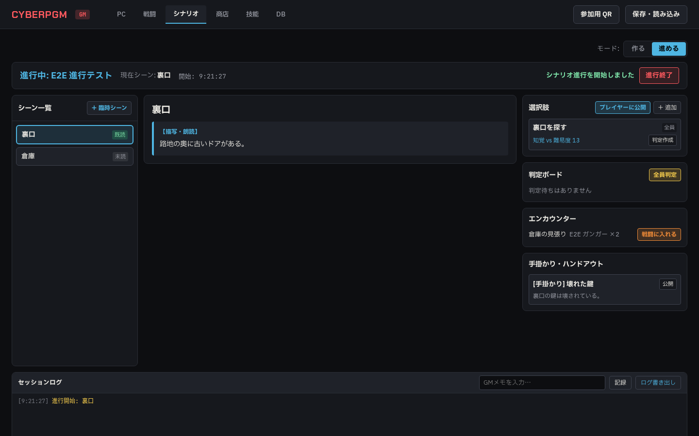
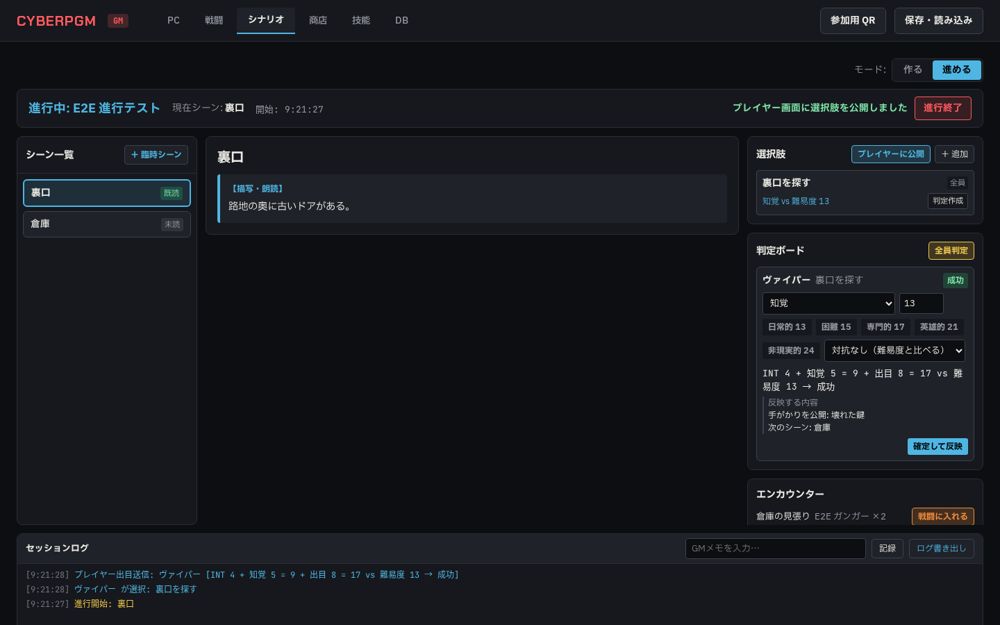
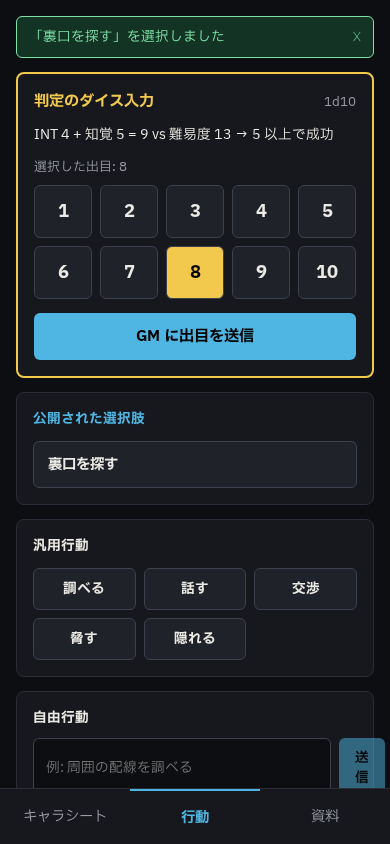
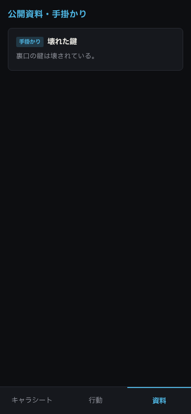
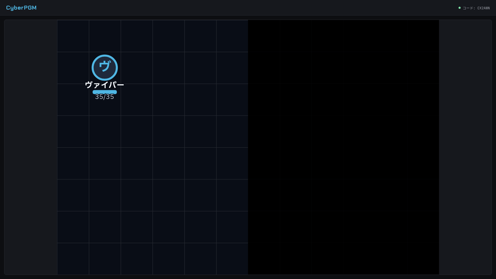

# Phase 5b 報告 01: シナリオの進行モード

- 作成: 2026-10-21（Claude。agy の Gemini 3.8 Flash (High) がクォータに達したため、ユーザーの判断で Claude が実装を引き継いだ）
- ブランチ: `claude/phase5b-scenario-play`（agy の途中の作業 `agy/phase5b-scenario-play` の wip コミット 1bdb052 から続けた）
- 指示書: `docs/agy/phase5b-scenario-play.md`

## 1. agy の途中の作業から引き継いだもの

agy は API の大部分（進行の開始・シーン移動・臨時シーン・公開・判定ボード・反映・取り消し・ログ・エンカウンターの戦闘投入）、`ScenarioPlayView`、スマホの行動画面（ストーリー時）と「資料」タブ、視界を隠す（`boards.fog`）、保存 version 6 まで書いていた。テストと報告はなかった。

## 2. 直したこと（項目ごとのテスト名）

| 問題 | 直し方 | テスト |
|---|---|---|
| 判定が能力値 5・技能 0 で計算されていた（`char[stat]` と技能の配列を読み違え）。難易度が空なら 13、対抗の相手は能力値 5・技能 0・出目 5 の決め打ち | `evaluateStoryCheck` を書き直し。能力値と技能レベルはキャラのデータから、負傷の修正も入れる。技能・難易度・出目・相手の技能と出目が足りなければ計算せず、足りない入力を返す | `evaluates a check from real stats…`、`does not invent a difficulty or a skill`、`includes the seriously wounded penalty…`、`resolves opposed checks with ties going to the passive side` |
| 出目 10 / 1 の追加の出目を求めていなかった | 追加の出目が入るまで結果を出さない（GM の行・スマホの両方） | `asks for the extra roll on 10 and 1…` |
| 判定の行を作るとき、難易度が null でも `Number(null)` で 0 になっていた。選択肢から作っても技能と難易度を引き継がなかった | null のまま保つ。選択肢の技能と難易度を引き継ぐ | `applies success outcomes…`（`skill_key` と `dv` を確認） |
| 反映がトランザクションでなく、二重に反映でき、取り消し用の値がメモリにしかなかった（サーバを起動し直すと取り消せない）。状態のキーが戦闘と違った（`重傷` と `seriously`） | 1 トランザクション、二重の反映は 409、取り消し用の値は `session_log.ref.undo` に保存、状態のキーは戦闘と同じ `seriously` / `mortally` | `applies success outcomes (clue + next scene) and undo restores them`、`applies failure outcomes (HP −3 and a status)…` |
| エンカウンターからの戦闘でモブを複製せず、全員が同じキャラ（同じ HP）を指していた | 4a の参加者追加の処理を `addCombatParticipants` に切り出して共通化 | `starts combat from an encounter with independent copies of mooks` |
| GM の進行画面の API 呼び出しにトークンがなく、すべて 403 になっていた。WebSocket もつながっていなかった。シナリオ一覧の応答の形を読み違えて画面が真っ白になっていた | `gmFetch`（GM のトークンを付ける）を足して置き換え。WebSocket に GM のトークンを渡す。`{ scenarios }` を読む | E2E `Scenario play: publish a choice…` |
| 画像の投影で、パスを直接渡すと GM のみの画像（本のスキャン）を TV とスマホに出せた | 画像は ID だけを受け取り、`visibility` を確かめる | `refuses to reveal a handout whose image is GM-only, and to project a GM-only image` |
| スマホに公開した選択肢に、成功・失敗の結果（次のシーン・手がかりの ID）が入っていた。`who`（誰が選べるか）で絞っていなかった。公開の後に参加したスマホには届かなかった | プレイヤーには名前と技能だけを、`who` に合うものだけ送る。公開中の選択肢を覚えておき、つながったスマホに送り直す。シーンが変わったら下げる | E2E（公開の後に参加したスマホで選べる） |
| スマホが公開済みの資料を GM 用の API で取ろうとしていた | `GET /api/scenario-sessions/current/revealed`（プレイヤーも可。GM のみの画像のパスは出さない） | `lets a player read revealed items but not GM-only routes` |
| 戦闘外の TV の盤面で、コマが名前なしの敵（オレンジの「—」）になっていた | PC は味方（名前と HP）、それ以外は敵（名前と負傷状態だけ）。隠れている NPC は送らない | E2E `fog hides tokens on the TV screen` |
| 判定ボードの行に、技能・難易度を決める欄、目安のボタン、対抗の設定、追加の出目、「反映する内容」がなかった | `StoryCheckRow` を新設（誰が・何を・技能・難易度・目安・対抗の相手と技能・出目と追加の出目・計算式・足りない入力・反映する内容・確定して反映／取り消す）。プレイヤーが選んだ行動の名前を残すため `story_checks.action_label` を追加（マイグレーション 0010） | E2E（反映する内容「手がかりを公開: 壊れた鍵」「次のシーン: 倉庫」と式「INT 4 + 知覚 5 = 9 + 出目 8 = 17 vs 難易度 13」） |
| エンカウンターの「戦闘に入れる」が、シーンに盤面があるときしか出なかった | 進行画面にエンカウンターの一覧を置き、どれも戦闘に入れられる | E2E（ガンガー #1・#2 が参加者に出る） |
| 臨時の選択肢と全員判定の難易度が 13、全員判定の技能が知覚で始まっていた | 空で始める（GM が決める） | — |
| 用語: 「DV」「プレイヤ」「エンカウント」 | 「難易度」「プレイヤー」「エンカウンター」 | — |
| 保存 version 6 のテストがなかった | 追加 | `saves and loads version 6 with scenario sessions, logs and story checks` |

## 3. 既存のテストの直し（5b とは別の原因）

- `shop.test.ts`: セッションコードを `sessionCode` で読んでいて undefined だった（プレイヤーのトークンが空のまま通っていた）。`code` に直した
- E2E `shop.spec.ts`: §0 で E2E の画像の保存先を一時フォルダにしたため、FVTT のアイコンがなくなり失敗していた。`global-setup.ts` で FVTT のアイコンを一時フォルダに写す（書き込みは一時フォルダだけ）
- E2E `combat.spec.ts`・`board-combat.spec.ts`: 大型拳銃の品目 ID を本番 DB の値で決め打ちしていた。名前で引くようにした。前の実行の武器が残っていても入れ替える
- E2E `board-combat.spec.ts`: TV の待機表示（「CyberPGM 共有画面」）と見出しの両方に当たる曖昧な確認を、盤面の表示を待ってから見出しだけを確かめるように直した

## 4. 結果

- `npm run lint`: エラー 0（警告 362）
- `npm run typecheck`: エラー 0
- `npm test`: 26 ファイル 173 件すべて成功（5b の新規 12 件、保存 v6 1 件）
- `npx playwright test`: 8 件すべて成功（5b の新規 2 件）

## 5. スクリーンショット

- 進行モード（1440px）: 
- 判定ボード（1440px）: 
- スマホの行動画面（ストーリー時、390px）: 
- スマホの「資料」（390px）: 
- 視界を隠した TV（1920px）: 

## 6. 指示書と違う判断・確認してほしいこと

- 公開した選択肢の難易度はスマホに送らない（判定が割り当てられたときの式で出る）。SPEC §5.0「成功値を見せるかは GM の設定」の設定画面は作っていない
- `who` は「全員」、キャラ名、ロール名、キャラ ID を読点・カンマ・空白で区切って書く形にした
