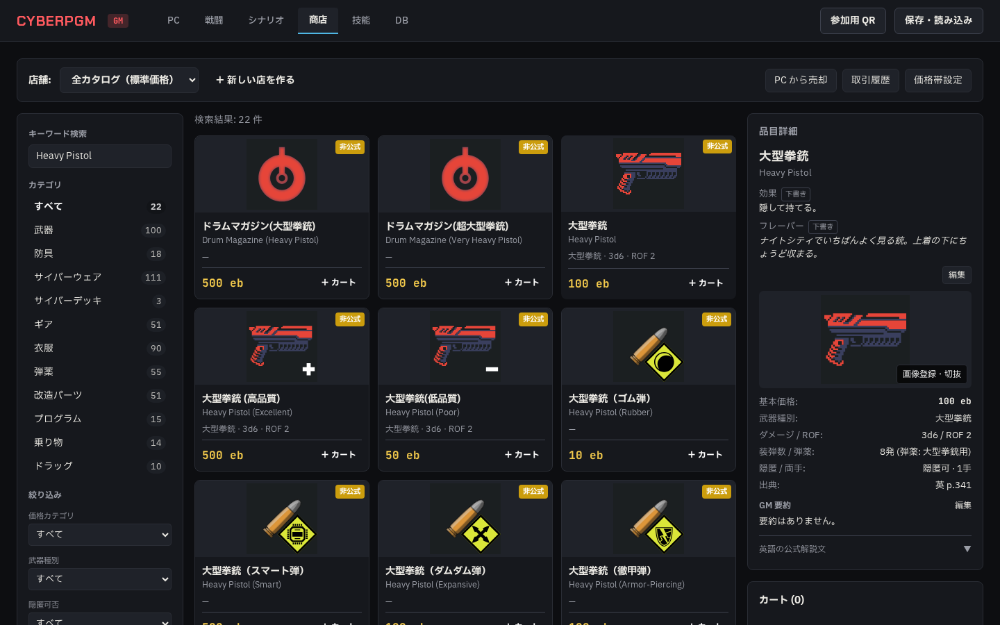
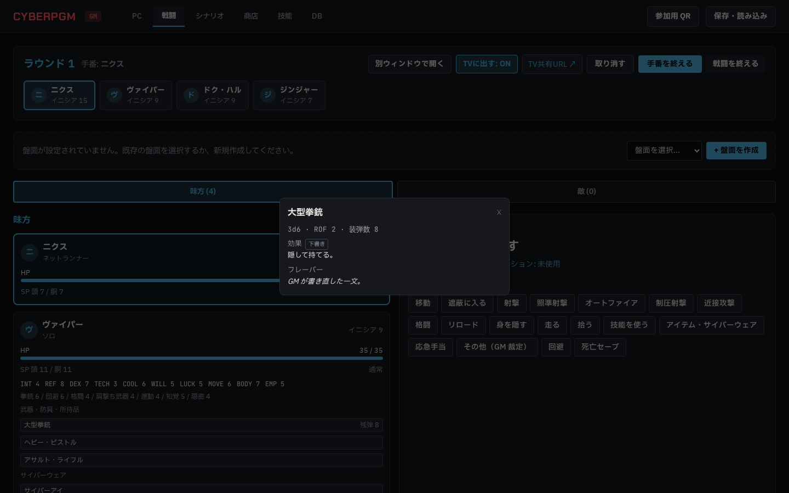

# Phase 5c 報告 01: 品目の効果とフレーバー

- 作成: 2026-10-21（Claude。agy のクォータ切れの間、ユーザーの判断で Claude が実装）
- ブランチ: `claude/phase5c-item-info`
- 指示書: `docs/agy/phase5c-item-info.md`

## 1. やったこと（項目ごとのテスト名）

| 指示書 | やったこと | テスト |
|---|---|---|
| §1 データ | `items` に `effect_ja`・`flavor_ja`・`effect_is_draft`・`flavor_is_draft`（マイグレーション 0011）。起動時に `docs/data/item-notes.ja.json` の下書きを、まだ入っていない品目にだけ入れる（`init-phase5c.ts`） | `seeds every item from the drafts and marks them as drafts` |
| §1 GM の編集を上書きしない | 編集した欄は下書きの印が消え、起動し直しても上書きしない。`import:fvtt` は名前の決まった列しか更新しないので消えない | `keeps a GM edit across a re-seed…`、`import.test.ts` の `does not overwrite GM edited columns on subsequent run`（効果とフレーバーを追加） |
| §1 保存 | 保存ファイルに `item_notes`（GM が編集した品目の効果とフレーバーだけ）を追加。読み込みで戻す。古い保存ファイルは `item_notes` なしで読める | `keeps GM edits through save and load`、`only GM-edited notes go into the save file` |
| §2 商店の詳細 | 詳細の上に「効果」「フレーバー」と「下書き」の印。「編集」で書き換え（変えた欄だけ送り、その欄だけ下書きでなくなる）。「下書きに戻す」。効果が空なら「特別な効果なし（性能の欄を参照）」。英語の説明は折りたたみのまま | E2E `Item notes: shop detail shows drafts, GM edits them…` |
| §3 戦闘の参加者カード | カードを押すと詳細が開く（能力値・技能・武器・防具・所持品・サイバーウェア）。品目の行を押すと、性能・効果・フレーバーの窓（編集はできない）。品目 ID のない行は「品目の情報なし」。別ウィンドウ `/gm/combat` も同じ部品 | 同じ E2E |
| §3・§4 プレイヤーには出さない | `GET /api/items`・`GET /api/items/:id` は GM 以外には `effect_ja`・`flavor_ja`・`*_is_draft` を外して返す（キャラ作成でスマホも品目を読むため、API は閉じずに欄だけ外す）。TV とスマホのキャラシートには品目の文は入っていない | `sends the notes to the GM only` |
| §4 API | `PATCH /api/items/:id` で `effect_ja`・`flavor_ja`、`POST /api/items/:id/reset-notes` | 上のテスト |

## 2. ついでに直したこと

- 戦闘の参加者カードの詳細（Phase 4a の指示書 §3「カードをタップで詳細」）がなかったので、5c の品目の窓と一緒に作った。参加者のデータにサイバーウェアを足した
- 射撃の距離の初期値が 5m だった（4a §11.1 で外すよう指摘したもの）。空で始め、盤面から入るか GM が入れる
- E2E のサーバは globalSetup より先に起動するので、新しい列のマイグレーションが起動時の下書きの投入に間に合わなかった。`playwright.config.ts` のサーバのコマンドでマイグレーションしてから起動する

## 3. 結果

- `npm run lint`: エラー 0
- `npm run typecheck`: エラー 0
- `npm test`: 27 ファイル 178 件すべて成功（5c の新規 5 件、取り込みのテストに 3 つの確認を追加）
- `npx playwright test`: 9 件すべて成功（2 回続けて実行）

## 4. スクリーンショット

- 商店の詳細（1440px）: 
- 参加者カードの品目の窓（1440px）: 

## 5. 確認してほしいこと

- 下書きの文（518 件）は `docs/data/item-notes.ja.json`。言い回しの直しは、商店の「編集」からでも、この JSON の直しでもよい（JSON を直した場合、まだ下書きのままの品目は「下書きに戻す」で新しい文になる）
