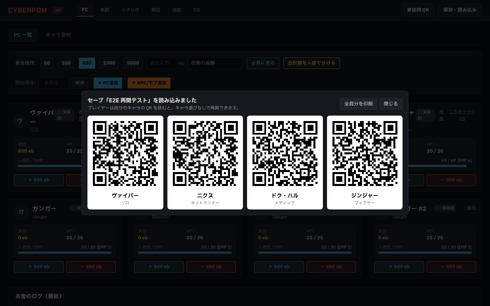
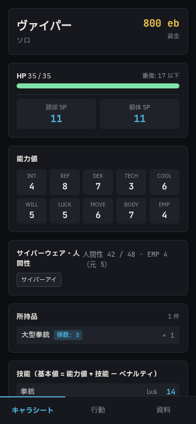

# Phase 5d 報告 01: キャラごとの再開 QR と、シナリオ取り込みの直し

- 作成: 2026-10-21（Claude。agy のクォータ切れの間、ユーザーの判断で Claude が実装）
- ブランチ: `claude/phase5d-resume-qr`
- 指示書: `docs/agy/phase5d-resume-qr.md`

## 1. やったこと（項目ごとのテスト名）

| 指示書 | やったこと | テスト |
|---|---|---|
| §1 QR の中身 | `GET /api/session/pc-qr`（GM だけ）: PC ごとに `…/player?join=<今のコード>&pc=<キャラ ID>` と QR の SVG。開くたびに今のコードで作る（保存ファイルには入れない） | `lists one resume URL per PC with the current session code, and a new code after a restart`、`is GM only` |
| §1 出す場所 | 保存の読み込みが終わると、PC ごとの QR を並べた画面を出す（それまでの「読み込みました」のダイアログの代わり）。PC タブの各 PC に「このキャラの QR」（1 人分） | E2E `Resume QR: after loading a save…` |
| §1 印刷 | 「全員分を印刷」: QR と名前を並べた印刷用のページを開いてブラウザの印刷を出す | （印刷ダイアログは E2E で扱えないので手で確認が必要） |
| §1 読んだとき | スマホは `pc` があればキャラ選びを飛ばしてそのキャラで参加する。ほかの端末が使っていれば、これまでどおり GM に確認が出る（勝手に奪わない） | E2E（キャラ選びが出ずにヴァイパーのシートが開く）、`claims the PC from the QR URL without the character list` |
| §1 使えないキャラ | NPC・モブの ID は 400、ない ID は 404。スマホは理由を出してキャラ選びに戻る。あわせて、これまで NPC もスマホで選べてしまっていたのを止めた（`/api/auth/claim` は PC だけ） | `refuses NPCs and unknown characters…` |
| §2 取り込みの ID | 取り込みで手がかりとハンドアウトにも新しい ID を振り、選択肢の結果（`reveal_clue`・`reveal_handout`）の参照を付け替える。複製も同じ処理を使うように共通化した（`insertScenarioCopy`）。複製にも同じ漏れがあった | `re-keys clue and handout references when a scenario is exported and imported`（取り込みと複製の両方） |

## 2. あわせて直したこと（テストの隔離）

- **保存ファイルの置き場所が分かれていなかった**: 保存ファイルは DB にかかわらず `data/saves` に書かれていた。agy のフォルダ（本番のサーバも同じフォルダ）でテストを流すと、テスト用の保存ファイルが本番の `data/saves` に入っていた（165 個。DB からは参照されていない）。さらに自動保存のファイル名は `auto.cpgm-save` で固定なので、テストが本番の自動保存のファイルを上書きしうる状態だった。`SAVES_DIR` を足し、単体テストと E2E は一時フォルダを使う。本番の自動保存は今のところ本番のサーバが 09:38 に書いたもので、テストのものではないことを確認した。残っている 165 個はマージ後に Claude が片付ける。テスト `writes save files to SAVES_DIR during tests, not to data/saves`
- **E2E の DB が実行ごとに散らかっていた**: 前の実行のキャラ（キャラ作成のテストの Alt Cunningham など）・保存・戦闘が残り、商店の E2E が「一覧の 1 人目」に買わせると別のキャラに入る、などで落ちていた。`global-setup.ts` で毎回キャラ・保存・進行・戦闘・盤面を消し、デモの PC 4 人を入れ直す（品目のカタログはそのまま）
- 5c のテストの初期化: 単体テストの品目は E2E の DB から写すので、前の編集を消してから下書きを入れる

## 3. 結果

- `npm run lint`: エラー 0
- `npm run typecheck`: エラー 0
- `npm test`: 29 ファイル 189 件すべて成功（5d の新規 5 件、保存先の確認 1 件）
- `npx playwright test`: 10 件すべて成功（2 回続けて実行）

## 4. スクリーンショット

- 読み込み後の QR の一覧（1440px）: 
- QR から開いたスマホ（390px）: 

## 5. 確認してほしいこと

- 印刷用のページは白地に黒の QR、3 列。実機のプリンタで読めるかを見てほしい
