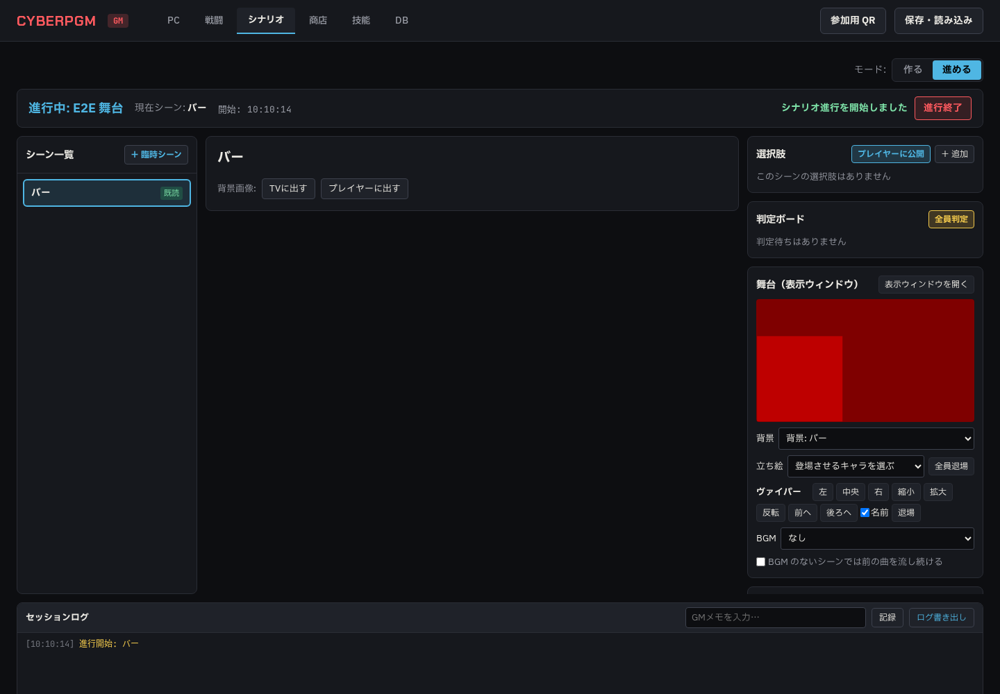
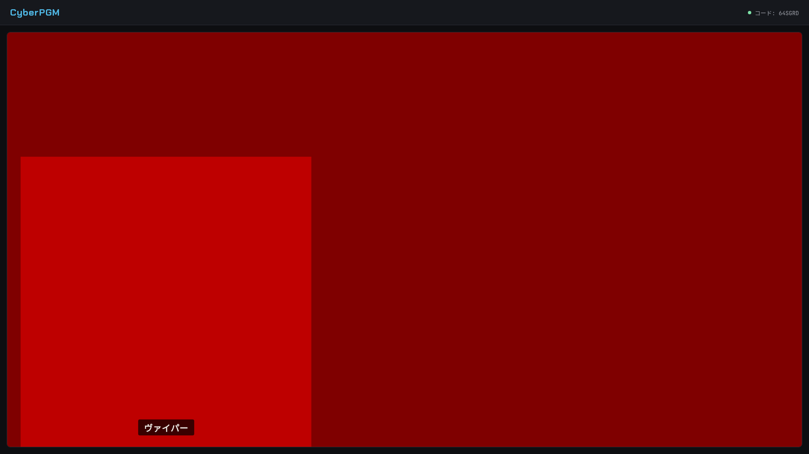
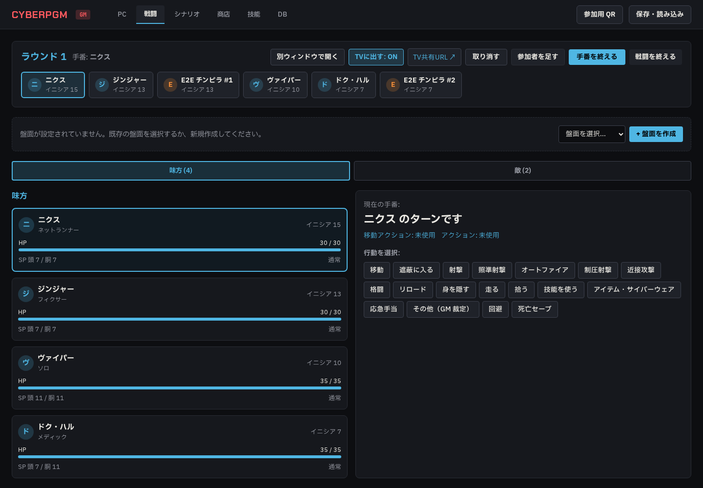
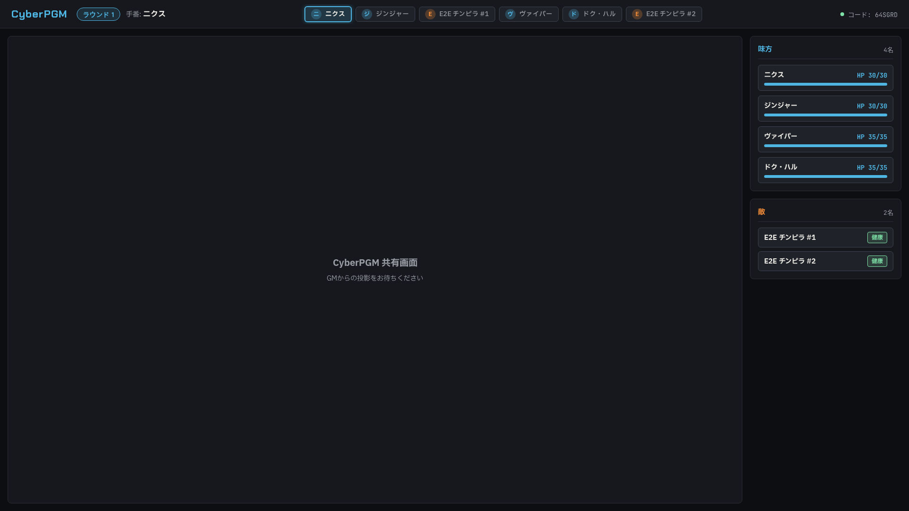

# Phase 5e 報告 01: 表示ウィンドウ（背景・立ち絵・BGM）と戦闘の途中参加

- 作成: 2026-10-21（Claude。agy のクォータ切れの間、ユーザーの判断で Claude が実装）
- ブランチ: `claude/phase5e-stage-display`
- 指示書: `docs/agy/phase5e-stage-display.md`

## 1. やったこと（項目ごとのテスト名）

| 指示書 | やったこと | テスト |
|---|---|---|
| §1 表示ウィンドウ | `/screen` をそのまま使う。進行中は背景と立ち絵、戦闘中は盤面（戦闘が始まると自動で切り替わり、終われば戻る）。ボタン・選択欄・GM の数値は出さない（BGM があるときだけ「クリックして音声を有効にする」を 1 回出す） | E2E `Stage display…`（`select, input, textarea` と `button` が 0 個） |
| §2 背景・立ち絵 | GM の進行画面に「舞台」パネル（`StagePanel`）。背景を選ぶ、立ち絵のあるキャラを登場させる、プレビューの上でドラッグして動かす、左・中央・右、拡大・縮小、反転、前へ・後ろへ、名前の表示、退場・全員退場、「表示ウィンドウを開く」 | `clicking a scene shows its background, saved portraits and BGM…`、E2E |
| §2 配置の保存 | 立ち絵の配置は `scenes.stage` に保存し、シーンに戻ると戻る | `saves portrait moves to the scene and restores them when coming back` |
| §2 立ち絵の画像 | `characters.portrait_image_id`。PC タブの編集で選ぶか登録する（登録した画像は「プレイヤーにも見せる」で入れる） | E2E（PATCH で設定した立ち絵が出る） |
| §2 本のスキャン | `visibility = gm` の画像は表示ウィンドウに送らない。舞台パネルに「プレイヤーにも見せる」（最初の 1 回だけ私的利用の確認） | `does not send GM-only portraits until the GM lets players see the image` |
| §2 GM だけ | 舞台パネルは GM のメインウィンドウだけ。戦闘の別ウィンドウにもスマホにも出さない | E2E（`/gm/combat` に `stage-panel` がない） |
| §2.5 BGM | 音声ファイル（mp3 / ogg / m4a / wav、30MB まで、拡張子と中身の先頭のバイトを確認）を `data/audio/` に登録。シーンの編集に「BGM」（曲・ループ・音量・登録）。シーンをクリックすると背景・立ち絵・BGM が切り替わる。曲の切り替え・停止は 1.5 秒のフェード。BGM のないシーンでは止める（「前の曲を流し続ける」も選べる）。舞台パネルで再生・停止・音量・その場の差し替え（シーンの設定は変えない）。戦闘の設定に `bgm` があればその曲、なければストーリーの曲を流し続ける | `accepts mp3 / ogg / m4a / wav only when the content matches the extension`、`stops the BGM on a scene without one, unless the GM keeps it playing` |
| §3 途中参加 | 戦闘画面に「参加者を足す」（PC・NPC・モブと人数、味方か敵、PC はイニシアチブの出目を入れるか空欄でアプリが振る）。行動順に差し込み、今の手番の人は変えない。モブは 4a と同じく 1 体ずつ複製。コマは「未配置の参加者コマを配置」で置く。取り消せる | `joins mooks mid-combat into the order without changing whose turn it is, and undo removes them`、`asks for the extra die when a given initiative roll is 10 or 1`、E2E（別ウィンドウと TV に出る） |
| §3 退場 | 参加者カードの詳細に「退場させる」。グレーになり手番を飛ばす。取り消せる | `marks a participant as left and undo brings them back` |

## 2. あわせて直したこと

- **TV の背景が出ていなかった**（5b）: 表示ウィンドウに画像のパス（`user/xyz.png`）をそのまま渡していて、読み込めていなかった。画像の ID を渡し `/api/images/:id` で読む
- **商店の検索の結果が古い結果で上書きされることがあった**: 最初の一覧の読み込みが検索より後に終わると、検索欄は「Heavy Pistol」なのに全件が出ていた（E2E がときどき落ちた原因）。最後に出した要求の結果だけを使う
- 保存の読み込みで、シーンの `is_adhoc`（5b）が戻っていなかった。`stage`・`bgm`・キャラの立ち絵と一緒に戻す
- テストの音声は一時フォルダ（`AUDIO_DIR`）、E2E は毎回店も片付ける、E2E の失敗時にスクリーンショットを残す
- ルートの `npm run build` で、先に shared と rules を作る

## 3. 結果

- `npm run lint`: エラー 0
- `npm run typecheck`: エラー 0
- `npm test`: 29 ファイル 192 件すべて成功（5e の新規 8 件）
- `npx playwright test`: 11 件すべて成功（3 回続けて実行）

## 4. スクリーンショット

- 舞台パネル（1440px）: 
- 表示ウィンドウのストーリー（1920px）: 
- 戦闘中の途中参加（1440px）: 
- 表示ウィンドウの戦闘（1920px）: 

## 5. 確認してほしいこと

- BGM の初期の音量は 70 にした（音量は GM が変えられる）
- 立ち絵の大きさは表示ウィンドウの高さの 70% を 1 倍にした
- 実際の音（フェードの具合）は実機で聞いて確かめてほしい（E2E では音は確かめられない）
