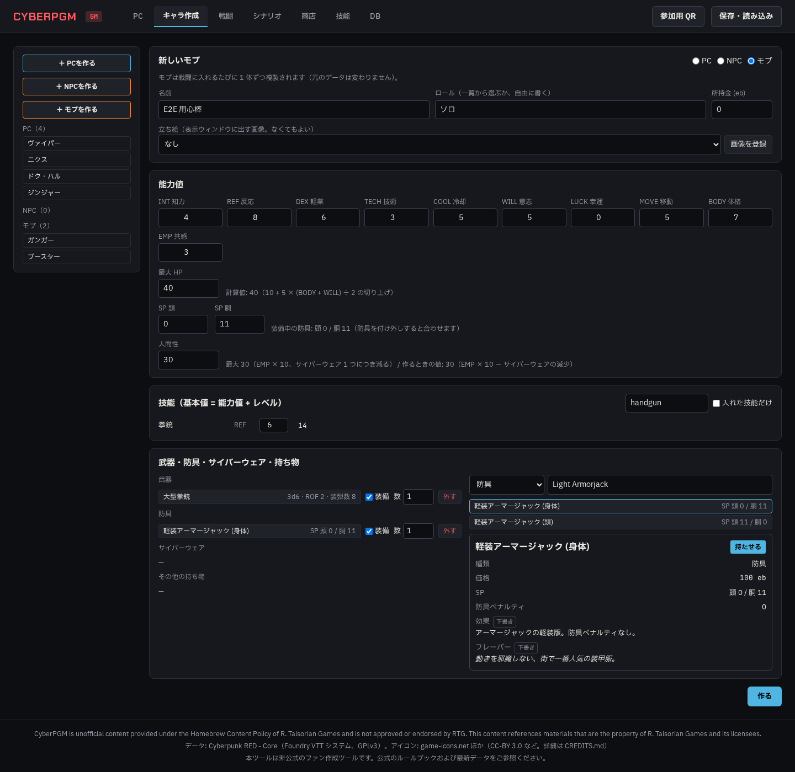
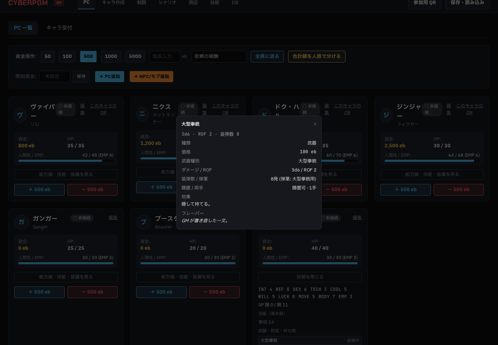

# Phase 5f 報告 01: キャラ作成タブと PC の装備の詳細

- 作成: 2026-10-21（Claude。agy のクォータ切れの間、ユーザーの判断で Claude が実装）
- ブランチ: `claude/phase5f-character-editor`
- 依頼（2026-10-21 ユーザー）: 「キャラクター作成タブもいるね。NPCはあるけど、これ、武器や装備を選べない。選んだときに装備の詳細なども記載して欲しい。後、プレイヤーの装備とかの情報がPCから見れない」

## 1. やったこと（項目ごとのテスト名）

| 依頼 | やったこと | テスト |
|---|---|---|
| キャラ作成タブ | GM の画面に「キャラ作成」タブ（スマホの下のタブは「作成」）。PC・NPC・モブを作る・直す。左に種類ごとの一覧と「＋ PC を作る」「＋ NPC を作る」「＋ モブを作る」 | E2E `Character editor: build a mook…` |
| 能力値 | 10 の能力値は空欄から入れる（決まった値は入れない）。入れ終わるまで「作る」は押せず、「未入力: …」を出す。範囲は 1〜10（LUCK は 0〜10） | E2E（空欄で押せない）、`rejects stats out of range instead of filling in a value` |
| HP | 最大 HP は 10 + 5 × (BODY + WILL) ÷ 2 の切り上げ（FVTT `cpr-actor.js` と同じ。`hpMaxFromStats` に入れ、プレイヤーのキャラ作成の承認でも使う）。新しく作るときは計算値が入り、GM が書き換えられる。直すときは今の値のまま（本の NPC の HP を勝手に変えない）で、「計算値にする」で合わせられる | `hpMaxFromStats`、E2E（`計算値: 40`） |
| 技能 | 技能の一覧（名前・能力値・レベル・基本値 = 能力値 + レベル）。探す・入れた技能だけを出す | E2E（拳銃 6 → 基本値 14） |
| 武器・装備を選ぶ | 品目の一覧（武器・防具・サイバーウェア・ギア・衣服・弾薬・ドラッグ・サイバーデッキ・プログラム・改造パーツ・乗り物）から名前で探す。選ぶと性能（ダメージ・ROF・装弾数・武器種別・隠匿・両手 / SP・防具ペナルティ / 人間性の減少・部位）と効果・フレーバー（5c）が出て、「持たせる」で入る。持たせた武器・防具は「装備」、数、「外す」 | E2E（大型拳銃と軽装アーマージャック） |
| SP | 防具を付け外しすると SP を装備中の防具（シールドを除く）のいちばん高い値に合わせる。手で書き換えもできる | E2E（SP 胴 11） |
| サイバーウェア・人間性 | サイバーウェアは品目から選ぶ。最大人間性は EMP × 10 からボーグウェア 1 つにつき 4、ほかのサイバーウェア 1 つにつき 2 を引く（rules の `maxHumanity`）。新しく作るときの人間性は EMP × 10 − サイバーウェアの決まった減少（プレイヤーのキャラ作成と同じ） | `saves catalog equipment and counts borgware against max humanity` |
| 名前だけの武器 | 以前のデータ（デモの PC、本の NPC）の「名前だけの武器」は、キャラ作成タブで「品目から探す」→ 選んだ品目に置き換える | E2E `Character editor: replace a name-only weapon with a catalog item` |
| PC から装備を見る | PC タブのカードに「能力値・技能・装備を見る」。能力値、SP、技能（基本値）、武器・防具・持ち物（装備中・数）、サイバーウェア。品目をクリックすると性能・効果・フレーバーの窓（戦闘カードと同じ窓） | E2E（PC タブで大型拳銃の窓） |
| 編集・追加の入口 | PC タブの「編集」「＋ PC 追加」「＋ NPC/モブ追加」はキャラ作成タブを開く | E2E（「編集」でキャラ作成タブ） |

## 2. あわせて直したこと

- **NPC/モブ追加と PC 追加の小窓をなくした**: 決まった能力値（INT 4、TECH 3、全部 6 など）と技能（`Handgun: 4` など、カタログのキーと合わない名前）を勝手に入れていた。キャラ作成タブに置き換えた。以前の小窓で入った「Handgun」などの技能名は、キャラ作成タブで開くとカタログのキー（`handgun`）にそろえる（保存したときに直る）
- **ボーグウェアの最大人間性**: シートの計算で種類を渡していなかったため、ボーグウェアが 4 でなく 2 で数えられていた
- 戦闘カードの品目の窓をキャラ作成・PC タブと同じ部品（`ItemDetailPopup`）にした。品目 ID のない持ち物は、名前がぴったり同じ品目があればそれを出し、なければ「品目と結び付いていない」と出す

## 3. 結果

- `npm run lint`: エラー 0
- `npm run typecheck`: エラー 0
- `npm test`: 30 ファイル 195 件すべて成功（5f の新規 3 件）
- `npx playwright test`: 13 件すべて成功（3 回続けて実行）

## 4. スクリーンショット

- キャラ作成タブ（1440px）: 
- PC タブの詳細と品目の窓（1440px）: 

## 5. 確認してほしいこと

- 本の NPC の武器（ユニティ、ミリテク クラッシャー、ゴリラアーム、モノワイヤーなど）は品目の一覧に同じ名前がないので、自動では結び付けていない。キャラ作成タブの「品目から探す」で GM が選ぶ
- 「キャラ作成」タブにはキャラの削除を付けていない（依頼になかったため）
