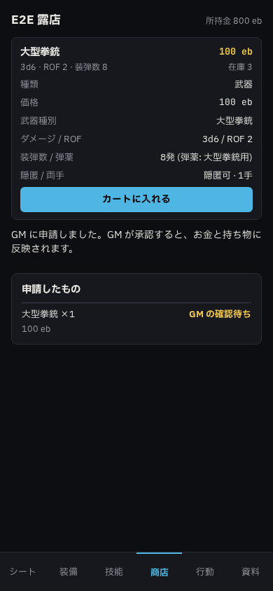
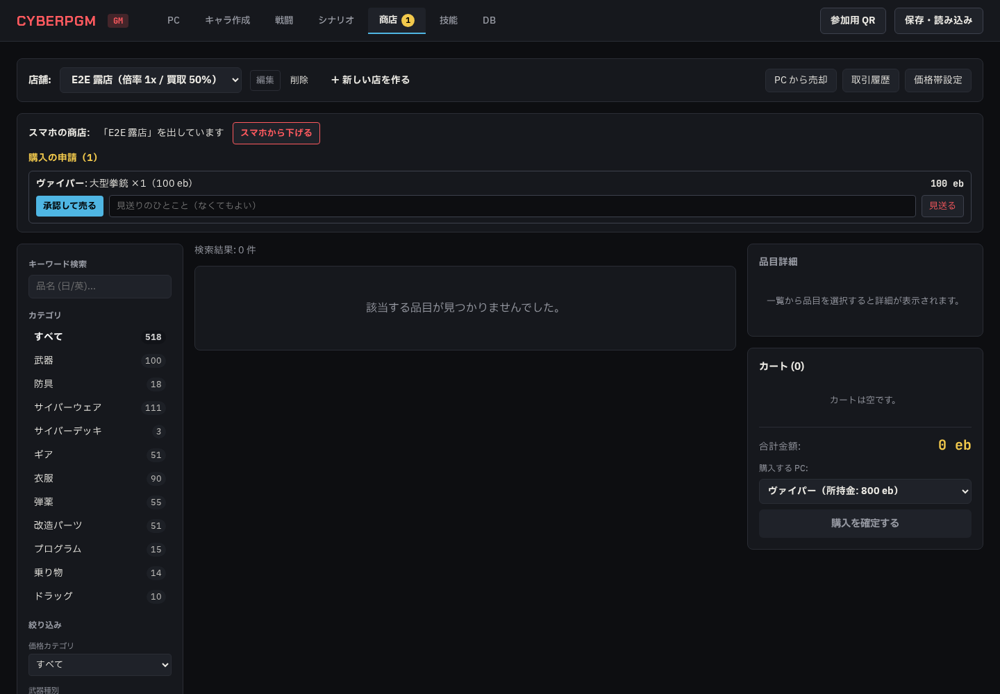
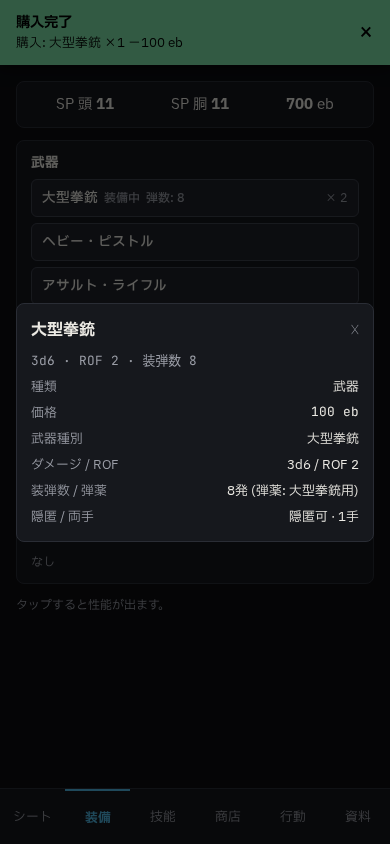
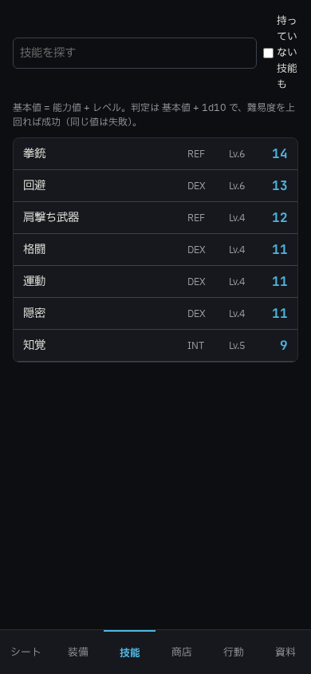
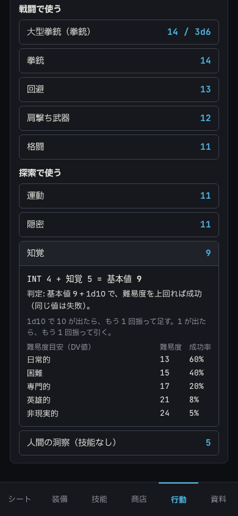

# Phase 5g 報告 01: スマホの装備・技能・商店と、行動の「使える技能」

- 作成: 2026-10-21（Claude。agy のクォータ切れの間、ユーザーの判断で Claude が実装）
- ブランチ: `claude/phase5g-player-tabs`
- 依頼（2026-10-21 ユーザー）:
  - 「プレイヤー画面はショップや、装備品、自分のスキル一覧なども加えて下さい。」
  - 「行動に関して、戦闘や探索で使えるスキルをプレイヤー画面で表示するようにして。ボタンを押すと計算式等が表示されるように。」
- 決めたこと（2026-10-21 ユーザー回答）: 購入は GM に申請 / 出すのは GM が開いている店の在庫だけ / 品目は性能だけ見せる（効果・フレーバーは GM だけのまま）

## 1. やったこと（項目ごとのテスト名）

| 依頼 | やったこと | テスト |
|---|---|---|
| 下のタブ | スマホの下のタブを シート / 装備 / 技能 / 商店 / 行動 / 資料 にした。シートにあった所持品・技能・武器は「装備」「技能」へ移した | E2E `Player phone: …`、既存の E2E を新しいタブに合わせた |
| 装備 | SP・所持金、武器・防具・サイバーウェア・持ち物（装備中・弾数・数）。タップで性能の窓（効果・フレーバーは出さない） | E2E（買った大型拳銃の窓に `item-notes` がない） |
| 技能 | 技能の一覧（能力値・レベル・基本値）。探す、「持っていない技能も」（能力値だけで振る値） | E2E（拳銃の基本値 = REF + 技能） |
| 商店（スマホ） | GM が出した店の在庫と値段（店の倍率込み）・在庫数。品物を開くと性能、カート、「GM に購入を申請する」。申請したものと結果（確認待ち / 買えました / 見送り + GM のひとこと） | `shows nothing until the GM opens a shop…`、E2E |
| 商店（GM） | 商店タブに「スマホの商店」: 選んでいる店を「スマホに出す / スマホから下げる」。届いた申請を「承認して売る」（今までの購入と同じ処理: 資金・在庫・所持品・お金のログ・通知）か「見送る」（ひとこと付き）。サイバーウェアは「その場で取り付ける」を選べる。商店タブに申請の数 | `does not buy on request; the GM approves…`、`rejects with a comment and refuses requests over stock or funds`、E2E |
| 行動の「使える技能」 | 行動タブに「戦闘で使う」（持っている武器と、その武器の技能・ダメージ、戦闘系の技能。回避と格闘は技能がなくても出す）と「探索で使う」（認識・身体・社会・技術などの持っている技能。知覚・人間の洞察・隠密・運動は技能がなくても出す）。戦闘中は戦闘を上に出す。押すと計算式（能力値 + 技能 = 基本値、負傷のペナルティ）、判定の仕方（1d10、10 と 1 の振り足し、同じ値の扱い）、難易度目安（DV値）ごとの成功率。武器は攻撃の比べ方とダメージ、回避は使える場面 | E2E（大型拳銃: `REF 8 + 拳銃 6 = 基本値 14`、知覚） |

ルールの値は rules の定数（`tieRule`、`opposedTieWinner`、`rangedDodgeMinRef`）と `successProbability` から出す。難易度目安（DV値）の表はストーリー判定と同じもの（イージー・モード p.15）。

## 2. あわせて直したこと

- **技能タブの説明の誤り**（このフェーズの途中で書いたもの）: 「難易度以上なら成功」と書いていたが、ルール設定は「同じ値は失敗」。設定から文を出すようにした
- **GM 用の在庫の一覧が効果とフレーバーを GM 以外にも返していた**（`GET /api/shops/:id/stock`）: GM 以外には外す
- **買った品目に種類が入っていなかった**: 商店で買った武器が「持ち物」に入っていた。種類（武器・防具など）を入れる
- 購入の処理を関数（`executePurchase`）にして、GM の購入と申請の承認で同じ処理を使う

## 3. 結果

- `npm run lint`: エラー 0
- `npm run typecheck`: エラー 0
- `npm test`: 31 ファイル 198 件すべて成功（5g の新規 3 件）
- `npx playwright test`: 14 件すべて成功（3 回続けて実行）

## 4. スクリーンショット

- スマホの商店（390px）: 
- GM の申請（1440px）: 
- スマホの装備（390px）: 
- スマホの技能（390px）: 
- 行動の「使える技能」（390px）: 

## 5. 確認してほしいこと

- 申請の値段は申請したときの値段で売る（申請のあとで店の倍率を変えても、その申請は変わらない）
- サイバーウェアを「その場で取り付ける」ときの人間性の減少は、品目の決まった値を使う（今までの GM の購入と同じ）。品目に決まった値がないときは、以前からの購入の処理が 2 を使っている（根拠のない値。今のカタログのサイバーウェア 111 件はすべて値があるので、実際には使われない）
- デモの PC の「名前だけの武器」（ヘビー・ピストルなど）は品目と結び付いていないので、行動の「戦闘で使う」には出ない。キャラ作成タブで品目に置き換えると出る
