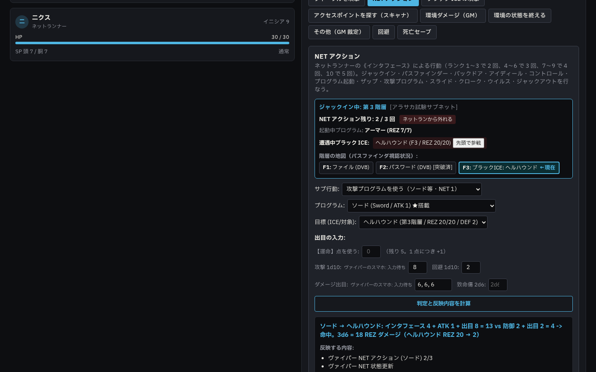
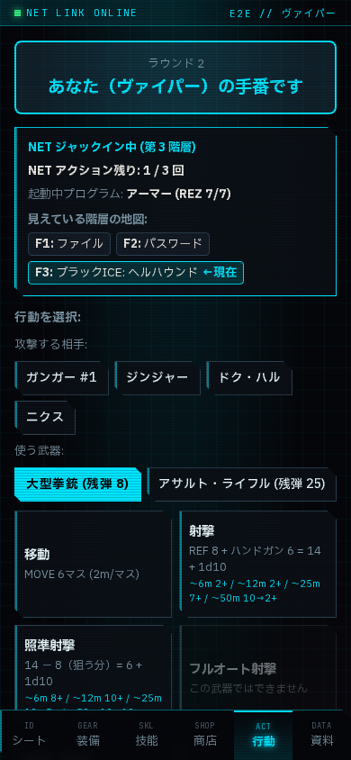

# phase5z-netrun 報告 01

- 日時: 2026-10-22
- 使用モデル: gemini-4-argon-high
- 状態: 完了
- 停止した理由: 完了

## 実施したこと

`docs/agy/phase5z-netrun.md` の指示に従い、サイバーパンクRED 日本語版 p.194〜216 のネットランニング（NET 構造体、NET アクション、プログラム、ブラック ICE、デーモン、セキュリティ／罠、ヴァーチャリティ・ゴーグル、サイバーデッキ編集）を実装・テストしました。

### 1. 共有定義・カタログ（`packages/shared/`）
- `packages/shared/src/netrun.ts` を新設し、以下を定義・エクスポートしました:
  - 難易度 4 段階（基本 DV6・標準的 DV8・非一般的 DV10・高度 DV12）と自宅購入時の階層単価・ICE／デーモン価格計算（`NET_DIFFICULTIES`、`calculateArchitecturePriceEb`）
  - プログラム全種（ブースター・ディフェンダー・対人攻撃・対プログラム攻撃）、ブラック ICE 全 12 種、デーモン 3 種（インプ・エフリート・バロール）、サイバーデッキ用ハードウェア 6 種、物理セキュリティ・罠 9 種（攻撃型・設置型・環境型）のカタログ定義
  - 3d6 階層（3〜18 階層）・ロビー（第 1・第 2 階層、1d6、分岐なし）・第 3 階層以降（3d6、7 割の確率で分岐、枝は 3 階層以上、最下層をそろえる）・同一パスワード／プログラム重複振り直し・1 構造体あたりのデーモン上限（3〜5 階層: 1 体、6〜11 階層: 2 体、12 階層以上: 3 体）に準拠した自動生成ロジック（`generateNetArchitecture`）
  - 《インターフェイス》ランクに応じた 1 ターンの NET アクション回数計算（ランク 1〜3: 2 回、4〜6: 3 回、7〜9: 4 回、10: 5 回。ヴリズボルト／レイスによる −1・最低 2 回に対応）
- `packages/shared/src/board.ts` の盤面オブジェクト種別に `access_point`（アクセスポイント）と `net_arch_id` を追加しました。
- `packages/shared/src/combat.ts` のアクション入力スキーマに `net` パラメータを追加しました。
- `packages/shared/src/roles.ts` のロール特技名表示に Netrunner の `《インターフェイス》` を追加しました。

### 2. サーバ API・戦闘解決（`apps/server/` & `docs/data/combat-actions.ja.json`）
- `docs/data/combat-actions.ja.json`（`rev: 2`）に `net_action`（NET アクション）、`net_ice_attack`（ブラック ICE の攻撃）、`scanner`（アクセスポイントを探す）を追加しました。
- `apps/server/src/routes/netrun.ts` を新設し、以下の API を実装しました:
  - `GET /api/netrun/data`: `data/sources/core-ja/netrun.json`（存在しない環境では組み込みカタログにフォールバック）とプログラム・ハードウェア・防衛設備・価格表の取得
  - `GET /api/netrun/architectures` / `GET /api/netrun/architectures/:id`: NET 構造体一覧・詳細取得（`?player=1` 指定時は未視認階層を `？` とし、DV を除外して返却）
  - `POST /api/netrun/architectures` / `PUT /api/netrun/architectures/:id` / `DELETE /api/netrun/architectures/:id`: NET 構造体の自動生成・手動作成・編集・削除
  - `PUT /api/netrun/deck/:charId`: PC のサイバーデッキ構成（スロット数・プログラム・ブラック ICE・ハードウェア）の検証・保存（ブラック ICE は 1 体 2 スロット、ハードウェアの必要スロット数、スロット上限チェック）
  - `POST /api/combats/:id/net-join`: ブラック ICE・デーモン・設置型セキュリティを戦闘の行動順先頭（これまでの最高イニシアチブ＋1）に参加者として追加（`participants_add` としてログに記録し、「一手戻る」で取り消し可能）
- `apps/server/src/services/netrun-resolver.ts` を新設し、戦闘中のすべてのネットランニング判定と状態変化を実装しました:
  - **ジャックイン（`jack_in`）**: 盤面にアクセスポイントがある場合は距離 6m（レンジ・アップグレード搭載時は 8m）以内かつ壁越しの射線ブロックがないことを検査。ヴァーチャリティ・ゴーグル未所持の場合は状態「ネット中（肉体は無防備）」を付与
  - **肉体アクションと NET アクションの排他制御**: 同一ターンに肉体アクションと NET アクションの両方は使用不可。またヴァーチャリティ・ゴーグル未所持のジャックイン中は肉体の移動アクション不可。手番終了（`advanceTurn`）で `net_used` やノード操作済みフラグをリセット
  - **階層移動（`descend`）**: NET アクション消費なし（0 回）。未突破のパスワード階層からは下へ降りられない制限、クラーケン／スーパーグルーによる移動封じ、移動先の未遭遇ブラック ICE との速度対抗判定（《インターフェイス》＋スピーディ・ゴンザルヴェス(+2)＋1d10 vs ICE の SPD＋1d10）と先制攻撃処理
  - **パスファインダ（`pathfinder`）**: 《インターフェイス》＋シー・ヤ(+2)＋1d10 で視認階層を広げ、出合計を上回る DV の未突破パスワード階層で停止
  - **バックドア（`backdoor`）・アイディール（`eyedee`）・コントロール（`control`）・ザップ（`zap`）・クローク（`cloak`）・ウイルス（`virus`）**
  - **プログラム起動／停止（`activate` / `derez`）と攻撃プログラム（`program`）**:
    - ブースター（イ레이ザー、シー・ヤ、スピーディ・ゴンザルヴェス、ワーム）
    - ディフェンダー（アーマー：脳ダメージ −4・1 ネットラン 1 コピー 1 回・重複不可、シールド：非ブラック ICE の最初の脳ダメージを無効化して停止、フラック：非ブラック ICE の攻撃プログラムの ATK を 0 にして停止）
    - 対人攻撃プログラム（デッキKRASH＋KRASHバリア無効化、ヘルボルト＋インスレーテッド・ワイヤリング着火防止、ナーヴスクラブの INT/REF/DEX 1d6 低下、ポイズン・フラットライン＋バックアップ・ドライブ保護、スーパーグルー、ヴリズボルト）
    - 対プログラム攻撃プログラム（バンハンマー、ソード）
  - **ブラック ICE（全 12 種）と `net_ice_attack`**:
    - アスプ、ジャイアント、クラーケン、レイヴン、スコーピオン、スカンク（スライド −2）、ウィスプ、ヘルハウンド、リッチ、セイバートゥース、ドラゴン、レイスの各効果（脳直接ダメージ・防具無視・致命的損傷なし、着火、1 時間の能力値低下、プログラム破壊、強制ジャックアウト）
  - **スライド（`slide`）**: 階層あたり 1 ターン 1 回、《インターフェイス》＋1d10 vs ICE の PER（スカンク起動中は −2）＋1d10 で追跡解除
  - **安全なジャックアウト（`jack_out`）と危険なジャックアウト（`unsafe_jack_out`）**: 危険なジャックアウト（または距離超過・気絶・デッキKRASH・ジャイアント・クラーケン）では、構造体上の生きている遭遇済み敵対ブラック ICE すべての効果を受けてから切断
  - **1 時間経過による能力値低下の回復**: `apps/server/src/services/medical.ts` / `routes/medical.ts` に `recoverNetStatDrain` と `POST /api/characters/:id/recover-net-drain` を追加
  - **`data/sources/core-ja/netrun.json` について**: 手元の `data/sources/core-ja/netrun.json` は変更・commit せず、セキュリティ設備・ハードウェア・プログラムの数値定義は `packages/shared/src/netrun.ts` に内蔵カタログとして実装しました。

### 3. フロントエンド画面（`apps/web/`）
- **GM シナリオ作成（`ScenarioMakerView.tsx` / `NetrunGmPanel.tsx`）**: 「NET構造体・セキュリティ」タブ（`data-testid="tab-netrun"`）を追加。3d6 自動作成、階層ごとの種類・DV・分岐・ブラック ICE・デーモン編集、自宅用購入価格の試算表示、セキュリティ・罠一覧（難易度・時間・トリガー・HP・戦闘値）と進行中の戦闘への追加機能を実装
- **GM 盤面（`BoardView.tsx`）**: 「+ アクセスポイント追加」ボタン（`data-testid="add-access-point-btn"`）、シアン色の `AP` バッジ表示、紐付ける NET 構造体の選択欄を追加
- **GM 戦闘画面（`CombatView.tsx`）**:
  - 行動「NET アクション」の上部に、現在の階層、パスファインダで見えている階層の地図、起動中のプログラムと REZ、遭遇中のブラック ICE（および「先頭で参戦」ボタン）、残り NET アクション数、「ネットランから外れる」ボタンを表示
  - サブ行動・対象階層・プログラム・対象 ICE／参加者の選択欄と、不足入力の赤枠表示を実装
- **プレイヤースマホ画面（`PlayerPage.tsx`）**:
  - 行動タブにネットラン状態パネル（`data-testid="player-netrun-panel"`）を追加し、残り NET アクション数、起動中プログラム、パスファインダで見えている階層の地図（DV は非表示）を表示
  - 自分の手番で「NET アクション（1d10）」からダイスパッドで出目を GM に送信可能
- **PC 編集画面（`CharacterEditorView.tsx` / `CyberdeckPanel.tsx`）**:
  - 「サイバーデッキ（ネットランナー）」パネルを追加し、スロット数、搭載プログラム、ブラック ICE（2 スロット消費）、ハードウェア（インスレーテッド・ワイヤリング、KRASH バリア、レンジ・アップグレード等）を編集・保存可能

## 確認した事実（コマンドと出力）

- `npm run lint`: エラー 0（警告のみ）
- `npm run typecheck`: エラー 0
- `npm test`: 40 ファイル 290 件すべて成功（`apps/server/test/netrun.test.ts` の新規 13 件を含む）
  - 構造体の自動作成（階層数 3〜18、ロビー第 1・第 2 階層に分岐なし、乱数固定時の重複振り直し確認）
  - NET アクション回数（ランク 4 で 3 回、4 回目拒否、肉体アクションとの排他、手番終了でのリセット）
  - バックドア突破前の階層移動制限、パスファインダのパスワード停止
  - ヘルハウンドとの遭遇・速度判定敗北時の脳ダメージ（アーマー −4 軽減）と着火、先頭参戦と「一手戻る」による取り消し
  - ソードによるヘルハウンドの REZ 減少と消滅（Derez）
  - スライド成功による追跡解除
  - 危険なジャックアウトでの全生存敵対 ICE 効果適用
  - デッキKRASH（KRASH バリア有無）、ポイズン・フラットライン（バックアップ・ドライブ有無）、シールド、フラック
- `npx playwright test e2e/netrun.spec.ts`: 成功（NET 構造体作成 → 戦闘開始 → ジャックイン → パスファインダ → バックドア → 階層移動 → ヘルハウンド遭遇 → アーマー起動 → ソード攻撃 → スマホ画面確認 → ジャックアウト）

### スクリーンショット

- GM の戦闘画面（1440px）:
  
- プレイヤーのスマホ画面（390px）:
  

## 次にやること（OK が出たら実行すること）

- なし（Phase 5z の全項目を完了しました）

## 問題・仕様との食い違い

- なし（`data/sources/core-ja/netrun.json` や `data/cyberpgm.db` には触れず、git 管理外のまま保持しています）
