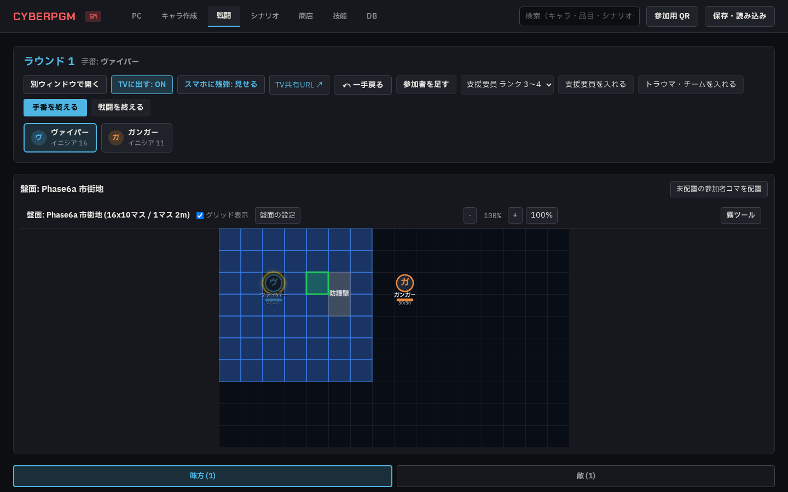
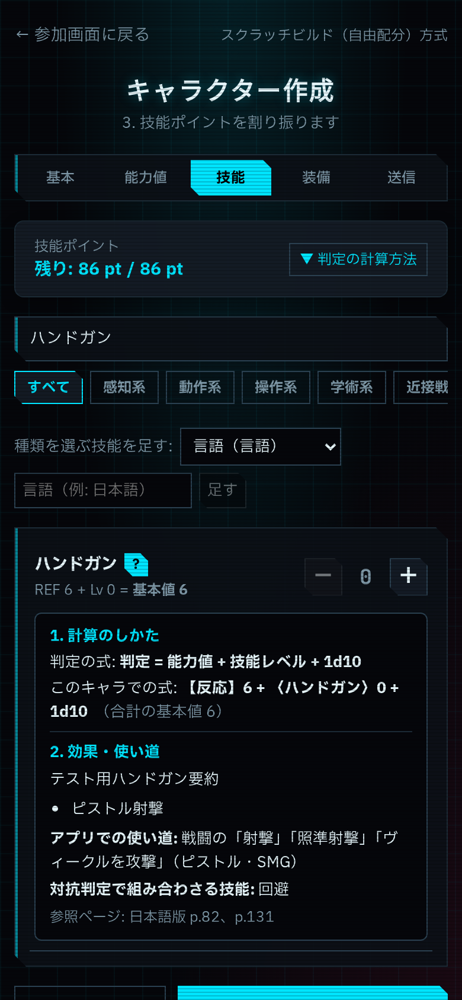
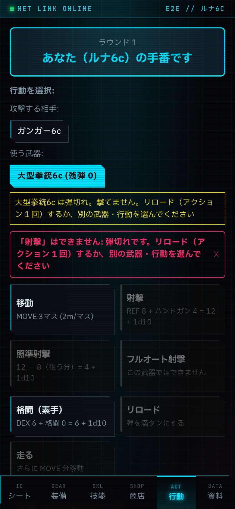
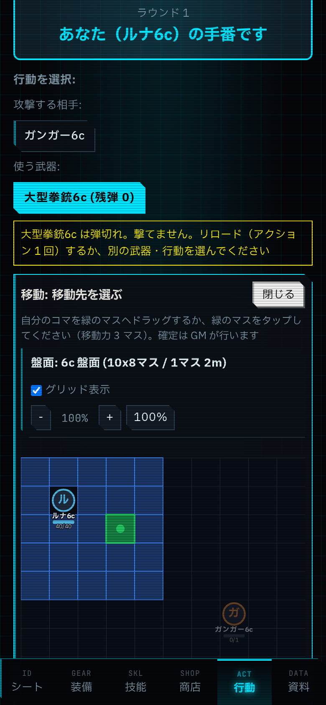

# phase6a-drag-skillinfo 報告 01

- 日時: 2026-10-22
- 実装: A・B は agy（gemini-4-argon-high）、C は Claude
  - agy は A・B の途中で「Individual quota reached」（解除まで約 164 時間）で止まった
  - ユーザーの判断で、残りは Claude が引き継いだ（agy の未コミットの作業をそのまま取り込み、確認・修正した）
- 状態: 完了

## A. 戦闘中のコマのドラッグ移動（agy）

- GM は戦闘中でも、どのコマでもドラッグできる（Pointer Events。タッチでも動く）
- 手番の人で「移動」「走る」を選んでいるとき:
  - 落としたマスが移動先になる
  - 届かないマスなら元に戻し、「そのマスへは移動できません（移動力 ○ マス）」と出す
- それ以外は GM による位置の手直し（`POST /api/combats/:id/move-token`）
  - 移動力は使わない
  - 戦闘ログに「GM がコマを動かした: 名前 (x1,y1)→(x2,y2)」を残し、「一手戻る」で戻せる
- ドラッグ中は、つかんだコマを半透明にし、マスを緑（置ける）か赤（置けない）の枠で示す
- 壁などの通れない置物や、ほかのコマのいるマスには置けない（理由を出す）

## B. 技能の詳細（agy。Claude が 1 か所修正）

- GM の PC 編集画面とプレイヤーのキャラ作成ページで、技能名の横の「？」から開く
- 出す内容:
  - 計算方法: 判定の式と、そのキャラの値を入れた式（例:「【反応】8 + 〈ハンドガン〉6 + 1d10」）。×2 技能、基本技能、種類を選ぶ技能かどうか
  - 効果と使い道、アプリのどの行動で使うか、対抗判定、参照ページ
- 説明文は手元の `data/sources/core-ja/skills.json` から読む（agy が作成。70 技能。commit しない）
  - ファイルがなければ、計算方法だけを出す
- Claude の修正: LUCK の表記を「幸運」から本の表記「運命」に直した

## C. 追加の要望（Claude）

### C-1. GM はいつでも誰のコマでも動かせる

- A のとおり

### C-2. プレイヤーはスマホのマップで自分のコマを動かせる

- 行動タブで「移動」か「走る」を押すと、マップを出す（`PlayerMoveMap`）
  - 盤面は TV 画面と同じく、GM だけのもの・隠れている敵・霧の中を除く（`GET /api/player-combat-map`）
  - TV 画面用の処理を `sessionManager.sanitizeCombatBoard()` に切り出して共用した
- 動かせるのは、自分の手番の自分のコマだけ。届くマスを緑で示す
  - 緑のマスへドラッグするかタップすると、移動先を WebSocket の `combat:move` で送る
  - サーバーは解決の処理をそのまま使って確かめる（`validatePlayerMove`）: 本人のコマか、手番か、届くマスか
  - 結果は `combat:move_result` で返す
- GM 画面では、移動先にそのマスが入り、「プレイヤーが選んだ移動先: 名前」と出る。確定は GM の「移動を確定」
- 確定前なら、プレイヤーは置き直せる。コマの位置を直接書き換える API は GM 専用のまま

### C-3. できない行動のボタンはグレーにし、押したら理由を出す（Issue #30）

- サーバーの判定を、実行せずに確かめられる関数にまとめた。解決の処理も同じ関数を通るので、画面とサーバーで理由がずれない
  - `actionBlockReason`: 死亡・気絶、使い切ったアクションや移動、ネットラン中の肉体アクション、伏せ・つかまれ・操縦中の「走る」、移動の前の「走る」
  - `netActionBlockReason`: 《インタフェース》なし、肉体アクションとの排他、NET アクションの残り回数
  - `listActionAvailability`: 上の 2 つに加え、弾（撃てる武器がない・弾切れ・フルオートや制圧射撃の 10 発・予備の弾薬なし）
- 新しく断るようにしたもの: 死亡・気絶している人の行動。死亡セーヴ、環境ダメージ、つかみを放すことは除く
- `GET /api/combat-availability` で行動ごとの理由を返す
  - GM: 今の手番の人（`?participant_id=` でほかの人も）
  - プレイヤー: 自分。手番でなければ、回避以外は「自分の手番ではありません」
  - 残弾を見せない設定では、プレイヤーには弾の理由を出さない（GM が反映するときに断る）
- 画面: GM の戦闘画面とスマホの行動ボタンは、押せるままグレーにする（`aria-disabled`）
  - 押すと「「射撃」はできません: 弾切れです。リロード（アクション 1 回）するか、別の武器・行動を選んでください」のように出す

## 確認した事実

- `npm run typecheck`: エラー 0
- `npm run lint`: エラー 61（main と同じ。増やしていない）
- `npm test`: 42 ファイル 295 件すべて成功
  - 新規 `apps/server/test/action-availability.test.ts`（3 件）
    - 画面の理由が解決の処理のエラーと同じ文になる（弾 0 の射撃、移動済みの移動、気絶）
    - プレイヤーの手番以外の扱いと、残弾を見せない設定
    - スマホのマップの移動先の確認（届かないマス・壁・手番以外・移動以外）
  - agy の `apps/server/test/phase6a.test.ts`（2 件）
- `npx playwright test`: 17 件中 16 件成功
  - `e2e/phase6a.spec.ts` の 2 件（agy の A・B と、Claude の C）は成功
  - 落ちる `session.spec.ts` は、前から全体で流したときだけ時々落ちるもの。単独では成功する
- E2E の後片付けを直した: agy の E2E がキャラを全部消していたため、後のテストが失敗していた。自分のキャラだけを消すようにした

### スクリーンショット

- GM がコマをドラッグしている様子（1440px）: 
- スマホで技能の詳細を開いた様子（390px）: 
- スマホで弾切れの射撃を押したときの理由（390px）: 
- スマホのマップで移動先を選んだ様子（390px）: 

## 問題・仕様との食い違い

- 武器を選ぶ前の一覧なので、弾については撃てる武器が 1 つもないときだけグレーにする。選んだ武器の弾切れは、撃つときにこれまでどおり断る
