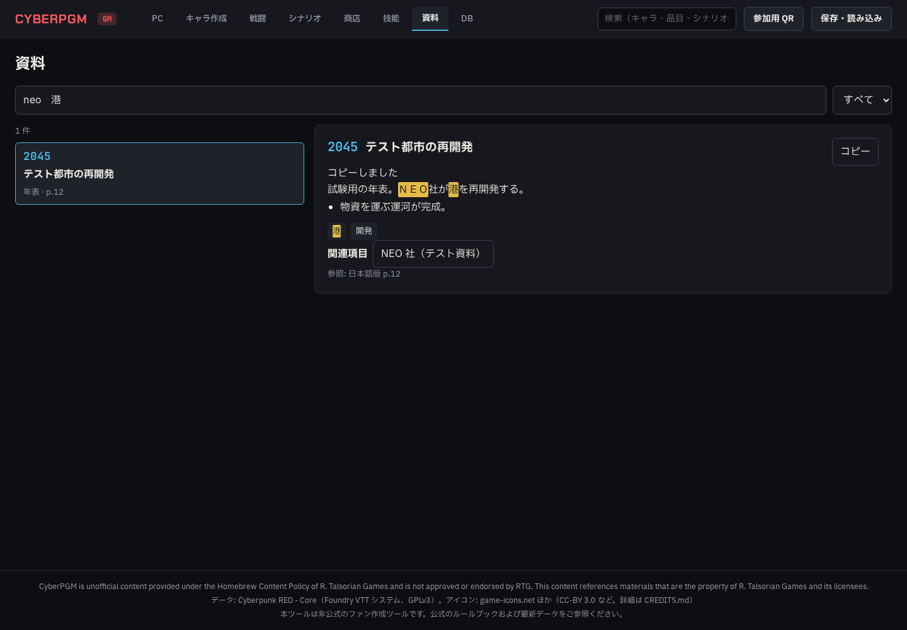
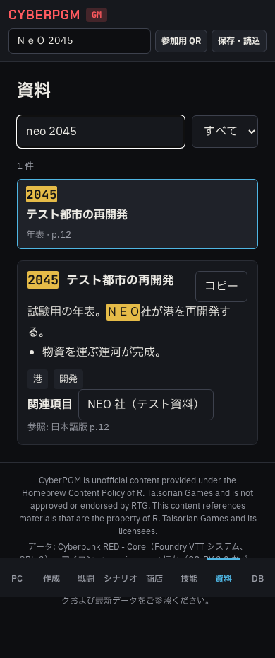
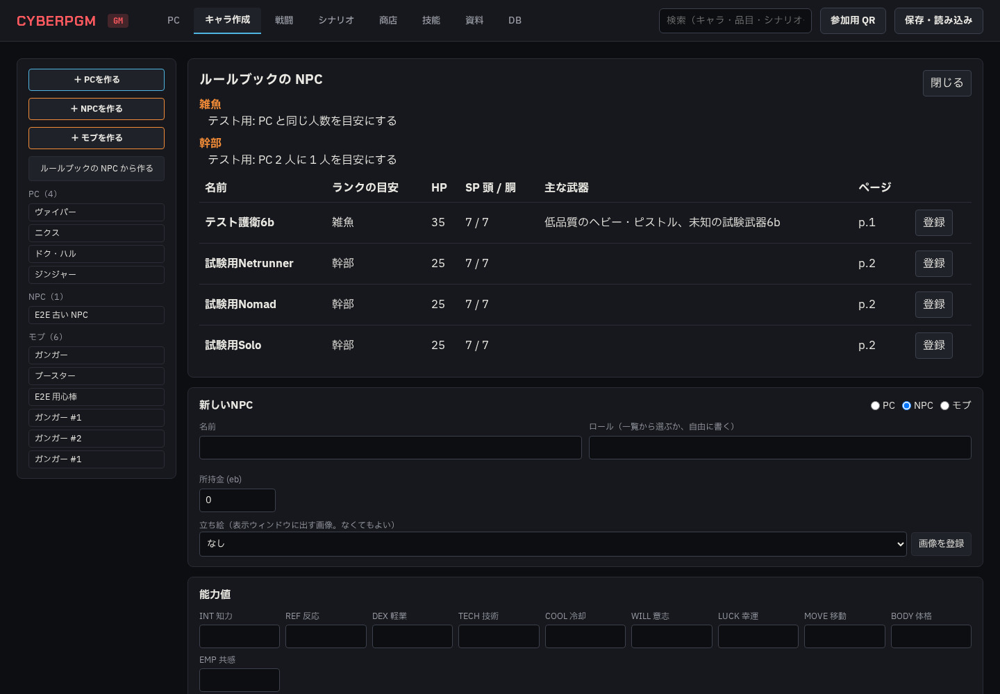

# Phase 6b: 世界観資料・NPC 登録 報告 01

- 日時: 2026-10-23 10:12 JST
- 使用モデル: Codex gpt-6.1-sol
- 作業ブランチ: `agy/phase6b-lore-npc`（変更なし）
- 状態: 完了（実装・自動検証。Claude の監査・実機での UI 確認は未実施）
- 停止した理由: 完了。ただし、検証途中の既存テストによる `data/` への出力があり、下記に記録。

## 実施したこと

### 資料

- `loadLoreData()`、GM 専用 `GET /api/lore` を追加。ファイルなしの場合は `{ entries: [], hasSource: false }`。
- 題名・要約・箇条書き・タグ・年を、NFKC 正規化と小文字化のうえ、空白区切りの AND 条件で検索。分類で絞り込み、年表は開始年順、それ以外は参照ページ順に表示。
- 全文検索に `kind: lore` を追加。分類名・年を表示し、結果を選ぶと資料タブで該当項目を開く。
- GM の PC・スマホ両方に「資料」タブを追加。分類・検索、一致箇所の強調、要約・箇条書き・タグ・関連項目・参照ページ、クリップボードへのコピーを実装。
- 390px では一覧と詳細を縦に配置。既存 GM ヘッダーの検索・QR・保存ボタンも折り返し、横はみ出しを修正。

### NPC

- `loadNpcTemplates()`、GM 専用の一覧取得・登録 API を追加。
- NPC の名前を重複時に「名前 2」「名前 3」と採番。能力値・HP・SP、防具名、`extra.npc_template` を保存。
- 技能名は既存の `skillNameToKey` と `getSkillDef`（`SPECIALIZED_SKILLS` を含む）で解決。技能基本値から対応能力値を引いてレベルを保存し、負値は 0 と注意、未知の技能は未登録と注意にする。
- インターフェイス・モト・コンバット・アウェアネスは通常技能にせず、ロールと `extra.role_ranks` に保存。防具適用済みの能力値・技能欄は使用しない。
- 武器名・既存エイリアスから品目を検索。「低品質の」は所持品の `quality: poor` に記録。未対応武器は名前・ダメージを残して注意を表示。
- 装備・プログラムは一致する品目を所持品に入れ、未対応の文字列は `notes_gm` に保存。防具がカタログになくても名前・SP・ペナルティを保持。
- 所持品の共有型・スキーマに `quality`、`damage`、`armor_penalty` を追加し、読み込み・編集時も失われないようにした。
- キャラ作成タブに NPC 一覧を追加。ランクの目安・HP・SP・主な武器・ページを表示し、登録後は作ったキャラを開いて注意を表示。戦闘参加は既存の手順を使用。

### テストの隔離・後始末

- `CORE_SOURCE_DIR` で手元の資料の読み取り先を切り替え可能にし、単体・E2E は `/tmp` の資料複製・自作フィクスチャを使用。
- 既存の roles・skills・netrun テストを一時資料へ移行。特に skills の「ファイルなし」試験で実ファイルをリネームしないようにした。
- Vitest のカタログ読み込みも、一時コピーの SQLite を ATTACH する形に変更。
- Playwright の資料・ログ出力先を一時フォルダへ指定。別 DB でのサーバー起動時は、本番 DB の日次バックアップを作らない。
- 新しい E2E は、作成した NPC と戦闘の ID を保持して `finally` でそのデータだけを削除。
- 既存 NET E2E がヴァイパーを Netrunner に変えたまま残し、後続の session E2E を失敗させていたため、`afterEach` で変更前のキャラ情報を復元するようにした。
- 既存 FVTT 取込試験の画像・取込報告の出力先を指定できるようにし、試験では一時フォルダへ出力して削除するようにした。修正前の副作用は後述。
- npm パッケージの追加なし。git add・commit・push は未実施。

## 確認した事実（コマンドと出力）

| コマンド | 最終結果 |
| --- | --- |
| `npm run lint` | 終了コード 0。`670 problems (0 errors, 670 warnings)`。開始時も 0 errors / 670 warnings で、増加なし |
| `npm run typecheck` | 終了コード 0。`tsc --noEmit` 成功 |
| `npm test` | 終了コード 0。43 files / 311 tests passed（Phase 6b は 16 tests） |
| `PORT=8788 DATABASE_URL=/tmp/<一時フォルダ>/test-e2e.db npx playwright test` | 終了コード 0。20 passed（40.8s、Phase 6b は 2 tests） |
| `npm run build -w @cyberpgm/web` | 成功。Vite の既存の大きい JS チャンク警告あり |
| `git diff --check` | 成功 |

単体では資料の有無・複数語・タグ・本文・年・英数字の全半角／大小文字・分類・並び・全文検索・GM 権限、NPC の能力値・HP・SP・技能差し引き・種類つき技能・ロール特技・未知データ・装備・採番・防具修正の二重適用防止を確認した。武器が items に存在し weapons の詳細行がない場合も、品目との結び付きを保持することを確認した。

E2E では資料検索→項目表示、関連項目、実際のクリップボード内容、PC タブから全文検索経由の資料表示、390px で横スクロールなし、資料なしの案内、NPC 登録→編集画面→戦闘参加を確認した。

読み取りだけの照合で、手元の `npcs.json` は 10 テンプレートあり、ロール特技を除く技能名は全件既存カタログで解決できることも確認した。

最初の E2E 全体実行は 19 passed / 1 failed（先行 NET 試験によるロール変更の残留）。後始末の修正後、20 件すべて成功した。

### スクリーンショット

本の本文・NPC データをリポジトリへ収録しないため、自作の試験用資料・試験用 NPC で撮影。

資料タブ（1440px）:

資料タブ（390px）:

NPC 一覧（1440px）:

E2E が書き換えた関係ない既存画像 56 枚は復元済み。指定どおり `git checkout -- <対象画像>` を試したが、この環境では `.git` が読み取り専用で `index.lock` を作れず失敗したため、同じ HEAD の内容を `git show HEAD:<対象画像>` で取得し、作業ファイルを復元した。既存画像の `git diff` は空。

## 次にやること（OK が出たら実行すること）

- 実装側の残作業なし。Claude による監査と、ユーザーによる実機 UI 確認。
- 下記の既存テスト出力も監査対象。`data/` をさらに変更しないため、その削除・復元は行っていない。

## 問題・仕様との食い違い

### `data/` 読み取り専用指示に対する検証途中の違反

初期の `npm test` 実行で、既存 `tools/import-fvtt/test/import.test.ts` が DB だけを一時フォルダに分離し、画像・取込報告は `data/` へ出していたことを見落とした。ユーザーの「`data/` は読むだけ」という指示に反する副作用が生じた。

確認できた出力:

- `data/images/fvtt/compendium/weapons/test_pistol.svg` を上書き。ファイルは開始時から存在した。現在の内容は取込試験の自作 SVG フィクスチャと一致するが、開始時の内容のバックアップはない。
- `data/import-reports/` に試験用の報告 JSON を 30 個追加。今回の実行分は `fvtt-2026-10-23T01-05-45-*.json`、`fvtt-2026-10-23T01-07-54-*.json`、`fvtt-2026-10-23T01-09-40-*.json`（UTC）の各 10 個。

取込処理に任意の `imagesDir`・`reportDir` を追加し、試験では `/tmp` を指定するように修正済み。修正後の `npm test` も全件成功し、上記 SVG のサイズ／更新時刻の追加変化、および取込報告の追加がないことを確認した。既存試験の出力先を事前に確認し切れなかった点は実装担当の確認漏れ。

`data/cyberpgm.db` 本体、`data/test-e2e.db`、`npcs.json` は開始時からサイズ・更新時刻とも変化なし。`lore.json`、本番 DB の WAL/SHM、自動保存には作業中の更新時刻変化を観測したが、こちらではこれらへの編集・復元・削除は行っていない。変化の原因は断定しない。

本番ポート 8787 への接続・kill は行っていない。実装・E2E の動作確認は 8788 と `/tmp` の複製 DB で実施。手元のルール資料・DB・本の画像を Git の追加対象にしていない。
