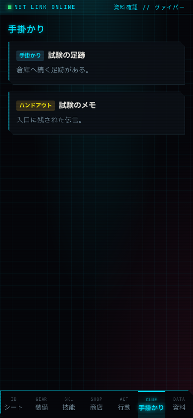
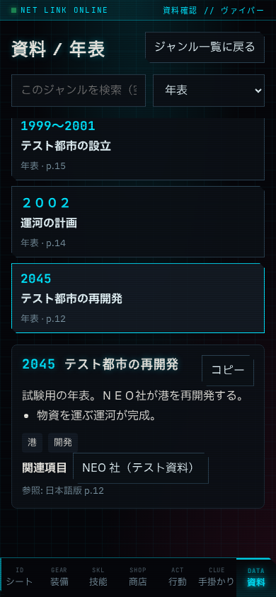
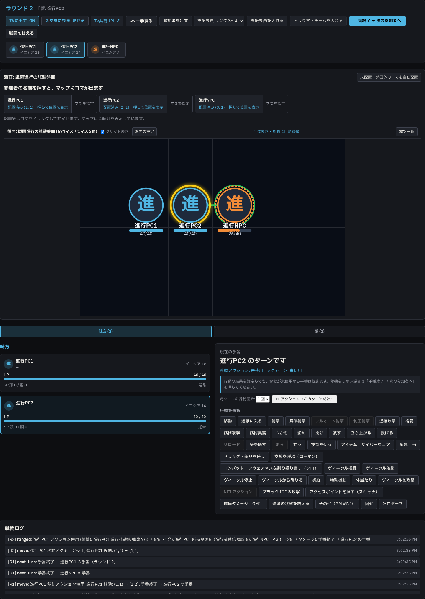

# Phase 6c feedback 報告 01

- 日時: 2026-10-23（JST）
- 使用モデル: GPT-6（Codex）
- 作業ブランチ: `codex/phase6c-feedback`（既存ブランチで作業）
- 状態: 完了
- 停止した理由: 完了。報告と変更をこの作業ブランチへ commit・push して停止する。

## 実施したこと

### A. プレイヤーの「手掛かり」と「資料」

- `PlayerPage.tsx` の `handouts` を「手掛かり / CLUE」、`lore` を「資料 / DATA」に変更した。
- 公開内容の見出しを「手掛かり」、空表示を「まだ公開された手掛かりはありません」に統一した。世界資料側の見出しは wip 時点ですでに「資料」だったため、そのまま使用した。
- 公開済みの手掛かり・ハンドアウトと世界資料の内容、GM の「資料」タブは維持した。公開の同期は既存の `handouts:update` で手掛かり一覧に届く。タブへ誘導する通知や新着印は現行実装にはなく、追加していない。
- `e2e/phase6b.spec.ts` に390pxの確認を追加した。公開前の空表示から、再読み込みなしで試験用の手掛かりとハンドアウトが届くこと、資料の年表を閲覧できること、相互に内容が混ざらないことを確認した。
- 7タブの位置と文字のはみ出しを確認し、スクリーンショットも目視した。390px内に収まる。
- `e2e/scenario-play.spec.ts` の公開手掛かりの移動先を「資料」から「手掛かり」に変更した。`player-tabs.spec.ts` は該当タブ名の指定がなく、修正なしで通った。

### B. 戦闘進行・HP 反映

`e2e/combat-flow.spec.ts` を追加した。自作の試験用PC 2人とNPC 1体、試験用2d6武器（ROF 1、装弾8）、SP 0、初期HP 40を使用する。戦闘の作成・参加者選択・攻撃・移動・手番終了・取り消し・終了は画面から操作した。キャラ・武器・盤面はテストDBで用意し、盤面の紐付けだけGM APIで設定した。

GM は1440px、プレイヤーは390pxの別ブラウザーコンテキストで同時に開き、同期を確認した。

| 指示の項目 | 結果と確認内容 |
| --- | --- |
| 1. PC 2人＋NPC 1体で開始 | 動いた。ほかのPCの参加チェックを外し、PCの出目8・6を入力。NPCの自動出目はブラウザー側の乱数だけ固定して5。行動順が PC1（16）→ PC2（14）→ NPC（7）、ラウンド1・手番0で開始した。 |
| 2. 攻撃の確定とNPCのHP | 動いた。GM画面でPC1がNPCを射撃し、攻撃出目8、ダメージ出目4・3を入力。計算後はHP 40のまま。「確定して反映」で7ダメージとなり40→33。GM参加者カード、プレイヤー本人のトークンで取得する戦闘API、DB `characters.hp` の一致を確認し、スマホの行動結果バナーも表示された。 |
| 3. 移動／手番終了 | 動いた。攻撃だけではPC1の手番が続く。その後、GMの盤面で (1,1)→(1,2) の移動を確定するとPC2へ自動進行した。PC2が移動せず「手番終了 → 次の参加者へ」を押すとNPCへ進んだ。DB・GM・スマホの手番を毎回照合した。 |
| 4. ラウンド更新 | 動いた。NPCの手番を終えるとラウンド1→2、PC1へ戻った。後述のスマホ攻撃と取り消しの後も、全員の手番を終えると2→3になった。 |
| 5. スマホから攻撃 | 動いた。ラウンド2のPC1で移動を先に確定し、スマホでNPCと試験銃を選択。攻撃前に「ダメージ 2d6」が見えることを確認し、出目8をGMへ送信した。GM側の対象・武器に応じた計算と、出目欄にスマホから届いたことを確認。ダメージ4・3をGMが入力して確定するとNPC HP 33→26、同時にPC2へ自動進行。HP照合と両画面の手番確認も成功した。 |
| 6. 一手戻る | **修正前はスマホの手番が戻らなかった。修正後は動いた。** HP 26→33、ラウンド2・PC1へ戻り、移動使用済み／アクション未使用へ復元。GMとDBに加え、スマホも再読み込みなしで「あなた（進行PC1）の手番です」に戻り、射撃を選べる状態になった。 |
| 7. 戦闘終了 | 動いた。「戦闘を終える」の確認で複製モブを削除しない選択をし、DBの戦闘が `ended` になることを確認。GMは「戦闘を始める」に戻り、手番表示が消えた。スマホの行動タブも手番と攻撃対象選択が消え、再読み込みしても古い戦闘が表示されない。 |

敵のHP数値は、現行プレイヤー画面の攻撃対象ボタンには表示されない。したがって項目2・5のスマホ側は、画面の結果通知と、実際に参加したプレイヤーの認証で取得する `/api/combats/current` のHPを確認した。敵HPの数値を画面へ追加する変更はしていない。

#### 再現した不具合と修正

- 再現: スマホからの攻撃でPC2へ自動進行 → GMで「一手戻る」。HPとDB・GMの手番はPC1へ戻るのに、スマホはPC2の手番表示を保持し、自分の行動を選べなかった。修正前のE2Eはこのスマホ表示の検証で失敗した。
- 原因: `PlayerPage.tsx` が `combat:turn` の内容を `combatTurnInfo` として保持し、最新の `currentCombat` より優先していた。一手戻るは `combat:changed` で戦闘データを更新するが、手番通知の保持値は戻らない。
- 修正: 重複した手番通知の状態を廃止し、バナーの名前と自分の行動可否を、取得した戦闘データの `turn_index` と参加者から判断するようにした。`combat:turn` を受けたときの戦闘再取得は残した。
- HPの減算、移動と行動を使った自動進行、ラウンド更新、戦闘終了のサーバー側処理には、この試験で不具合は再現しなかった。

### C. 全体テスト・既存テスト修正

次の2件はwipの振る舞いに既存テストが追従していなかったため修正した。

- `apps/server/test/combat.test.ts`: 判定前の表示が対象名・距離付きになったため、文字列の期待値を現在の表示に合わせた。成功ラインと距離帯の検証は維持した。
- `apps/server/test/phase6b.test.ts`: `/api/lore` はwipでプレイヤーにも閲覧可能になったため、プレイヤーには200、未認証には401/403、NPC・全体検索などGM用のエンドポイントは引き続き401/403を期待するよう修正した。

npmパッケージの追加なし。既存の報告画像17件はE2Eで上書きされたため、指示どおり `git checkout -- docs/agy/reports/img` で戻した。今回の3枚だけを追加する。

## 確認した事実（コマンドと出力）

```text
npm run build -w @cyberpgm/web
✓ built in 1.36s
# 成功。既存の大きなJSチャンクに関する警告あり。

npm run lint
✖ 670 problems (0 errors, 670 warnings)
# 終了コード0。既存の any / unused-vars の警告。

npm run typecheck
> tsc --noEmit
# 終了コード0。

npm test
Test Files  43 passed (43)
     Tests  311 passed (311)
Duration  23.95s
```

```sh
PORT=8790 npm run test:e2e -- \
  e2e/combat-flow.spec.ts \
  e2e/equipment-help.spec.ts \
  e2e/scenario-layout.spec.ts \
  e2e/shop-map.spec.ts \
  e2e/phase6a.spec.ts \
  e2e/phase6b.spec.ts \
  e2e/player-tabs.spec.ts \
  e2e/scenario-play.spec.ts
```

```text
Running 18 tests using 1 worker
18 passed (29.5s)
```

| E2Eファイル | 件数 | 結果 |
| --- | ---: | --- |
| combat-flow.spec.ts | 1 | 成功 |
| equipment-help.spec.ts | 1 | 成功 |
| scenario-layout.spec.ts | 3 | 成功 |
| shop-map.spec.ts | 5 | 成功 |
| phase6a.spec.ts | 2 | 成功 |
| phase6b.spec.ts | 3 | 成功 |
| player-tabs.spec.ts | 1 | 成功 |
| scenario-play.spec.ts | 2 | 成功 |

サンドボックス内ではtsxのIPC・待ち受けとネットワークインターフェース参照が拒否された。必要な許可を得てテストを再実行し、上記の成功結果を得た。検証用サーバーは8790、E2EのDBは `data/test-e2e.db`、画像・保存・音声・ログ・ルール資料の検証用領域は一時フォルダー。単体テストは一時DBを使用した。8787のサーバーの停止・再起動、本番DB・本番画像への書き込みはしていない。E2Eの既存セットアップによる `data/images/fvtt` から一時領域への読み取り専用コピーは実行される。本番DBはテストに使用していない。Tailscale・待ち受けの設定変更なし。

### スクリーンショット

プレイヤー「手掛かり」、390px。公開した試験用手掛かりとハンドアウト、下部7タブを確認。



プレイヤー「資料」、390px。試験用の年表と世界資料の閲覧、下部タブを確認。



戦闘中のGM、1440px。スマホ攻撃後のNPC HP 26/40、ラウンド2・PC2の手番、進行ログを確認。



## 問題・仕様との食い違い

実装を止める必要のある前提不足はなかった。以下は画面文言・表示の**提案のみ**で、実装していない。

- 「判定と反映内容を計算」を押した段階で命中とHPの変化先が出るが、実際のHPは「確定して反映」を押すまで変わらない。プレビュー部分に「まだ反映されていません」と明示する案。今回、計算だけではHP 40のままになることを確認した。
- 攻撃結果の確定後も移動が残っていれば手番が続く。wipの説明と「手番終了 → 次の参加者へ」はあるが、説明は現在の手番欄、終了ボタンは画面上部にあり、縦長の画面で離れる。残っている操作や手番終了ボタンを結果付近にも表示する案。
- 判定前の距離表示にある「合計 2 以上で成功」は、内訳の基本値14に足す**出目**の条件として計算された数値に「合計」が付いている。基本値＋出目の合計が2以上という意味に読めるため、「出目2以上」など、計算対象に沿う表記へ整理する案。既存wipの表示であり、今回の指示では文言案を報告に留めた。
- スマホで攻撃を選んで出目を送っても、HPの確定はGMが行う。GMの確認待ちであることを、プレイヤー側にも明示する案。

## 次にやること（OK が出たら実行すること）

今回の実装・テスト・報告は完了。この作業ブランチへのpushで停止する。上記表示案はユーザーが確認し、別途指示があった場合だけ対応する。mainへのpush・マージ、force pushは行わない。
