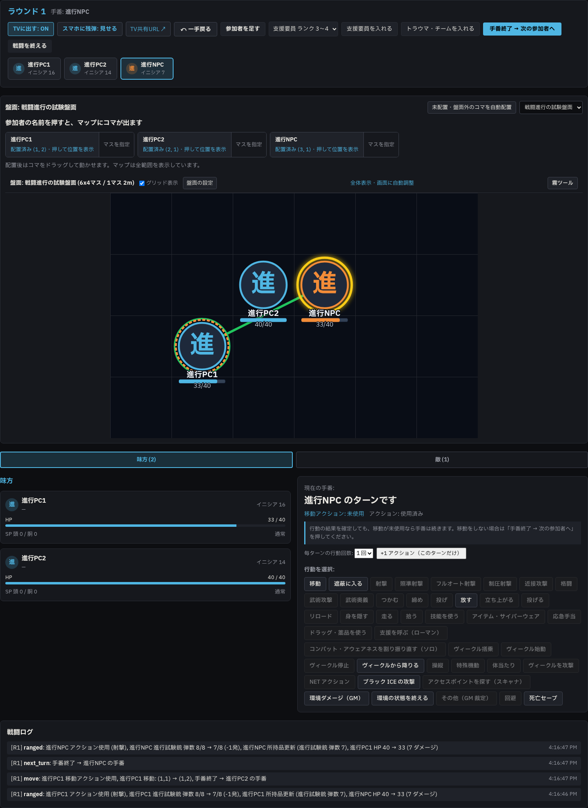
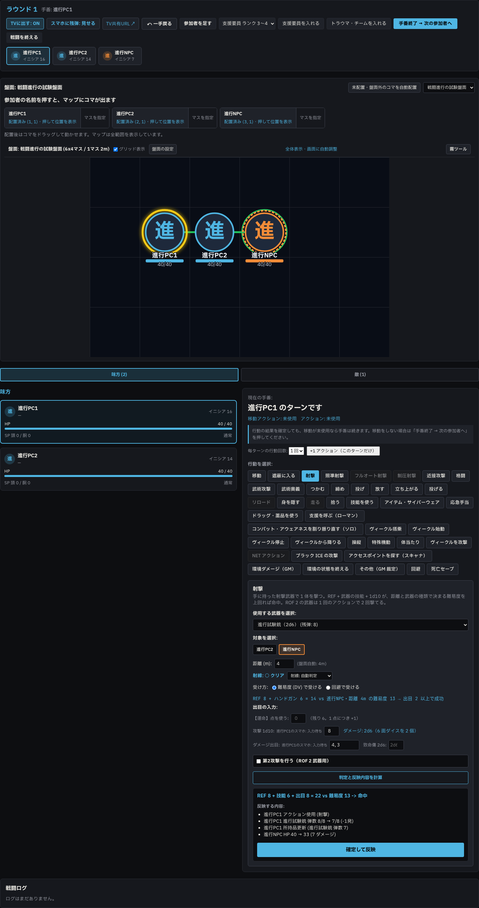
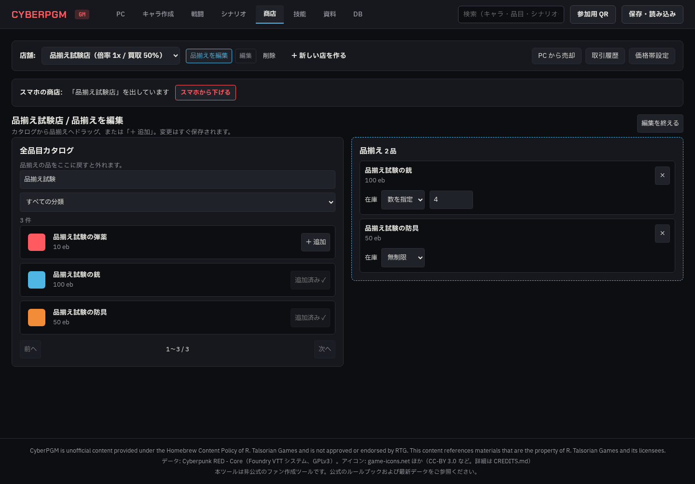
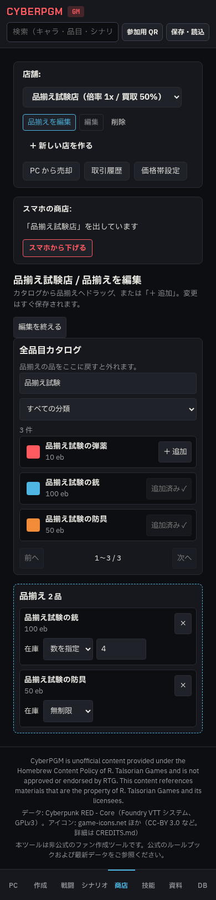

# Phase 6d HPバー・武器ダイス・商店品揃え 報告 01

- 日時: 2026-10-23（JST）
- 使用モデル: GPT-6（Codex）
- 作業ブランチ: `codex/phase6d-hpbar-weapondice-shopstock`
- 起点: main `c34b548`。`git pull --ff-only origin main` 後、指定名で新規作成。
- 状態: 完了
- 停止した理由: 完了。実装・テスト・報告を作業ブランチにcommit・pushして停止する。

## 実施したこと

### A. 4か所のHPバーと数値の同期

確認対象はGMの参加者カード、GM盤面のコマ、TVの味方欄（およびTV盤面）、プレイヤーのシート。バーには実際のHPを表す `role="progressbar"`、`aria-valuenow`、`aria-valuemax` を付けた。

原因は2点あった。

1. **古いコマHPを優先する表示**: `BoardView.tsx` は `tok.hp` があると、更新された戦闘参加者の `character.hp` より優先していた。キャラHPが33でもコマのスナップショットが40なら40/40のバーが残った。戦闘参加者のHP・最大HP・負傷状態を優先し、キャラHPがない場合だけコマの値へ戻るよう修正した。
2. **HP編集・回復後の配信不足**: キャラ編集APIと医療処理は本人の `me:update` を送るだけで、現在の戦闘データをGM・TVへ配信していなかった。`SessionManager.broadcastCurrentCombat()` を追加し、HP・最大HPの編集、医療によるHP変更、医療の取り消しで最新の戦闘を配信するよう修正した。戦闘がなければ共有画面を更新する。

#### 修正前の失敗を確認

`e2e/combat-flow.spec.ts` を拡張し、HP40・SP0の試験PCをNPCが2d6（出目4・3）で攻撃する操作を追加した。

- コマHPの回帰条件は、GMの盤面取得レスポンスに **古い `hp: 40, hp_max: 40` を付ける** ことで再現した。攻撃・計算・確定・DB更新自体は実際のAPIで実行した。本番のコマに古いHPが付いていたかは、本番データを調べていないため断定しない。
- 修正前、GMカードは33になったのに、盤面のコマは40のまま。以下のE2Eが失敗した。

```text
PORT=8790 npm run test:e2e -- e2e/combat-flow.spec.ts
Locator: getByTestId('board-hp-flow-pc1')
Expected: "33"
Received: "40"
1 failed
```

- コマの優先順位を直した後、HP編集APIで40→33にすると本人のシートだけが更新され、GMのカードは40のままだった。配信修正前にもE2Eの失敗を確認した。

```text
Locator: getByTestId('gm-hp-flow-pc1')
Expected: "33"
Received: "40"
1 failed
```

#### 修正後の値

| 操作 | DB・GMカード・GMコマ・TV味方欄／TVコマ・プレイヤーシート |
| --- | --- |
| 攻撃を確定 | 40→33。HTMLバーは82.5%（スマホは従来の丸めで83%）、SVGバーも33/40 |
| 戦闘の「一手戻る」 | 33→40、バー100% |
| キャラHP編集による減少・回復 | 40→33→36→33。それぞれの値と割合に更新 |
| 自然治癒を有効にし、本人が24時間休息 | BODY6により33→39、バー97.5%（スマホ98%） |
| 医療の「一手戻る」 | 39→33へ復元 |
| 最後にHPを40へ編集 | 全箇所が40、バー100%に戻る |

すべて画面の再読み込みなしで確認した。E2Eでは `aria-valuenow` だけでなく、GM・TV・スマホの実際のHTMLバー幅、GMコマのSVGの幅比、数値表示、DBも照合した。既存の攻撃・移動・自動進行・ラウンド更新・取り消し・戦闘終了の検証も継続して通った。TVの敵HPを隠す既存テストも成功した。

### B. GMの武器ダイス表示

- `packages/shared/src/combat-damage.ts` に、GMとスマホで共用するダメージ式の取得と振り方の表示を追加した。
- GMの武器選択肢に、実際の所持品を品目データで補完したダメージを武器名と並べて表示する。スマホの武器選択も同じ関数を使用する。
- 出目欄付近に `ダメージ: 2d6（6 面ダイスを 2 個）` を表示する。
- 不明な武器は「ダメージ不明」とし、式を推測しない。
- 素手・格闘はBODY別の値、サイバーアーム本体がある場合の最低2d6を使用する。既存の解決処理の同じ計算を共用関数に移した。武術は既存の `martialArtsDice`、フルオート射撃は既存の解決処理と同じ2d6を使用する。ルールの計算結果は変更していない。
- 単体テスト2件で、選択武器の2d6／3d6、不明値、BODYの境界、サイバーアームと付属品の区別、武術・フルオートを確認した。
- E2EでGMの武器選択肢の2d6と、出目欄付近の「6 面ダイスを 2 個」を確認した。

### C. 商店の品揃え編集

- 店を選んで「品揃えを編集」を押すと、PCでは左に全品目カタログ、右にその店の品揃えを表示する。新しい店を作った直後は自動的に編集画面を開く。
- カタログには検索、指定された11分類、画像・名前・店の倍率を反映した価格を表示する。40件ごとのページ送りで全品目へ到達できる。
- HTML5 Drag and Dropで左→右に追加（在庫は無制限）、右→左で除外。右の「×」でも除外できる。
- 各品の「＋ 追加」でドラッグなしでも追加できる。追加済みは印と無効化したボタンで示し、重複追加しない。
- 在庫方式を無制限／数で選び、数量はその場で変更する。数量はEnterまたは入力欄から離れたときに保存する。0以上の整数を使用する。
- 保存中は重複操作を防ぎ、APIの失敗は画面に表示する。変更は既存の在庫APIに保存する。
- 在庫追加・更新・削除のAPIから既存の `player-shop:update` を配信し、開いているプレイヤーの商店も再読み込みなしで更新する。
- 390pxでは2列を縦に並べ、横にはみ出さず操作できる。画像は自作の試験用SVGを一時画像領域に置いて検証した。
- 複数品の同時選択ドラッグは任意要件のため追加していない。npmパッケージ追加なし。

新規 `e2e/shop-stock.spec.ts` で次を実操作した。

1. GMが新しい店を作る→自動で品揃え編集が開く。
2. 検索・分類で試験品を絞り込み、画像が読み込まれることを確認。
3. 店をスマホに公開し、プレイヤーは専用の試験PCで参加。
4. 銃・防具・弾薬の3品をドラッグで追加。スマホも0→1→2→3品と変化し、追加済みのボタンは無効になる。
5. 弾薬を右から左へ戻して除外し、2品になる。
6. 銃の在庫を無制限→数指定→4個に変更。DBとスマホが4個を示す。
7. 390pxで「＋ 追加」と「×」による追加・除外も操作。最終的にスマホとDBが銃・防具の2品になる。
8. 編集を閉じて開き直しても在庫4個が保存されている。

### D. 全体テストと既存E2Eの調整

関連E2Eをまとめて実行した際の待機・テスト間干渉も修正した。

- `board-combat.spec.ts`: 移動確定の完了を待たずに射撃を選び、遅れて完了した移動処理に選択を消されていた。移動確定ボタンが消えるまで待機する。TVのサイズ検証はwipの「盤面全体を画面へ収める」仕様に合わせ、固定の800px／1000px以上という期待を変更し、表示サイズとスクロール不要を確認する。
- `board-combat.spec.ts`・`combat.spec.ts`・`player-tabs.spec.ts`: 手動作成したブラウザーコンテキストを後処理で閉じる。前のプレイヤーの接続が残り、後のテストがGMの参加許可待ちになることを防ぐ。
- `equipment-help.spec.ts`: 共通名E2Eで前のキャラが自動選択されていたため、このテスト専用のプレイヤー名を使用する。
- 新規商店テストも専用PCを使用し、390pxへの変更直後はレイアウトの反映を待って幅を検証する。
- 戦闘進行テストは、認証済みGMのトークンをテスト開始時に用意する。別ウィンドウ初回起動時のトークン取得とNPC一覧取得のタイミングに依存させない。初回認証処理そのものは今回変更していない。

既存報告画像26枚はE2Eで上書きされたため `git checkout -- docs/agy/reports/img` で元へ戻した。今回の4枚だけを追加する。

## 確認した事実（コマンドと出力）

```text
npm run build -w @cyberpgm/shared
# 終了コード0。

npm run build -w @cyberpgm/web
✓ built in 2.48s
# 終了コード0。従来からのJSチャンクサイズの警告あり。

npm run lint
✖ 670 problems (0 errors, 670 warnings)
# 終了コード0。既存のany・unused-varsの警告。

npm run typecheck
> tsc --noEmit
# 終了コード0。

npm test
Test Files  44 passed (44)
     Tests  313 passed (313)
Duration  45.82s
# 終了コード0。
```

```sh
PORT=8790 npm run test:e2e -- \
  e2e/combat-flow.spec.ts \
  e2e/shop-map.spec.ts \
  e2e/shop-stock.spec.ts \
  e2e/shop.spec.ts \
  e2e/player-tabs.spec.ts \
  e2e/item-notes.spec.ts \
  e2e/board-combat.spec.ts \
  e2e/combat.spec.ts \
  e2e/phase6a.spec.ts \
  e2e/equipment-help.spec.ts
```

```text
Running 15 tests using 1 worker
15 passed (34.6s)
# 終了コード0。
```

| E2E | 件数 | 結果 |
| --- | ---: | --- |
| combat-flow.spec.ts | 1 | 成功 |
| shop-map.spec.ts | 5 | 成功 |
| shop-stock.spec.ts | 1 | 成功 |
| shop.spec.ts | 1 | 成功 |
| player-tabs.spec.ts | 1 | 成功 |
| item-notes.spec.ts | 1 | 成功 |
| board-combat.spec.ts | 1 | 成功 |
| combat.spec.ts | 1 | 成功 |
| phase6a.spec.ts | 2 | 成功 |
| equipment-help.spec.ts | 1 | 成功 |

## スクリーンショット

HP33/40になった戦闘画面（1440px）。PC1のカードとコマに反映。



GMの武器選択と出目欄付近の2d6表示（1440px）。



品揃え編集（1440px）。左に画像付きカタログ、右に品揃えと在庫。



品揃え編集（390px）。追加ボタンと在庫編集を縦配置。



## 問題・仕様との食い違い

指示範囲の実装で解消した。追加の機能・npmパッケージ・本番商店データは作っていない。

検証用サーバーは8790で起動し、8787のサーバーを停止・再起動していない。E2Eは `data/test-e2e.db` と一時画像・保存・音声・ログ領域、単体テストは一時DBを使用した。本番 `data/cyberpgm.db` を使わず、本番 `data/images/` への書き込みなし。既存E2Eセットアップによる `data/images/fvtt` から一時領域への読み取り専用コピーは実行される。ルールブック本文・スキャン・取り込みDBはcommitしない。Tailscale・待ち受け設定変更なし。

## 次にやること（OK が出たら実行すること）

作業ブランチへのcommit・pushで停止する。mainへのpush・マージ、force pushは行わない。本番の商店データ作成はこの作業に含めない。
