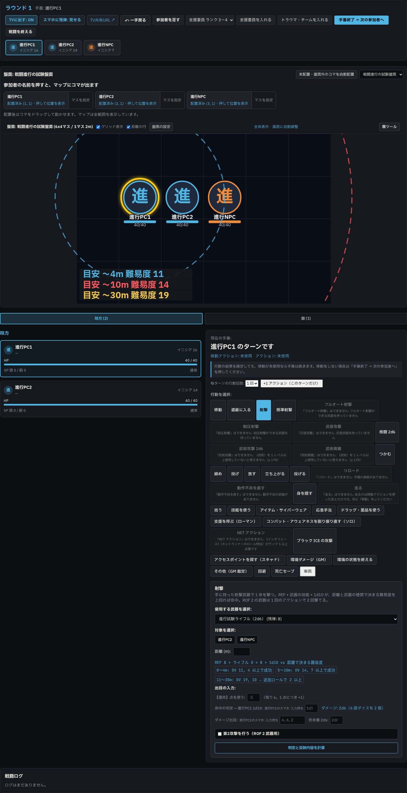
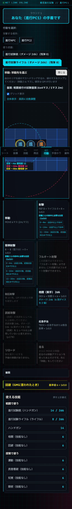
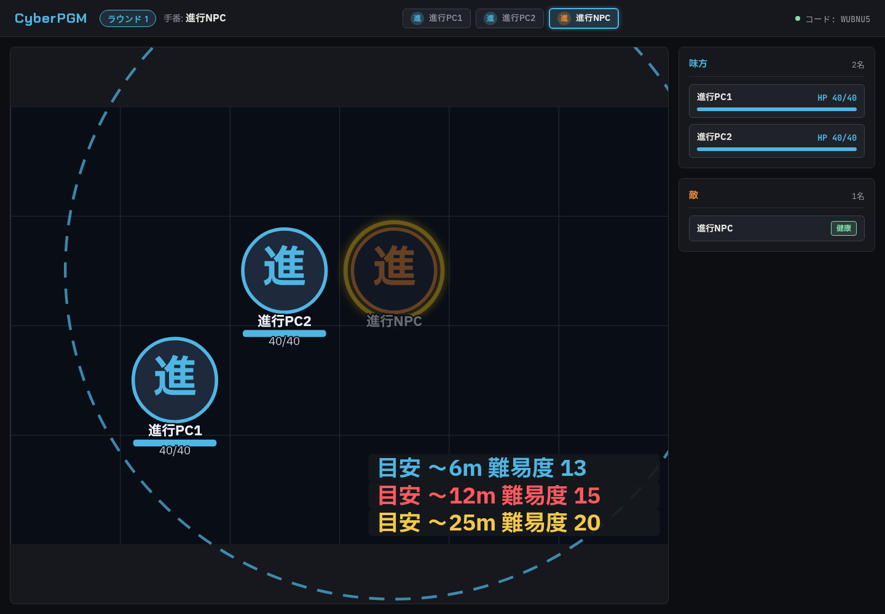

# Phase 6g 距離の円 報告 01

- 日時: 2026-10-23
- 使用モデル: GPT-6 (Codex)
- 状態: 完了
- 停止した理由: 完了

## 実施したこと

- 戦闘中の GM 盤面、TV 表示、プレイヤーの移動マップに、手番キャラを中心とした距離の同心円を追加。
- GM 盤面に「距離の円」チェックボックスを追加（既定で表示）。TV とスマホは表示を固定。
- 距離帯ラベルは円ごとに色分けして盤面の空き角へ置き、重なりを抑制。円は盤面の SVG 範囲で切り取り。
- TV 向けには手番キャラの移動値と最初の遠隔武器の距離表だけを送る。
- 武器の射程表が GM/プレイヤーの戦闘データに含まれていなかったため、手番キャラの武器データに `dv_table_key` と距離表を付加。
- 単体テストと E2E を追加し、GM 1440px・スマホ 390px・TV の画像を保存。

### 円の半径とラベル

- GM は選択中の遠隔武器、スマホは自分が選択した遠隔武器の `dv_table` 各帯の上限を使い、各上限のメートルを盤面の `cell_m` で割って半径（マス）に換算。
- 数値 DV の帯を「目安 〜12m 難易度 15」の形式で表示。`N/A` は難易度がないため円から除外。
- 使用できる距離表がない場合は 2m（近接間合い）と MOVE × 2m の円を表示。MOVE は手番キャラの `stats.move`。
- TV は個別の武器選択状態を持たないため、手番キャラの最初の遠隔武器の距離表を使用。
- 距離の円は目安であり、実際の距離と成功ラインは Phase 6f の案内に従う。

## 確認した事実（コマンドと出力）

- `npm run build` — 成功。既存の Vite 外部化・チャンクサイズ警告あり。
- `npm run lint` — 成功、0 errors（715 warnings）。
- `npm run typecheck` — 成功。
- `npm test` — 成功、48 files / 326 tests passed。
- `PORT=8791 npm run test:e2e -- e2e/phase6f.spec.ts e2e/combat-flow.spec.ts e2e/combat.spec.ts e2e/board-combat.spec.ts e2e/action-guard.spec.ts e2e/phase6a.spec.ts` — 成功、7 tests passed。武器変更、手番変更、GM 切り替え、スマホ、TV を確認。
- E2E はポート 8791 を使用。8787 は使用していない。テスト用サーバーは Playwright 終了時に停止した。
- E2E が更新した既存画像は元に戻し、以下の新規画像だけを追加。

## スクリーンショット

- GM 盤面（1440px）: 
- スマホのマップ（390px）: 
- TV 表示: 

## 次にやること（OK が出たら実行すること）

なし。

## 問題・仕様との食い違い

- TV 表示には選択武器の状態が共有されないため、手番キャラの最初の遠隔武器を使う。
- テスト用に npm パッケージは追加していない。
