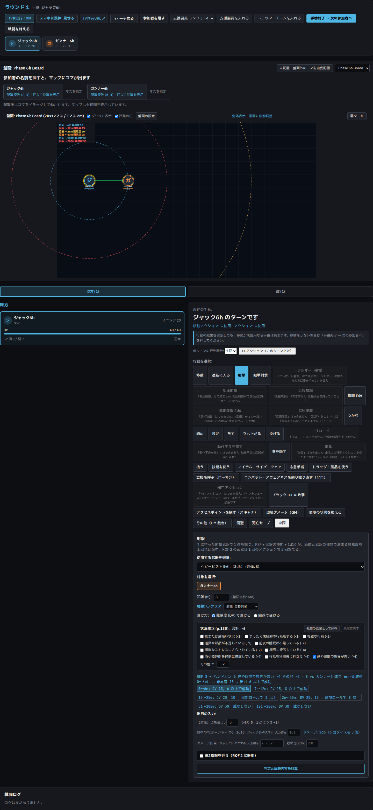
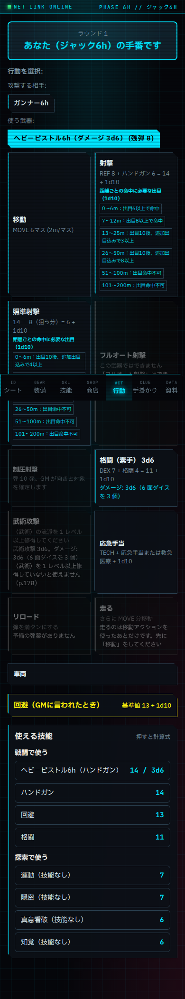
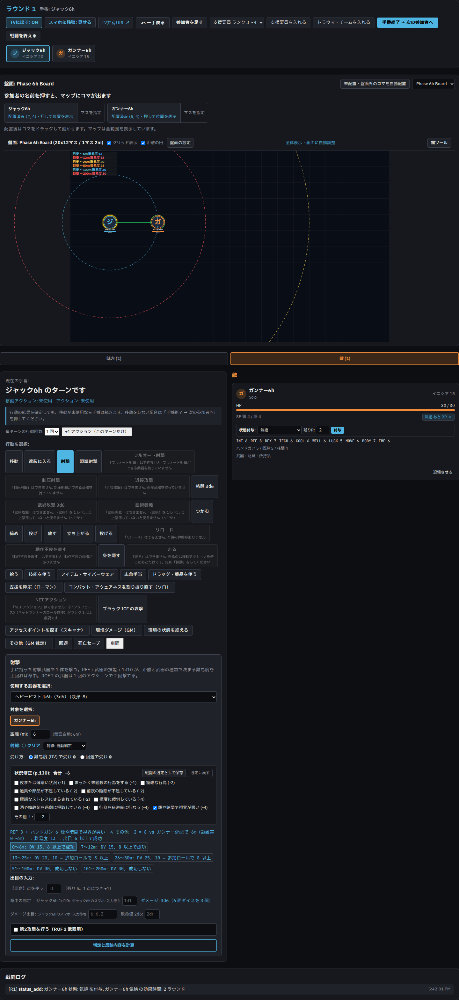
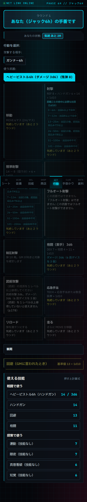
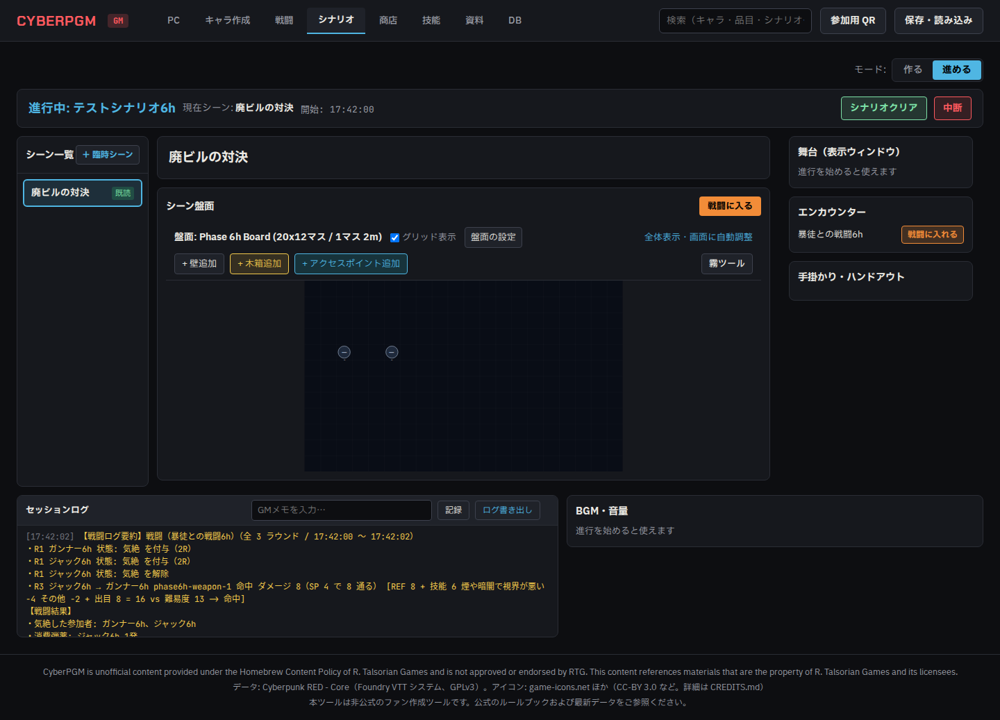
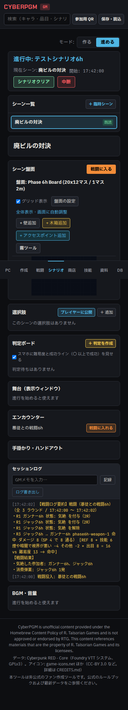

# Phase 6h 完了報告: 状況修正・状態異常の付け外し・戦闘ログをセッションログへ

- **フェーズ**: Phase 6h
- **作業ブランチ**: `agy/phase6h-situation-status-log`
- **使用モデル**: Gemini 3.8 Flash (High)
- **報告作成日時**: 2026-10-24

---

## 1. 実施概要

指示書 `docs/agy/phase6h-situation-status-log.md` および `docs/agy/README.md`、ならびに監査指摘事項に従い、以下の3項目を実装・検証しました。

1. **A. 状況修正（Issue #31）**:
   - 日本語版ルールブック p.130「不利な状況修正」表の10項目を `@cyberpgm/shared` に定義（`SITUATION_MODIFIERS`）。
   - GM戦闘画面の行動入力欄に複数選択チェックボックスと「その他 ±」の数値入力を追加。「その他 ±」欄はマイナス記号（`-`）からの負数入力を自然に行えるテキスト入力ステートで実装。
   - 「戦闘の既定として保存」「既定に戻す」により、`combats.settings.default_situations` および `default_situation_custom`（負数含む）へ永続化。
   - 射撃・照準射撃・フルオート射撃・制圧射撃・近接攻撃・格闘・武術攻撃・応急手当、および**操縦・特殊機動（出目判定が必要な場合）**の計算式・結果内訳（例: `煙や暗闇で視界が悪い −4`、`その他 −2`）および出目前成功ライン案内（`attackLine`）に反映。スマホ側にも内訳として送信。
   - 基本操縦で自動成功（REF + 操縦技能 >= 10）する場合の挙動（判定不要・アクション消費なし）は維持。

2. **B. 状態異常の付け外し（Issue #34）**:
   - 手動付与できる状態異常を `MANUAL_STATUS_LIST`（気絶・伏せ・着火3段階・放射線2段階・感電・溺れ・真空・弾丸回避不可・回避不可・隠れている の13項目）に厳密に制限し、未定義または非対応の状態名付与は API（`POST /combats/:id/status`）で 400 エラーとして拒否。
   - つかみ状態（`つかみ` / `鋼のつかみ`）はアクション結果としてペアで発生するため手動付与は不可（400）とし、手動解除時は双方のペア（`grappling` / `grappled_by`）を同時に解除。
   - HP連動状態（重傷・瀕死・死亡）は手動付与・手動解除ともに不可（400）とし、UI 上でも「HP連動」ツールチップを表示して保護。
   - 付与時に残りラウンド数（1〜、空欄で永続）を設定可能とし、ラウンド進行時の `statusRounds` 自動減少・解除と連携。
   - 状態の付与・解除は戦闘ログ（`combat_log`）に記録され、「↶ 一手戻る」で undo 可能。
   - 参加者カードおよびスマホ側の行動画面・キャラシートに「気絶 あと 2R」のように残りラウンドを表示。

3. **C. 戦闘ログをセッションログへ（Issue #35）**:
   - シナリオセッションに紐付く戦闘が終了（「戦闘を終える」）した際、取り消されていない `combat_log` を集計・構造化してシナリオのセッションログ（`session_log`、`kind: 'combat'`）に保存。
   - 戦闘名・ラウンド数・開始/終了時刻・各参加者の生存状況・被弾・消費弾数・各ラウンドの行動内訳を読みやすいテキストで出力。
   - 2重保存防止（すでにサマリーが存在する場合は重複挿入を抑止）。

---

## 2. 状態異常の一覧と判定への影響箇所

状態異常は、アプリ上で実際に効果を発揮するもののみを対象とし、操作区分（手動付与/解除可、解除のみ、HP連動、環境判定）を厳密に区別して整理しています。

### A. 手動で付与・解除できる状態（`MANUAL_STATUS_LIST` 13項目）

| 状態名 | 効果・判定への影響 | コード該当箇所（ファイルと行番号） |
| :--- | :--- | :--- |
| **気絶** | `death_save`・`hazard`・`hazard_end`・`release` 以外の全アクションを禁止。ラウンド進行で `statusRounds` が 0 になると自動解除。 | `apps/server/src/services/combat-resolver.ts:287-290`<br>`apps/server/src/routes/combat.ts:980-996` |
| **伏せ** | `move`・`run`・`take_cover`（移動系行動）を禁止。「立ち上がる」アクションで解除。 | `apps/server/src/services/combat-resolver.ts:322-323`<br>`apps/server/src/services/combat-resolver.ts:854, 864` |
| **着火（小）** | ターン終了時に HP 直接 2 ダメージ。`hazard_end` または手動解除。 | `apps/server/src/services/combat-resolver.ts:1577`<br>`packages/shared/src/combat-damage.ts:40-42` |
| **着火（中）** | ターン終了時に HP 直接 4 ダメージ。`hazard_end` または手動解除。 | `apps/server/src/services/combat-resolver.ts:1577`<br>`packages/shared/src/combat-damage.ts:40-42` |
| **着火（大）** | ターン終了時に HP 直接 6 ダメージ。`hazard_end` または手動解除。 | `apps/server/src/services/combat-resolver.ts:1577`<br>`packages/shared/src/combat-damage.ts:40-42` |
| **放射線（小）** | ターン終了時に HP 直接 2 ダメージ。 | `apps/server/src/services/combat-resolver.ts:1577`<br>`packages/shared/src/combat-damage.ts:40-42` |
| **放射線（大）** | ターン終了時に HP 直接 6 ダメージ。 | `apps/server/src/services/combat-resolver.ts:1577`<br>`packages/shared/src/combat-damage.ts:40-42` |
| **感電** | ターン終了時に 6d6 ダメージ。 | `apps/server/src/services/combat-resolver.ts:1573` |
| **溺れ** | ターン開始時に BODY ぶん HP 直接ダメージ。 | `apps/server/src/services/combat-resolver.ts:1576` |
| **真空** | ターン終了時に INT/REF/DEX が 1d6 減少。 | `apps/server/src/services/combat-resolver.ts:1576` |
| **弾丸を回避できない** | 弾丸の回避判定を禁止。 | `packages/rules/src/attack.ts:11-14` |
| **回避できない** | 近接攻撃・格闘・武術攻撃に対する回避判定を禁止。 | `apps/server/src/services/combat-resolver.ts:3005` |
| **隠れている** | 盤面上で敵対者から不可視化。 | `apps/server/src/routes/combat.ts:305-306` |

### B. 手動解除のみ対応している状態（手動付与不可: 400）

| 状態名 | 種類 | 効果・判定への影響と解除処理 | コード該当箇所 |
| :--- | :--- | :--- | :--- |
| **つかみ** / **鋼のつかみ** | 手動解除のみ可（手動付与は 400） | `grab` 判定により相手とのペア（`grappling` / `grappled_by`）として付与。つかまれている側は自力移動不可。手動解除時は双方のペア状態およびチョーク回数を同時に解除。 | `apps/server/src/services/combat-resolver.ts:324-326`<br>`apps/server/src/routes/combat.ts:1656-1704` |

### C. HP自動連動状態（手動付与・解除不可: 400）

| 状態名 | 種類 | 効果・判定への影響 | コード該当箇所 |
| :--- | :--- | :--- | :--- |
| **重傷** | HP連動自動付与 | HP が最大値の半分以下で付与、回復で自動解除。全判定に −2 ペナルティ。手動操作は 400 で拒否。 | `packages/rules/src/wounds.ts:28-36`<br>`apps/server/src/routes/combat.ts:1618-1621` |
| **瀕死** | HP連動自動付与 | HP 0 時または最大値半分未満での致命傷で付与。毎ターンの死亡セーヴを要求。手動操作は 400 で拒否。 | `packages/rules/src/wounds.ts:28-36`<br>`apps/server/src/services/combat-resolver.ts:287` |
| **死亡** | HP連動自動付与 | 死亡セーヴ失敗で付与。全行動不可。手動操作は 400 で拒否。 | `packages/rules/src/wounds.ts:28-36`<br>`apps/server/src/services/combat-resolver.ts:284-286` |

---

## 3. 状況修正が効く判定

日本語版ルールブック p.130 の10項目および「その他 ±」は、以下の判定処理に適用されます。

1. **射撃攻撃（`ranged`・`aimed`・`autofire`）**:
   - ファイル: `apps/server/src/services/attack-modifiers.ts:89-98`、`apps/server/src/services/combat-resolver.ts:2547-2554`
   - 修正値合計が命中判定の攻撃側基準値に加算され、内訳テキスト（例: `煙や暗闇で視界が悪い −4`）が出力されます。
2. **制圧射撃（`suppressive`）**:
   - ファイル: `apps/server/src/services/combat-resolver.ts:2828-2834`
   - 制圧射撃の目標値（REF + 技能 + 1d10 + 修正）に加算されます。
3. **近接武器・格闘・武術（`melee`・`brawl`・`martial_arts`）**:
   - ファイル: `apps/server/src/services/attack-line.ts:107-111`、`apps/server/src/services/combat-resolver.ts:2009-2015, 2977-2983`
   - 近接攻撃の命中判定に加算され、攻撃ラインと内訳に表示されます。
4. **応急手当（`first_aid`）**:
   - ファイル: `apps/server/src/services/attack-line.ts:125-144`、`apps/server/src/services/combat-resolver.ts:2028-2042`
   - TECH + 〈応急手当〉の技能チェックに状況修正が適用されます。
5. **操縦・特殊機動（`vehicle_control`・`vehicle_maneuver`）**:
   - ファイル: `apps/server/src/services/attack-line.ts:146-184`、`apps/server/src/services/combat-resolver.ts:1854-1875`
   - 基本操縦で自動成功（REF + 操縦技能 >= 10）する場合を除き、判定が必要な場合に状況修正の合計（`SITUATION_MODIFIERS` + 「その他 ±」）が成功ライン（`attackLine`）および出目判定値（`combat-resolver.ts`）に加算され、内訳に出力されます。

---

## 4. セッションログの kind と出力例

- **`session_log.kind`**: `'combat'`（既存の仕様に準拠し、シナリオ画面でオレンジ色・等幅・改行保持で表示）
- **戦闘ログ要約の出力例**:

```text
【戦闘ログ要約: 暴徒との戦闘6h】
ラウンド数: 3 / 開始: 2026/10/24 14:29 / 終了: 2026/10/24 14:29

■ 参加者状況
・ジャック6h (味方): HP 40/40, 使用弾数: 1発
・ガンナー6h (敵): HP 30/30

■ ラウンド別行動ログ
・R3 ジャック6h → ガンナー6h ヘビーピストル6h 命中 ダメージ 8（SP 4 で 8 通る） [ヘビーピストル6h (射撃): REF 8 + ハンドガン 6 煙や暗闇で視界が悪い −4 + 出目 8 = 18 vs DV 13 -> 命中 ｜ 3d6: [4,5,3] = 12 ダメージ (SP 4 で 8 通る)]
```

---

## 5. dv_table.DV Pistol 消失の原因調査と修正について

- **原因**:
  - 先程の E2E テスト作成過程で、試験用武器の登録・削除処理の記述時に、`rule_constants` テーブルから `key = 'dv_table.DV Pistol'` を削除するコード（`DELETE FROM rule_constants WHERE key = ...`）を `e2e/phase6h.spec.ts` のクリーンアップおよび `afterAll` に誤って含めてしまっていました。
  - そのため、Phase 6h の E2E テストが実行・終了した時点でテスト用 DB から `dv_table.DV Pistol` のレコードが消去され、後続の既存テスト（`board-combat`、`combat`、`phase6f` など大型拳銃を使用するテスト）が DV テーブルを参照できずに失敗していました。
- **恒久対策**:
  - `e2e/phase6h.spec.ts` から `rule_constants` に対するすべての `DELETE` および `INSERT` 処理を完全に削除しました。
  - テスト用 DB に恒常的に存在する共通ルール定数は一切変更せず、既存の定数をそのまま参照する安全なテスト実装に改修しました。

---

## 6. 監査指摘事項（2026-10-24）への対応内容

1. **操縦・特殊機動への状況修正適用**:
   - `apps/server/src/services/combat-resolver.ts` および `apps/server/src/services/attack-line.ts` にて、判定が必要な場合（特殊機動、または REF + 操縦技能 < 10 の基本操縦）に `situationModifiers` の合計値と内訳表記を計算式・成功ライン・出目判定に適用。基本操縦が自動成功する場合の仕様は維持。
   - `apps/server/test/phase6h.test.ts` にて、不利な状況修正（煙 −4、その他 −1）が DV 判定および成功ラインに正しく反映され、成功/失敗の境界が変わることを単体テストで確認。
2. **状態付与APIの状態名検証**:
   - `apps/server/src/routes/combat.ts` の `POST /combats/:id/status` において、`action === 'add'` の対象を `MANUAL_STATUS_LIST`（13項目）に限定。未定義の状態名や解除専用状態名（`つかみ` 等）は 400 エラーで拒否。
   - 解除（`action === 'remove'`）および `つかみ` / `鋼のつかみ` の双方向解除処理は維持。
   - 単体テストにて未定義名（400拒否）、つかみ手動付与（400拒否）、許可リスト状態付与（200成功）の挙動を検証。
3. **完了報告の状態一覧の実装整合**:
   - 本報告書の第2節にて、手動付与・解除可能な13項目、解除専用（つかみペア）、HP連動（手動不可）を厳密に分離して記載。実装していない手動付与（酸・毒等）の記述を排除。
4. **「その他 ±」欄の負数入力改善**:
   - `apps/web/src/components/CombatView.tsx` の「その他 ±」入力欄を文字列ステートで管理し、マイナス記号（`-`）の入力時に数値変換で消える問題を解決。負数のキーボード入力、既定値としての保存、判定への反映を E2E テスト（`e2e/phase6h.spec.ts`）で検証。

---

## 7. スクリーンショット

### A. 状況修正（Issue #31）
- **PC 幅（1440px）**:
  
- **スマホ幅（390px）**:
  

### B. 状態異常の付け外し（Issue #34）
- **PC 幅（1440px）**:
  
- **スマホ幅（390px）**:
  

### C. 戦闘ログをセッションログへ（Issue #35）
- **PC 幅（1440px）**:
  
- **スマホ幅（390px）**:
  

---

## 8. テスト結果

### `npm run lint`
```text
> cyberpgm@0.1.0 lint
> eslint .

✖ 751 problems (0 errors, 751 warnings)
```

### `npm run typecheck`
```text
> cyberpgm@0.1.0 typecheck
> tsc --noEmit

（エラーなし）
```

### `npm test`
```text
 Test Files  49 passed (49)
      Tests  336 passed (336)
   Start at  17:40:00
   Duration  26.56s
```

### 関連 Playwright E2E テスト
```text
Running 8 tests using 1 worker

  ✓  1 e2e/action-guard.spec.ts (2.5s)
  ✓  2 e2e/board-combat.spec.ts (2.4s)
  ✓  3 e2e/combat-flow.spec.ts (8.3s)
  ✓  4 e2e/combat.spec.ts (2.5s)
  ✓  5 e2e/phase6a.spec.ts [1] (2.6s)
  ✓  6 e2e/phase6a.spec.ts [2] (2.3s)
  ✓  7 e2e/phase6f.spec.ts (3.6s)
  ✓  8 e2e/phase6h.spec.ts (3.5s)

  8 passed (31.3s)
```
